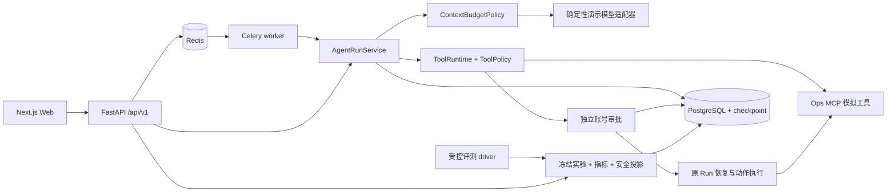

# AgentHub

AgentHub 围绕工具治理、人工审批、持久恢复和可追溯评测构建 Agent Runtime。
模型提出调用，发布策略决定能否执行；写入等待审批，批准后从 checkpoint 恢复原 Run。
审批决定与执行结果分别保存，无法确认的副作用进入 `UNKNOWN_OUTCOME / NEEDS_ATTENTION`。

**FINAL-CLOSE-1 本地交付版，2026-11-06。六项核心收口完成；本轮仅补齐密钥 ACL 与启动就绪两项交付修复。**
源码锚点为 main `5a37462` → R1 `27d7847` → 演示源码
`ca87af0a3ecde444a7dcf03fb93c48f1a31441d6`，分支 `codex/final-closeout-20261106`。
后续材料提交只含文档与安全证据；最终材料提交号见交付回执/`git log -1`。
Windows 交付修复源码为 `04fe8db`；仓库交付入口为 [PR #17](https://github.com/lijihao-0804/AgentHub/pull/17)。
最终提交、CI 与合并状态以该 PR 的实时检查为准，历史本地回执不替代候选 CI。预算 #14、研究 #10 未混入。

[启动与现场记录](docs/portfolio/final-closeout-evidence-20261106.md) ·
[当前状态](docs/current-state.md) · [求职入口](docs/portfolio/README.md) ·
[完整架构](docs/architecture.md)

## 可直接展示的结果

| 必须项 | 本轮结果 |
| --- | --- |
| 版本冻结 | 纳入 R1；独立工作树、独立数据库与 Redis；运行源码 C1 干净，文档编辑另记 |
| 核心阻断 | 修正 Windows Uvicorn 事件循环启动、固定指标枚举与 Next 构建时代理配置；预算/摘要研究路径保持关闭 |
| 主演示 | 两个独立账号；等待时真实停止并重启进程，再批准同 Run 成功；拒绝后无新增模拟回滚 |
| 评测入口 | 当前提交的 DEV 工程夹具 3 题，PASS/FAIL/UNKNOWN 各一；摘要、逐题详情、分页和 Viewer 权限实际核对 |
| 启动复现 | 新 Compose namespace/data volume，显式迁移至 0052、checkpoint bootstrap；API health/ready 与 Web 代理均 200 |
| 最小材料 | 当前 README、架构图、能力—证据表、5 张现场截图及安全 JSON 回执；必要检查通过 |

本地 Web：<http://127.0.0.1:3040>；API：<http://127.0.0.1:8040/docs>。
可复制的启动/停止命令、账号位置及演示步骤见[交付记录](docs/portfolio/final-closeout-evidence-20261106.md)。

## 演示架构

## 证据和限制

Incident 使用真实 API、数据库、队列、checkpoint、MCP、策略与审批；模型适配器为显式
确定性脚本，Ops 回滚为仓库模拟工具，不连接生产。评测 driver 直接提供受控 observation，
不调用模型或业务工具；3 题结果仅证明工程链路，不能写成模型准确率。

本轮检查包括 Ruff、前端统一入口 8 组、生产构建/TypeScript、5 个新增定点节点，以及
实际启动、重启恢复、拒绝和 HTTP/RBAC 验证；R1 沿用已有定点证据。
Windows 密钥与配置使用受保护 DACL；Start 默认最多等待 90 秒，检查 API、Web、Ops MCP 和专用 worker，
失败返回非零、报告日志并清理本次启动进程。可用 `-ReadyTimeoutSeconds 120` 调整为 5–300 秒。
完整 CI、公网部署、硬金额预算、judge 校准、Memory/RAG 新优化、容量/SLA 留待以后。
Qdrant/RAG 未启用；依赖诊断中的未选服务不能当作已部署能力。

Org OWNER/ADMIN 存在自审批豁免；本次实际使用不同账号，未宣称强制四眼审批。
上下文准入和版本快照有既有合同；自动摘要发布门仍拒绝，未宣称新语义收益。

代码与材料由用户组织并经 Codex/DeepSeek 协作完成。个人贡献应按本人实际设计、复核、
复现范围填写；历史模型实验保留原日期、SHA 和分母，见[历史验收](docs/reviews/README.md)。
