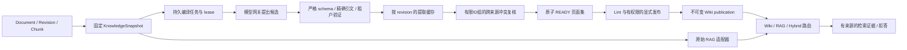

# ADR-012：版本化派生 Wiki 与原始证据分层

日期：2026-10-25；状态：Wiki 独立分支采用。基线 `23f1a384826c185c5eac2c4bf82c44408328286f`。
本轮用户需求授权新增 Wiki；旧状态页的停止开发记录保留为历史，不覆盖本轮授权。

## 决策与取舍

采用 PostgreSQL 中的版本化页面、结构化提取缓存、来源关联和导航关系；Markdown 是阅读投影。
继续使用 Document/DocumentRevision/DocumentChunk、KnowledgeSnapshot、Celery、模型网关、RBAC 和审计。
不引入新服务、图数据库、向量库或第三方 Wiki 运行时。Qdrant 继续属于原始 RAG 的检索适配器。

Wiki 的增益是把跨来源的概念/实体归组、证据摘编、潜在冲突和关联持久化，查询时可复用。
这不证明模型产生的语义归组正确。第一版以精确引文组成页面，避免把自由生成的总结再作为下一轮事实。
标题、谓词、值、条件和关系是模型候选；引文存在性可确定性验证，语义蕴含不能由子串检查证明。
相同主题、谓词、条件出现不同值时标记 POSSIBLE_CONFLICT，保留全部证据，不自动裁定真伪。
真实 v1 对照发现孤立提取会因标签/条件差异漏掉冲突。最终 `wiki-workflow-v2` 增加一次跨来源复核：
输入仅为已验证引文与候选归组，输出仅为有限的 claim ID 组。业务逻辑再次验证 ID 范围，
将候选冲突与对方引文关联，页面不改写事实；查询会一并交付关联证据并拒绝自动裁决。
复核提示、schema、版本另行冻结，改变复核不使原始 revision 提取缓存失效。
这增加每次新编译至多一次模型调用，并限于 200 条 claim；未证明其语义冲突召回率。
代价是摘要不如自由写作流畅，实体别名与隐含矛盾召回有限；这比无来源的自动知识修订更适合当前验收。

Markdown 文件适合个人本地编辑与 Git 版本；在本项目中会重复实现事务、租户与任务恢复。
PostgreSQL 适合现有权限、原子发布、版本约束、按 revision 复用。JSONB 保存有校验的变长 claims/relations，
页面本身可独立定位；关系先做小规模邻接，不宣称复杂图遍历性能。只有评测证明图查询收益后才考虑图索引。

## 数据流与边界

- `packages/wiki/compiler.py`：无工具的模型提案；冻结模型链；ContextBudgetPolicy；拒绝截断导致的假引用。
- `packages/wiki/conflict_review.py`：只对已验证引文提出候选冲突组，无法新增或改写事实。
- `packages/wiki/service.py`：鉴权、快照、持久任务、缓存、确定性组织、lint、发布及完整性检查。
- `packages/wiki/query.py`：独立查询路由，经 KnowledgeRetriever / RetrievalQuery 调用既有 RAG。
- `apps/api/routes/wiki.py`：现有身份会话与错误 envelope；`/api/v1/.../wiki`。
- `apps/worker/tasks/wiki.py`：重新检查请求者成员资格、短事务、lease 续期、丢消息 reconciliation。
- `migrations/versions/0032_wiki.py` 与 `0033_wiki_source_revocation.py`：独立部署迁移；API 进程不建表。
  发布、页面、提取缓存与撤销记录有数据库不可变保护。

## 三层版本身份（合并前不可削弱）

1. **来源**：固定 `source_snapshot_id + source_snapshot_hash`。Snapshot items 仍只包含原始 revision，原始 hash 口径不变。
2. **编译**：`compiler_spec` 冻结算法/提示版本、输出模式、模型链、超时、采样、输出上限、能力、重试。
   `identity_hash` 是版本化 canonical JSON SHA-256，包含来源快照与规格。同来源同规格请求幂等。
   revision 提取缓存同时检查规范输入 hash；只为新增/变化的 revision 调模型。移除来源时从新页面集剔除，保留旧版。
3. **发布**：`compilation_id + content_hash` 固定页面、claims、relations。发布是显式授权动作，不由模型决定。
   发布前 lint；READY/PUBLISHED 后页面不可修改。新知识产生新 compilation，不覆盖历史。

未来 Run / 正式 Experiment 必须额外固定 WikiBinding：
`schema_version, compilation_id, compilation_hash, source_snapshot_id, source_snapshot_hash`。
仅固定原始 Snapshot **不足以**唯一标识某版 Wiki；禁止历史读取时按 LATEST 推断 Wiki。
本分支保留 AgentVersion / Run / Experiment 既有 schema 和历史实验，不把 Wiki 自动注入老运行。
独立 Wiki API 显式绑定发布与来源；原生 Agent 工具的发布绑定在集成阶段统一扩展，不能先塞入任意 tool 参数绕过冻结。

## 撤销、过期、安全和恢复

- 默认 current 查询要求来源集合仍等于当前 ACTIVE/READY 集合，且未被跨文档 supersede，否则 WIKI_STALE。
- 显式历史模式可读 RETIRED revision；DELETED 是撤销，任何模式都拒绝内容交付。版本身份和审计仍保留。
- 永久 Wiki 撤销记录可抵御旧 ingestion 对 raw lifecycle 的重算；不能因此复活已撤销来源。
- **审计后的撤销范围决策**：新增 `/wiki/sources/.../revoke` 只撤销 Wiki 及其 raw fallback 的使用权，
  不把原始 revision 写成 DELETED，不停止原知识模块的 ingestion。否则会把新 Wiki 功能变成未经统一设计的全局删除入口，
  并与旧 ingestion 的 lifecycle 重算、历史 RAG 读取发生冲突。
  全局原始资料撤销仍由原知识模块管理；已经标 DELETED 的原始来源同样阻断 Wiki。
- 每个新编译把 `excluded_revision_ids` 固定在规格与 identity_hash 中。原始 Snapshot membership/hash 保持原样；
  有效 Wiki 来源 = 原始 Snapshot 减去固定排除集。之后新增撤销会阻断包含该来源的旧 Wiki。
  新发布可在同一个原始 Snapshot 上产生不同 Wiki 版本；revision 提取缓存不把排除集合算作模型行为配置，仍可复用。
  Wiki 中的原始检索适配器在 DB 层再次排除当前 Wiki 撤销集，即使原 retriever 返回被撤销片段也不能交付。
- 查询/发布读取来源时使用共享行锁，防止同一事务交付中途被撤销；不承诺响应发出后的撤销能召回已交付内容。
- chunk 必须属于同 workspace/KB/snapshot，quote 必须为精确原文。RAG 适配器输出也重新校验。
- 模型输入只含原始 chunk，无工具/网络执行权限；不把历史生成页面再次编译为证据。
  精确引文可能含恶意指令，因此仍是 UNTRUSTED 数据；schema/quote 验证不等于语义防注入证明。
- 来源更新后通过编译 API 显式维护，状态/lint 显示旧版 stale。第一版不自动发布、不添加用户未配置的长期编译订阅。
- durable job 先提交再发队列；重复投递原子 claim；lease token 与过期时间 fencing；revision 缓存可恢复；
  页面及 READY 在一个事务发布。崩溃后 beat 重投过期 lease，最多三次，之后 FAILED；人工 retry 有审计。
- 编译失败的已发生 API 费用可能无法完整获知；缺 usage/cost 必须 UNKNOWN，不能计零。

## RAG 合并接口

`query_wiki(..., compilation_id, source_snapshot_id, mode, intent, raw_retriever)` 是 additive 应用接口。
简单 overview 优先 Wiki；fact 回原始证据；synthesis 合并；缺知识/冲突补检或明确不足。
结果同时携带 WikiBinding、原始 chunk/revision/locator 和路由状态。检索结果不是语义充分性保证。
不依赖研究分支的 EvidencePlan、EvidenceSet、Context Selection 字段，不修改 Dense/Sparse/Rerank。
集成时只适配新证据 envelope，并为 WikiBinding 添加发布/Run/Experiment failure-closed 测试。
