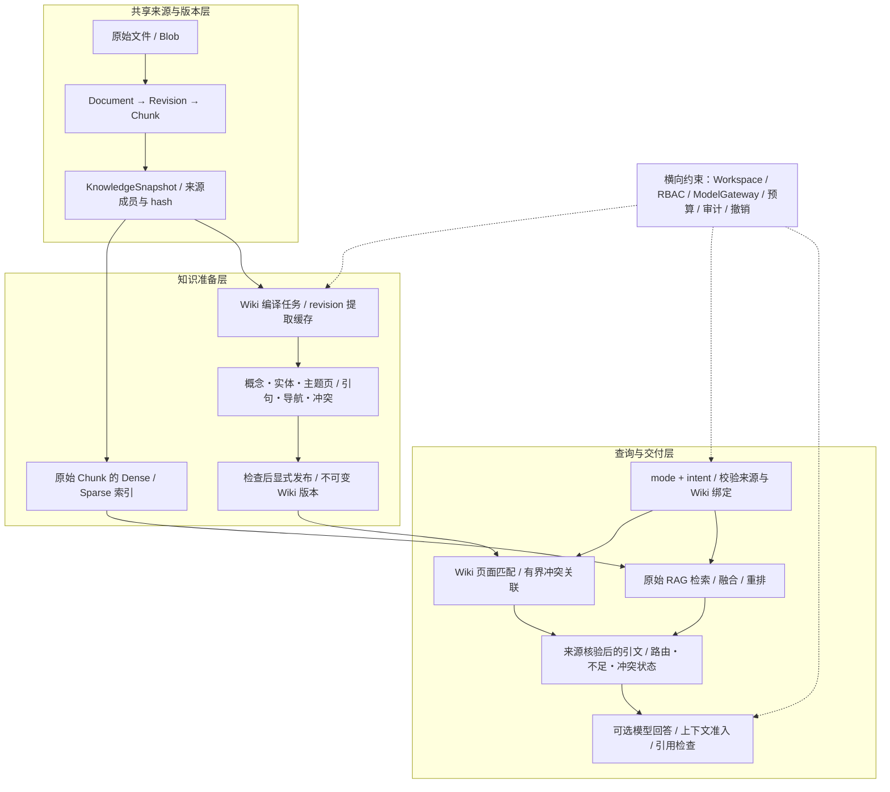
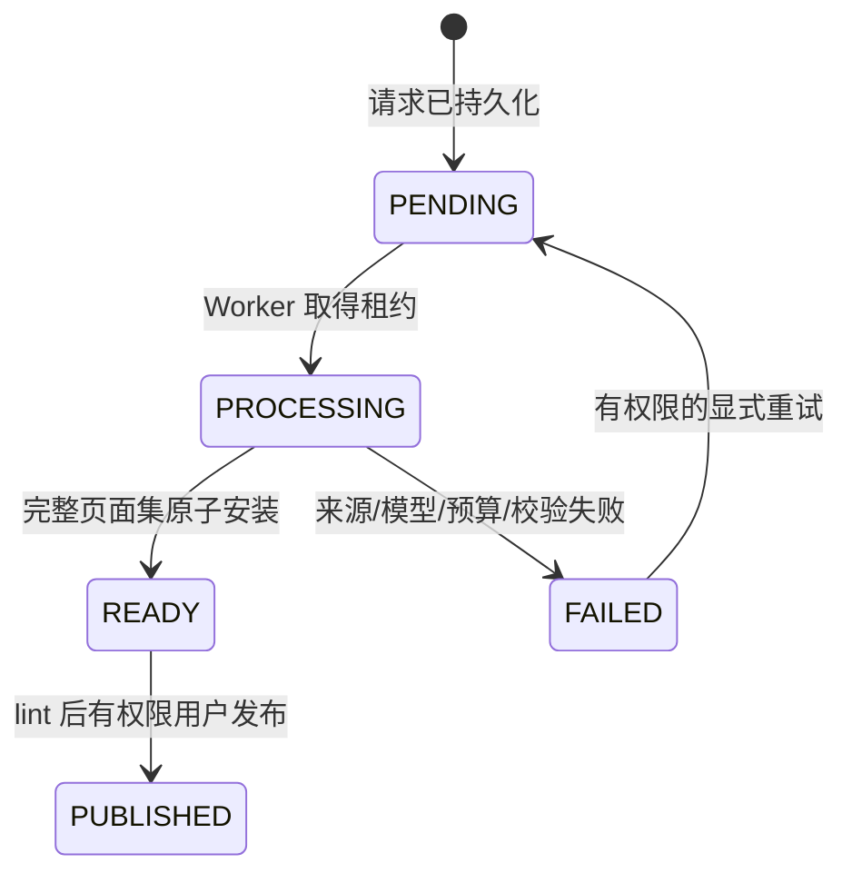

# AgentHub RAG + Wiki 并轨架构：当前结构、设计理由与取舍

整理日期：2026-10-25（Asia/Shanghai）。本文用于理解这次 RAG 与 Wiki 并轨的结构，建议先读本篇，再按需阅读 [RAG 开发复盘](12-rag-development-retrospective.md)。

源码基线：并轨提交 `11b74f8`，第一父提交为最新 RAG `fb62b57`，第二父提交为 Wiki 独立验收版 `51cb17d`。该提交已经进入当前 `E:/JAVA/AI+agent/AgentHub` 目录所在的 RAG 分支；`main` 保持原状。本文以合并后的实际代码为依据，不把“代码合到一起”写成“所有 Agent、正式实验和生产部署都完成了 Wiki 接入”。

外部资料于本日在线核查，优先采用作者原提案、项目官方文档与固定版本架构材料。下文分别标明本项目事实、设计收益的推论和已经实测的结果。

## 1. 先把这次设计讲清楚

AgentHub 现在采用的是：**共享原始证据，持久编译 Wiki，查询时按任务组合 Wiki 与原文，再做受预算和引用约束的回答。**

RAG 负责围绕当前问题从原始资料中找到相关片段；Wiki 负责把概念、实体、主题、来源引文和导航关系提前组织起来，保存成可以发布和追溯的知识版本。两条路径都回到同一套 Document / Revision / Chunk / KnowledgeSnapshot，不另造一套原始事实库。

这项设计试图同时保留两种能力：高频主题可以复用已经完成的知识组织，精确事实、出处和更新后的内容仍然能够回查原文。Wiki 页是派生阅读层，页面标题、关联和归组仍可能有误；原始证据也只是来源所声称的内容，系统不会因为一段文字存在，就保证它在现实世界中为真。

当前并轨最重要的成果是把这种职责分离接入同一工程底座。并轨验收记录为 288 项定向检查通过，覆盖两条路径的兼容性；没有重跑付费质量对照。**Hybrid 更准确、更便宜、更快，是要继续用数据验证的假设，而不是由架构图直接推出的结论。**[并轨验收](../wiki/integration-acceptance.md)。

### 1.1 “混合”在这里有两种含义

| 名称 | 混合的对象 | 主要解决的问题 |
| --- | --- | --- |
| 原 RAG 的 Hybrid Retrieval | Dense 语义召回＋Sparse 词法召回，再融合/重排 | 用不同检索信号找原始 Chunk |
| 本文 Wiki + RAG 的 Hybrid 查询 | 已发布 Wiki 的摘编证据＋原始 RAG 的检索证据 | 组合持久知识组织与问题相关的原文取证 |

它们可以同时存在：Wiki 查询的 raw fallback 可以调用原有 Dense/Sparse/BGE 重排检索器。不能因为接口写了 `HYBRID`，就假定它一定启用了全部 RAG 研究策略，或一定进行了复杂图推理。

## 2. 为什么需要在原 RAG 之上增加 Wiki

### 2.1 原 RAG 擅长“为这次问题找材料”

原有链路已经支持原始资料入库、版本快照、Dense/Sparse 召回、RRF、BGE 重排、证据选择、引用与上下文预算。它适合定位某个数字、规则、段落或证据来源，也能直接消费新入库的资料。

但围绕同一主题反复问问题时，系统仍可能反复寻找同一组文档、重新连接相同概念。不同文档中有关同一对象的表达分散在多个 Chunk，是否把它们选到一起，往往取决于这一次问题与当前排序。

这次 RAG 研发已经见过相应现象：候选池里有支持材料，最终前几段却没有覆盖完整关系链；独立相关性高的段落，不一定是彼此互补的段落。此前来源隔离的 MuSiQue 确认中，互补集合选择把完整支持集从 63.50% 提到 80.00%，说明“材料怎样组织”确有价值。不过那是特定受控集合选择实验，不能直接算作 Wiki 的效果。[实验原报告](../reviews/AgentHub-RAG互补证据选择与阅读组织-20261023.md)。

### 2.2 Wiki 增加的是“跨问题可复用的组织结果”

当前 Wiki 将来源中的候选知识归到概念、实体和主题页，保留原文引句和来源版本，记录页面间关系及潜在冲突。它保存的是能够在后续查询中继续使用的组织产物，而不只是某次问答的临时上下文。

这一动机与 Karpathy 的 [LLM Wiki 原提案](https://gist.github.com/karpathy/442a6bf555914893e9891c11519de94f)一致：在原始来源与使用者之间维护持久、互相链接的知识层，减少每次从分散资料重新整理的工作。该提案是个人知识管理范式，没有提供本项目需要的租户、事务或发布保证；AgentHub 的这些约束来自自身设计。

这也不是“RAG 已经过时”。[RAGFlow 的知识编译说明](https://ragflow.io/docs/knowledge_compilation/overview)把编译产物定义为后续检索和问答的辅助材料，并将 Parser、Chunker、Compiler、Indexer 分为不同职责。对 AgentHub 的启发是增加可复用派生产物，同时保留原始检索路径。

### 2.3 为什么不直接用 Wiki 替代 RAG

第一，编译一定有选择性。某个精确数值、表述条件或很少被问到的细节，可能没有进入 Wiki 页。

第二，编译产物有新鲜度问题。来源已经更新，不代表已发布 Wiki 已经重编译。

第三，主题归组、别名和关系是模型提出的，不能因为页面写得完整就当成可靠结论。原文引句真实存在，也不保证模型给它配的主题、谓词和条件正确。

所以当前选择是分工：Wiki 提供持久组织，RAG 负责原文定位，查询层保留不足与冲突状态。先证明两者可以安全组合，再研究哪些任务值得更多依赖 Wiki。

## 3. 总体结构：一套来源、两条读取路径、共同治理



图中是职责层次，不代表每次查询必须遍历所有节点。显式 WIKI 不调用原始检索，RAG 模式跳过 Wiki 页面匹配；模型回答也是可选步骤。

### 3.1 五个层次分别负责什么

| 层次 | 主要对象/模块 | 对外承担的职责 | 不能从这一层推导的保证 |
| --- | --- | --- | --- |
| 原始来源层 | `packages/knowledge` 的 Document、Revision、Chunk | 管理原始内容、修订和定位范围 | 来源内容必然正确 |
| 来源快照层 | KnowledgeSnapshot / SnapshotItem | 明确这次允许使用哪些原始修订 | 同一来源快照只会产生一种 Wiki |
| Wiki 编译层 | `compiler.py`、`service.py`、提取缓存 | 从固定来源生成并校验候选摘编、组织页面 | 模型归组与关系必然正确 |
| 发布和查询层 | WikiCompilation / WikiPage / `query.py` | 固定 Wiki 版本，路由、读取和验证证据 | 已实现任意图推理或语义充分性判定 |
| 回答交付层 | `answer.py`、ContextBudgetPolicy、ModelGateway | 基于已验证来源生成带引用的回答，拒绝结构不合法输出 | 每句有编号就等于每句有语义支持 |

### 3.2 实际模块边界

当前 Wiki 是一个新增的薄应用模块：

```text
apps/api/routes/wiki.py            认证 API、输入契约、原始检索器装配
apps/worker/tasks/wiki.py          编译执行、权限重查、租约续期、消息对账

packages/wiki/contracts.py         WikiBinding、模型计划冻结/还原
packages/wiki/models.py            编译、缓存、页面、撤销记录
packages/wiki/compiler.py          通过模型网关提出带原文引句的候选
packages/wiki/service.py           幂等、来源、组织、lint、发布、增量维护
packages/wiki/query.py             Wiki / RAG / Hybrid / AUTO 的确定性组合
packages/wiki/answer.py            可选的带引用回答
packages/wiki/conflict_review.py   默认关闭的模型冲突复核实验
```

关键拼接点是 `query_wiki(..., raw_retriever=...)`。Wiki 按 `KnowledgeRetriever` / `RetrievalQuery` 稳定协议请求原始证据，不复制 Dense/Sparse/RRF/BGE 算法，也不把研究线所有选择参数存进 Wiki 数据模型。

**好处是研发可以分轨，能力可以并轨。**RAG 可以继续改召回和证据交付；Wiki 可以继续改缓存、组织和维护；只要证据身份、权限、来源与查询合同保持一致，就不必为每个策略重构另一侧。

但这只是接口解耦，并不保证所有策略自动生效。当前 Wiki API 的 raw 适配器创建 `HybridKnowledgeRetriever`，读取相关部署设置，使用普通 `RetrievalQuery`。AgentVersion 中特定的 Onyx、EvidenceSet、compact 等显式配置，并没有因两个模块出现在一个分支就自动传进这个查询入口。

## 4. 为什么 Wiki 选择“结构化存储＋证据摘编”

### 4.1 原始事实身份只维护一套

Wiki claim 保存原始 document/revision/chunk、locator 和精确 quote；查询时还会重新检查它是否属于指定工作区、知识库和来源快照。raw retriever 返回的结果同样回数据库核验，不能只信向量库 payload 或某个适配器的声称。

这样做的直接收益是：Wiki 与 RAG 对“哪一版原文”说同一种语言。来源更新、历史查询、撤销与答案引用可以围绕同一身份核查，避免 Wiki 有一个文件路径、向量库有一个 UUID、回答又有一个无法对应的编号。

代价是多一次校验与来源关联读取。但在本项目里，检索命中不是权限证明；这笔成本是在守住可信交付边界。

### 4.2 第一版发布内容以精确引文为主

当前模型提出的候选包括：

| 字段 | 用途 | 可信程度 |
| --- | --- | --- |
| topic / kind | 归到概念、实体或主题页 | 模型候选 |
| predicate / value / condition | 表示候选命题、值与适用条件 | 模型候选，不等于已验证事实 |
| chunk_id / quote | 锚定原始片段与精确引句 | 能验证来源归属和子串存在 |
| related_topics | 提议页面关联 | 导航提示，不等于已证明关系 |

最终 Markdown 是业务代码按原文引句生成的阅读投影，不是任由模型自由改写的大段权威综述。引文和标题还会做展示转义，模型不能靠生成链接或 HTML 获得执行能力。

**设计理由：**自由摘要可能把“某论文报告了 X”改写成“X 就是真理”，也可能在多次更新中逐渐丢掉条件。原文摘编让问题更可定位：先证明来源存在，再评价归组和关系，不把无法验证的自然语言总结当作下一轮原料。

这也解释了为什么不把 Wiki 页再当原始来源反复编译。派生知识如果递归进入原始事实层，错误可能被多次复述，最终看上去像有多份证据支持；保留单向派生关系有助于阻止这种自我强化。

代价是阅读流畅性和高度综合能力有限。第一版更接近“有版本、有出处的主题证据册”，还不是可以可靠维护任意领域理论的自动百科。

### 4.3 PostgreSQL 是状态主库，Markdown 是阅读投影

| 对象 | 保存内容 | 为什么单独存在 |
| --- | --- | --- |
| `wiki_compilations` | 来源快照、编译规格、幂等身份、状态、租约、内容 hash、发布与用量 | 管理一次可恢复、有版本的编译与发布 |
| `wiki_extractions` | revision＋提取规格对应的结构化结果、输入 hash、用量 | 来源不变时复用模型工作 |
| `wiki_pages` | 页面 key、标题、类型、Markdown、claims、relations | 在一个编译版本下读取完整页面集 |
| `wiki_source_revocations` | Wiki 范围不可删除的来源撤销记录 | 防止旧产物或 fallback 重新交付撤销来源 |

这符合 AgentHub 的现有架构：PostgreSQL 已经管理租户、版本和任务状态，Celery 负责异步执行，Qdrant 负责原始检索。继续使用这些基础设施，减少多存储双写和独立服务的运维成本。

Microsoft 的 [固定版本 LLM Wiki 架构](https://github.com/microsoft/llmwiki/blob/e09126f257c1fcf8e63234382748a51cf6a5df7f/ARCHITECTURE.md)采用 raw / 生成 Wiki / schema 分层，并以 Markdown、索引和日志服务个人阅读。AgentHub 借鉴分层与阅读组织，但把权威状态放进数据库，以适配多人权限、原子发布和任务恢复；这是本项目的工程取舍，不是对个人文件型 Wiki 的普遍否定。

### 4.4 为什么暂时不新增 Wiki 向量库或图数据库

当前 Wiki 页面按标题与查询词匹配，支持中文词段处理；页面关系主要用于导航、来源共现和有限的冲突关联。没有给 Wiki 再建一套独立向量索引，也没有实现 GraphRAG 式社区聚类与全局 map-reduce。

这样可以先验证来源、版本和维护是否成立，避免同时引入新图存储、图抽取质量、向量同步和删除一致性问题。收益不足时，仍有原始 RAG 这条可用路径。

代价同样明确：标题词匹配会漏别名和隐含语义，当前能力不擅长深层图遍历；“存在 relations 字段”不等于拥有成熟知识图谱。若以后评测证明图结构是收益来源，现有原始身份和关系合同可以继续承接，届时再增加索引有依据。

[GraphRAG 官方查询说明](https://microsoft.github.io/graphrag/query/overview/)明确区分结合图与原文的 Local Search、使用社区报告的 Global Search 和 Basic Search；Global Search 还需要较高资源投入。这支持按任务选择表示和读取方式的思路，不代表 AgentHub 已实现这些查询算法。

## 5. 为什么必须分开“来源版本、编译规格、发布版本”

### 5.1 同一批来源可以产生多版 Wiki

假设来源快照 S1 固定了三份原始修订。用旧模型、旧提示抽取一次，再换提示或加入编辑者冲突声明抽取/组织一次，来源都还是 S1，Wiki 内容却可能不同。

因此仅固定 `source_snapshot_hash`，不能唯一说明“当时读的是哪一版 Wiki”。当前至少分三层身份：

| 身份 | 主要回答的问题 | 关键组成 |
| --- | --- | --- |
| 来源快照 | 看了哪些原文版本？ | source_snapshot_id + source_snapshot_hash |
| 编译身份 | 由什么固定规则生成？ | 来源身份＋compiler_spec 的版本化 canonical hash |
| 发布内容身份 | 最终发布了哪组页面？ | compilation_id + content_hash |

编译规格固定提示/schema、模型主备链、输出模式与参数、路由身份、冲突复核策略、撤销排除集和编辑者声明等。同来源同规格的重复请求返回同一个任务身份，而不是再次花钱生成一版“看起来一样”的内容。

面向消费者的 `WikiBinding` 核心字段为：

```text
schema_version
compilation_id + compilation_hash
source_snapshot_id + source_snapshot_hash
```

这不是为增加几个 hash 而增加复杂度，而是解决具体歧义：同一个原始快照，可能对应不同模型、不同组织和不同冲突维护结果。**原文版本冻结和派生版本冻结必须同时成立。**

### 5.2 READY 不等于 PUBLISHED



模型完成提取，只能说明得到了一个候选产物。发布还需要完整页面集、内容一致性、来源有效性与权限检查。READY/PUBLISHED 页面和提取缓存有数据库不可变保护；新知识产生新 compilation，不覆盖旧发布。

**好处：**查询不会读到“部分页面已经新了、另一半仍是旧版”的中间态；模型也不能通过输出一个“发布成功”就改变系统状态。历史问题可以指向明确内容版本，回归和审计更容易解释。

**代价：**不能像个人笔记那样随时原地改一句话并立即算作正式知识。当前编辑者冲突维护也形成新版本，不直接修改旧页。

### 5.3 为什么提取缓存和全局组织又分开

单份 revision 的原始内容和提取模型未变时，没有理由因为别的资料新增，或编辑者补了一组冲突声明，就把它重新提取一遍。

当前缓存按 revision 和提取规格定位，并核对规范输入 hash；修改全局复核或声明，不无故使未变化来源的提取失效。全页组装、lint 和发布则继续面向完整有效来源集执行。

因此“增量”准确指的是复用未变化 revision 的模型提取，不是宣称所有页面更新都已经实现最小图差分或常数时间处理。

这可以类比为带版本的物化知识视图：预先把部分计算保存下来，查询复用，但必须管理刷新与过期。PostgreSQL 的 [物化视图文档](https://www.postgresql.org/docs/current/rules-materializedviews.html)也强调持久结果与新鲜度之间的关系。**这里只借用思想，项目实际使用的是上述普通表与编译业务逻辑，没有创建 SQL MATERIALIZED VIEW。**

## 6. 查询为什么这样路由

### 6.1 当前路由是显式意图＋规则，不是已经训练好的智能路由器

调用方指定 `mode` 与 `intent`。`mode` 为 WIKI / RAG / HYBRID / AUTO；`intent` 为 overview / fact / synthesis。当前 query 模块本身不发模型请求来判断题型。

| 请求 | 当前主要行为 | 设计目的 |
| --- | --- | --- |
| WIKI，任意 intent | 只读取/验证 Wiki 摘编，不偷偷调用 raw | 支持独立阅读及公平消融 |
| RAG | 跳过 Wiki 页面匹配，调用 raw retriever 并核验来源 | 保留原始取证基线 |
| HYBRID | 合并 Wiki 摘编与一次 raw 检索的合法证据 | 让组织结果与原文同时可见 |
| AUTO + overview | 优先 Wiki；无 Wiki 证据或存在已识别冲突时请求 raw | 概念阅读复用持久组织，必要时回原文 |
| AUTO + fact | 必须请求 raw，不能仅凭 Wiki 有内容就宣布满足 | 精确事实回到原始资料 |
| AUTO + synthesis | 必须请求 raw，可同时利用匹配 Wiki | 综合问题保留原文核查路径 |

如果需要 raw 而没有可用检索器或合法 raw 证据，返回补充所需/证据不足状态。匹配到 Wiki、找到若干引句，只说明结构上有可交付材料，不是语义充分性证明。

同一 Wiki 查询 API 即使选择 RAG 模式，仍先验证 compilation 与来源快照绑定，再跳过 Wiki 页面读取；它是在同一绑定范围内比较原始路径，不是取消版本检查后搜索任意知识。

这里的“补充检索”目前是这次查询里受规则约束的一次 raw 调用。没有自动生成缺口查询、持续规划和多轮补检索，不应把这条 API 说成已经完成 Agentic RAG。

### 6.2 为什么精确事实必须保留原文路径

例如“唯一约束大致保证什么”适合先看概念页；“哪些索引类型可以声明为 unique”需要精确到原句和限定；“唯一约束与唯一索引是否需要手动都建”则要跨来源核对关系。

这些是 `benchmarks/wiki/cases.json` 已有问题类型。Wiki 可以把相关主题组织到一起，但真正回答仍需适用条件。当前设计宁可多取一次原文，也不让概念摘编的遗漏静默变成事实错误。

这个规则不是说 Wiki 对事实完全没有用，而是当前归组、概括和别名质量尚不足以支撑“只要 Wiki 命中就可以免核原文”的更强承诺。

### 6.3 为什么检索结果与生成答案分开

`query_wiki` 默认返回 WikiBinding、页面、原文 evidence、route、conflicts、insufficient_evidence 和 supplemental_required。其 `answer` 默认可能只是摘录或不足提示，不能把它当完整生成问答。

只有请求额外提供回答模型 profile 时，API 才调用 `answer_from_evidence`，生成 `generated_answer`。它继续经过模型网关和 ContextBudgetPolicy，并检查引用 ID 与句级引用覆盖。

**这样拆的收益：**阅读、调试、检索评测不必每次付回答费用；模型回答器可替换；检索不足和生成失败不会被混在一个文本框里。若 evidence 已标记冲突、不足或仍需补充，回答组件直接给出不足状态，避免再让模型把它润色成确定结论。

当前这个独立回答入口不是原生 AgentRun 的完整工具循环。复用 ContextBudgetPolicy 和 ModelGateway，并不等于已经完成 Checkpoint、ToolPolicy 与正式 Experiment 的 Wiki 绑定。

## 7. 更新、撤销和冲突为什么要做得保守

### 7.1 先拒绝过期，再显式重编译

默认 `require_current=true` 会核对当前有效来源集合；原文新增、更新、退役或跨文档替代后，旧 Wiki 可能被判 `WIKI_STALE`，不能继续以当前知识名义返回。

有意读历史时可设置 `require_current=false`，但它只是允许部分历史生命周期状态，不允许绕过撤销。历史内容版本可保留，当前是否还能交付这些内容是另一项检查。

第一版更新由编译 API 显式触发，没有长期自动订阅所有变更，也不会因为一次上传悄悄发起大量模型维护任务。这样让成本与发布动作可控，代价是需要维护者主动刷新。

[RAGFlow 的官方应用说明](https://ragflow.io/docs/knowledge_compilation/apply_knowledge_compilation_template)也区分模板、实际编译、知识库级产物生成及更新，模板变化不会自动重新编译完成文档。这支持把刷新视为有状态维护动作；本项目具体的 stale 检查和发布合同仍以本地代码为准。

### 7.2 Wiki 撤销为什么不直接删除全局原文

早期实现曾把 Wiki 撤销直接写成原始 Revision 的 DELETED，后来发现会与旧入库生命周期重算相互影响。最终采用独立 Wiki tombstone：撤销该 revision 在 Wiki 及 Wiki 的 raw fallback 中的使用权；普通 RAG 的原始生命周期仍由知识模块负责。

这种范围设计防止一个新 Wiki 维护接口意外变成全局删除入口，也防止旧 worker 状态重算把 Wiki 已撤销内容“复活”。新编译冻结排除集，原始 Snapshot membership/hash 不被重写；包含后来撤销来源的旧 Wiki 读取会受到阻断。

同时，原始模块已标 DELETED 的来源也不能由 Wiki 交付。这里的目标是权限和内容交付一致，而不是保证任何历史版本永远可重演原文。已经发送出去的响应也不能被事后撤销召回。

LightRAG 的 [固定版本 Purge Recovery Contract](https://github.com/HKUDS/LightRAG/blob/aaebfe1bb8d55deb6a4304d357a3bf4c92fcd40a/docs/design/PurgeRecoveryContract.md)强调删除前保留贡献归属和恢复依据，避免删除来源后留下无法归因的派生对象。AgentHub 没有移植其图清理实现，但同样需要保证撤销能沿来源关系影响派生交付。

### 7.3 冲突保留双方，不让模型自动选赢家

当前有三种冲突入口：

1. 确定性规则发现同主题、谓词和条件下有不同值。
2. 编辑者用同快照内已编译的 `chunk_id + quote` 声明冲突组，产生新编译版本。
3. 显式 MODEL 模式提出跨来源冲突 ID 组；这条实验默认关闭。

选择器或编辑者不能通过一个自由文本声明新增事实。业务逻辑检查已有引文、来源和有限 ID 范围；查询时把双方引文和冲突状态一并带回，不自动裁定哪个值是真的。

真实诊断里就有“记录保留 7 年”和“保留 5 年”的受控冲突。两者可能因适用对象、时期不同而不是真矛盾，也可能确实有矛盾；仅有两个数字不能推出赢家。当前宁可要求进一步裁决，也不把排在前面的值当答案。

最后还修过一个导航缺口：问题命中 `Records` 页，而冲突标记在相邻页上。现在做一次有界邻接冲突检查，并扩展对方引文。这个修复让冲突状态不轻易因页面组织而隐藏，但不意味着任意深度的隐含冲突都能识别。

## 8. 为什么继续复用队列、网关、预算和权限

### 8.1 编译是可恢复的持久任务

一次编译可能涉及多份资料和慢模型请求，不能等同于一次 HTTP handler 内生成 Markdown。

当前任务先持久化，再发 Celery；重复请求和重复消息通过身份与 claim 控制。worker 使用租约、续期和最终 fencing，未变化 revision 的提取可从缓存恢复；完整页面集与 READY 状态在同一事务安装。beat 对账丢投递和过期任务，失败重试有状态和次数限制。

这使“数据库里有任务，队列短暂没收到”可以被发现，也防止旧 worker 在租约失效后覆盖新结果。但它不证明模型请求恰好只发生一次：如果调用已经发生而缓存未提交，恢复仍可能产生重复成本；当前记录没有给出所有网络与崩溃窗口的严格 exactly-once 保证。

模型等待期间释放长数据库事务，准备调用前重新检查成员资格、凭据路线和租约。维护权限在任务排队之后也可能变化，不能只在创建 HTTP 请求那一刻看一次。

### 8.2 模型提候选，确定性代码做授权和状态转换

编译和可选回答复用 ModelGateway，冻结编译模型计划与路由。JSON_SCHEMA 模式要求模型声明相应能力；PROMPT_JSON 可以走普通文本生成，但本地 schema、来源和精确引文检查照常执行。

这避免为了“让某模型能用”而把 JSON object、提示 JSON 与严格原生 schema 混为一谈。编译器没有工具执行权，原始文字按 UNTRUSTED 数据处理；prompt injection 不能被当作页面维护命令。

ContextBudgetPolicy 负责模型调用前的上下文准入。编译或回答若因预算截断使“完整来源/完整证据”的前提失效，应明确失败，不能截完还声称完整编译。当前容量仍有上限，来源读取最多 2000 chunks，提取/汇总也有限额；没有宣称支持任意规模资料。

复用现有 `knowledge_edit` 维护权限和 `knowledge_run` 查询权限，保留 workspace 隔离与审计。维护接口没有被注册为可让模型自行执行的后台写工具，READ 也不会自动获得“安全无需权限”的含义。

### 8.3 版本绑定为何暂不偷偷塞进原生 Agent

如果某 AgentVersion 只冻结 raw snapshot，却在运行时默认加载“最新 Wiki”，同一个版本在不同日期可能读到不同知识。恢复 Run 或回看实验时也会变化，破坏本项目最重视的可复现性。

因此原生接入必须把 WikiBinding 进入发布规格、Run/恢复和 Experiment 的校验，并让工具经过既有授权、风险、审计和预算。当前独立 API 显式接收 compilation 与 source snapshot，是先把这条边界做清楚，而不是通过任意工具参数绕开它。

这是分阶段并轨：**已经组合模块与独立查询，原生版本级消费需要另做完整合同。**不能把 Git 合并当成全部产品路径都切到新知识体系。

## 9. 这种结构的好处，哪些已经验证

### 9.1 用一次具体问题说明结构价值

以下为说明架构的教学过程，不是新增质量成绩：

```text
来源 A：解释 unique constraint。
来源 B：解释 unique index。

编译阶段：
  固定 A/B 的 revision 和 source snapshot；
  从原文提取引句，组织概念页及关联；
  校验并显式发布 Wiki V1。

查询“这两个概念怎样关联”：
  AUTO + synthesis 读取匹配 Wiki，调用一次原始 RAG；
  两路结果都核对来源；
  有预算且无已识别冲突时，再由可选 reader 生成带引用回答。

来源 B 更新：
  V1 不改写；默认 current 检测过期；
  新编译复用未变的 A 提取，只为变化来源重新做模型工作；
  发布新版本 V2。
```

这条设计使“读哪版知识、从哪来的、为什么认为过期”都有具体对象可查。它并不保证模型这次一定答对关联问题，但能把错误定位到来源、提取、归组、检索还是回答。

### 9.2 已验证的工程价值

本次 `11b74f8` 并轨验收记录为 **288 passed、0 failed、0 skipped**：Wiki 单元 83 项，最新 RAG 预算/证据/发布/复现合同 143 项，Wiki 生命周期与 worker/API 组合 26 项，旧快照、Run 与正式实验数据库回归 36 项。新隔离 PostgreSQL 数据库部署到迁移 `0033`，没有迁移业务数据库。[并轨验收记录](../wiki/integration-acceptance.md)。

新增组合用例走实际 API → HybridKnowledgeRetriever → 来源核验，Qdrant 使用 SDK 内存实现，embedding、reranker、compiler 使用确定性 fake，覆盖同源组合、外租户隔离、旧绑定排除新增资料、冲突和撤销。它证明组合及合同兼容，不能替代真实 provider、远程 Qdrant、Celery 部署重启或语义质量对照。本次写作仅核对记录与测试代码，没有自行重跑这 288 项。

Wiki 独立验收报告记录了 144 个不同定向单元/集成用例，包括真实数据库约束、幂等、租约失效、不可变发布、来源变化/撤销及 raw fallback 再过滤。它是历史验收结果，本次写文档没有重跑这些测试，也不是整个并轨系统的全量 E2E 证明。[固定验收报告](../wiki/acceptance.md)。

两批检查存在重叠，不能将 144 与 288 相加宣称 432 个独立验证用例。

真实初始编译 5 请求，产生 23 页、31 条来源 claim、126 条导航边；新增一份资料后仅新增 1 次模型请求、复用 5 份 revision 提取。这直接验证了当前 revision 级增量复用路径。

126 条边多为同来源共现或导航提示，不能改称 126 条经过语义验证的知识关系。编译成本也已经付出：初始 12,565 tokens、增量 1,036 tokens，不能因为查询短了就忽略它们。

### 9.3 尚未证明的质量与总体成本收益

独立 Wiki 使用 6 个预先固定问题，分别做 WIKI / RAG / HYBRID 小样本对照：

| 模式 | 合法输出/6 次尝试 | 可答性标志一致/6 | 查询 tokens | 平均端到端时延 |
| --- | ---: | ---: | ---: | ---: |
| Wiki-only | 3/6 | 3/6 | 4,849 | 2.215s |
| RAG-only | 5/6 | 5/6 | 8,215 | 2.779s |
| Hybrid | 5/6 | 4/6 | 10,509 | 3.471s |

合法输出指 schema、引用范围和逐句引用门通过，不是语义准确率。这里 raw 基线是 DENSE＋MiniLM 384 维 CPU embedding＋隔离 Qdrant，**不是并轨后的生产 BGE-M3＋Sparse＋重排栈**。不能拿它对最新 RAG 下普遍结论。

原报告结论为 `NO_DEMONSTRATED_HYBRID_BENEFIT`。这批 Hybrid 有效输出没有超过 RAG，查询用量和时延更高，还要摊编译成本。它支持当前克制的设计：保留多模式和原始基线，不强制所有问题走 Hybrid。

两次显式模型冲突复核也都失败，第二次 8192 输出预算明确 `finish_reason=length`，所以自动 MODEL 路径默认关闭。编辑者声明则用 6 份真实提取缓存、新增模型请求 0，成功生成新版本并在原冲突问题上交付双方证据、确定性拒答。

累计 25 次真实模型请求、59,222 tokens；货币价格 UNKNOWN。不能写成“自动冲突识别已解决”或“Wiki 已比 RAG 省多少钱”。上述数据均来自独立 Wiki 原记录，没有在本次写作中追加模型调用。

### 9.4 什么情况下才可能摊薄编译成本

下面是设计推论，不是已测性能模型。设编译与维护成本为 `Ccompile`，纯 RAG 每次查询成本为 `Crag`，使用 Wiki 后每次总查询成本为 `Cwiki_query`：

```text
总成本差 = Ccompile + 查询次数 × (Cwiki_query − Crag)
```

只有在平均每次确实节约、重复查询足够多且来源没有频繁大改时，前期编译才可能被摊薄。如果大量问题都需要 Wiki＋raw，或编译频繁更新而查询很少，反而可能更贵。

当前小样本 Hybrid 的查询成本已更高，所以这里不能计算一个保证回本的次数。架构提供的是复用的可能性与可记账边界，是否值得仍由场景决定。

## 10. 设计决策总表：收益与代价成对看

| 决策 | 为什么这样设计 | 直接收益 | 代价/边界 |
| --- | --- | --- | --- |
| 共享 Document / Revision / Chunk / Snapshot | 两条路径需要同一原始身份 | 来源、权限和历史定位可统一核查 | 仍需逐入口检查，不能只信索引 |
| Wiki 为派生摘编层 | 避免生成总结冒充原始事实 | 更易追溯、撤销和发现归组错误 | 阅读流畅性与自由综合有限 |
| PostgreSQL＋JSONB 为状态主库 | 复用事务、RBAC 和任务基础设施 | 原子页面集、版本约束、缓存关联 | 没有天然获得图数据库性能 |
| 编译与查询分离 | 复用跨问题的组织工作 | 有机会减少重复整理 | 前期编译和刷新要花钱 |
| revision 提取缓存与页面组织分离 | 全局维护不应重提取未变资料 | 增量模型调用可复用 | 不是完整最小图差分 |
| 显式发布、不可变历史 | 模型生成不等于正式知识 | 防止半成品和旧版被覆盖 | 更新流程更严格 |
| 双重来源/Wiki 绑定 | 同一快照可有多版派生知识 | 能解释当时读取哪版 | 原生 Run/Experiment 接入需补合同 |
| AUTO fact/synthesis 必须 raw | 精确事实与综合不能仅信摘编 | 原文核验路径保留 | 额外检索，未保证质量提升 |
| WIKI 模式不暗中 fallback | 单独阅读和消融要透明 | 方法对照有意义 | Wiki 不足时会直接不足/失败 |
| 冲突保留双方并阻止自动裁决 | 相关性不是权威，模型也可能误判 | 不把争议抹成确定答案 | 自动召回和人工裁决仍有限 |
| Wiki 范围独立撤销 | 避免新维护入口越权全局删除 | 防止旧派生与 fallback 复活内容 | 普通 RAG 全局撤销仍由原模块管理 |
| durable job＋lease＋缓存 | 长任务需要恢复且旧 worker 不得回写 | 丢消息可对账，完整集原子安装 | 不承诺模型 API 恰好一次 |
| 不立即引入新图/向量后端 | 先验证必要性，再承担一致性成本 | 规模和维护复杂度可控 | 深层图推理、Wiki 语义召回未实现 |

## 11. 当前完成边界与源码阅读入口

### 11.1 当前结构做到哪里

| 层次 | 截至本次核查的事实 |
| --- | --- |
| 模块与独立 API | 已通过 `11b74f8` 合入当前 RAG 分支，包含 Wiki 生命周期、发布、撤销、查询及可选回答，复用现有 API/worker 底座 |
| RAG 算法 | 保留最新原始检索实现，通过适配器调用；未为合并重写 Dense/Sparse/Rerank |
| Wiki 组织 | 精确引文摘编、概念/实体/主题、导航关系和有界冲突扩展 |
| 自动维护 | 显式增量编译；没有上传后自动持续订阅和自动发布 |
| 冲突维护 | 确定性规则＋编辑者声明可用；MODEL 跨来源复核真实失败、默认关闭 |
| UI | 通过现有认证 API 阅读与维护，没有新增专用 Wiki Web 页面 |
| 原生 Agent / Run / 正式 Experiment | 独立分支未实现 WikiBinding 全链冻结，代码合并本身不补齐该能力 |
| 效果结论 | 已有增量复用与工程边界证据；尚未证明最终并轨 BGE 配置下 Hybrid 优于 RAG |

### 11.2 源码按什么顺序看

下列入口指向本目录已合并的实际源码与文档，核查基线为 `11b74f8`。独立 Wiki 阶段的数据与当时行为仍按原验收报告的提交和模型解释。

| 阅读问题 | 入口 |
| --- | --- |
| 刚刚合并的是哪两条线，验证了什么？ | [并轨验收](../wiki/integration-acceptance.md)、[真实组合测试](../../tests/integration/test_wiki_rag_integration.py) |
| 为什么选这种存储和版本设计？ | [ADR-012](../adr/ADR-012-versioned-derived-wiki.md) |
| 实际数据对象、缓存与发布身份是什么？ | [models.py](../../packages/wiki/models.py)、[contracts.py](../../packages/wiki/contracts.py) |
| 模型能提出什么、怎样验证引文？ | [compiler.py](../../packages/wiki/compiler.py) |
| 增量、组织、发布、撤销怎样协作？ | [service.py](../../packages/wiki/service.py) |
| 各 mode / intent 到底怎么走？ | [query.py](../../packages/wiki/query.py) |
| 引用、预算、不足怎样影响生成？ | [answer.py](../../packages/wiki/answer.py) |
| 现有 RAG 是怎样被调用的？ | [Wiki API 装配](../../apps/api/routes/wiki.py)、[本地 RAG 检索器](../../packages/knowledge/retrieval.py) |
| worker 怎样重查权限与恢复？ | [wiki task](../../apps/worker/tasks/wiki.py) |
| 如何从 API 编译、发布和查询？ | [Wiki 使用说明](../wiki/README.md) |
| 数据究竟证明了什么？ | [验收及负结果](../wiki/acceptance.md)、[三模式原汇总](../wiki/live-summary-20261025.json) |
| 原生 Agent 的后续绑定还有哪些事？ | [集成合同清单](../wiki/integration-plan.md) |

### 11.3 如何概括“为什么这么设计”

可以把理由说成四层递进：

1. **为重复使用组织知识。**同一主题不必每次从零拼，但仍保留原文检索处理精确与遗漏信息。
2. **为错误保留回查路径。**Wiki 的每条摘编都有原始版本和引句，派生内容不会自动升级成事实来源。
3. **为更新保留确定边界。**来源快照、编译规格和发布内容分开固定，旧版不覆盖，过期与撤销显式处理。
4. **为进一步研究保留替换空间。**查询、检索、编译和回答分开；可以比较 WIKI/RAG/HYBRID，也可以替换实现，不必同时推翻治理底座。

这是一种适合 AgentHub 当前工程基础和验证能力的折中：把可复用知识组织持久化，同时把来源、版本、失败和成本保持可见。后续要证明的是它在哪些真实任务上值得用，而不是因为增加了 Wiki 就默认判定系统更先进。

### 11.4 本文核查方式

本次阅读了 RAG/Wiki 分支、最终并轨提交的源码、ADR、使用说明、研究选型、组合测试和验收记录，并在线查阅上文链接的一手设计资料。没有启动服务、修改业务逻辑或追加模型请求。现有测试和实验数据保留其原样本、模型与日期，不改称本次写作产生的新实验成绩。
