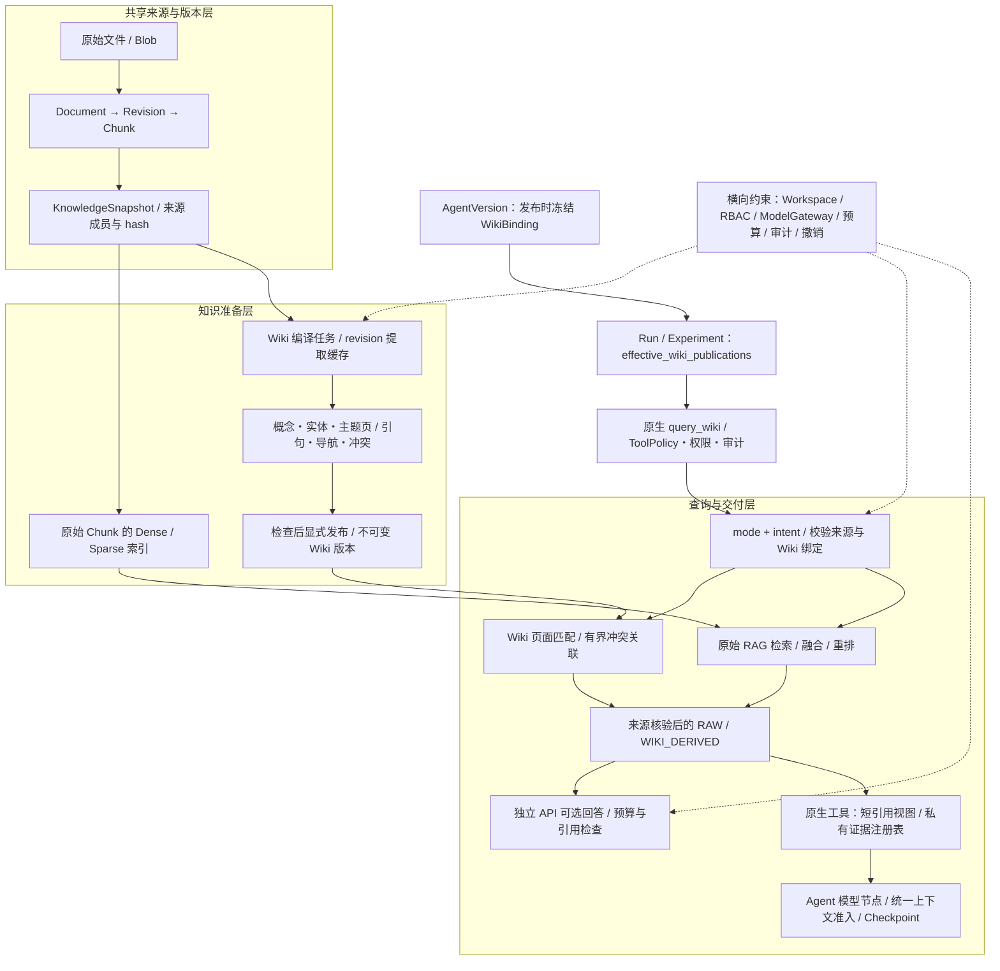
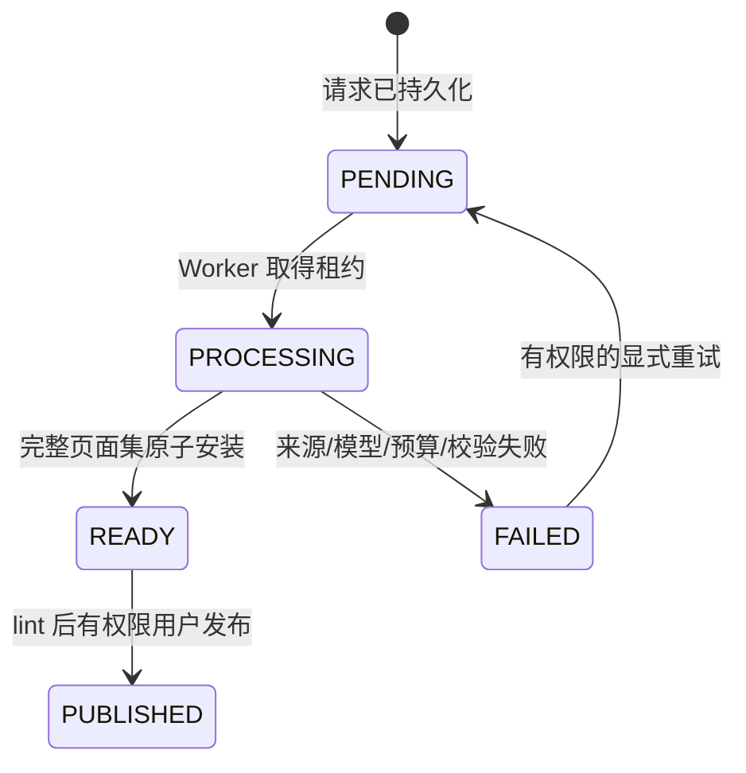

# AgentHub RAG + Wiki 并轨架构：当前结构、设计理由与取舍

首次整理：2026-10-25；更新日期：2026-10-26（Asia/Shanghai）。本文用于理解 RAG 与 Wiki 当前的架构与设计理由，建议先读本篇，再按需阅读 [RAG + Wiki 开发复盘与心得](12-rag-development-retrospective.md)；后者按开发过程解释试验、踩坑、未采用方案与共同经验。

已提交源码基线：`a2d47e4`（包含后端 `9ad8b9d`、前端 `1673515` 与最终验收归档）；结构分层基线为 `4d07c87`。`11b74f8` 是初次并轨，之后 `0523d06`～`318f604` 已完成原生证据 envelope、AgentVersion 绑定、Run/Experiment 冻结与 `query_wiki` 工具；`3cbc34e` 记录真实原生调用验收，`923fe16` 完成 Runtime 分层。旧版“原生绑定尚未实现”的结论已不再适用。

以 `4d07c87` 为基线的隐藏缺陷修复现已提交，验收状态为“29 项主要问题修复及集成验收完成，尚未部署业务环境”。本文按该状态同步消费合同与验证范围；代码迁移 head 为 `0037_run_resume_cursor`，不代表业务数据库、容器或所有部署已升级。

外部资料沿用 2026-10-25 在线核查的一手来源；本次更新主要核对本地提交、源码及实验记录，没有重新运行外部项目或付费评测。

### 本次更新先看什么

| 相比初次并轨 | 已有变化 | 阅读位置 |
| --- | --- | --- |
| Wiki 原先只能独立 API 使用 | 已增加受工具治理的原生 `query_wiki`，未绑定版本保持 opt-in | 第 6.4、8.3 节 |
| WikiBinding 原先是后续工作 | 发布时解析一次，进入 resolved spec；Run、Checkpoint 和 Experiment 固定消费 | 第 5.1、8.3 节 |
| 原始与派生证据仅概念分层 | 已有 RAW/WIKI_DERIVED envelope、短引用及私有来源注册 | 第 4.1、6.4 节 |
| 只有独立 Wiki 的 6 题对照 | 新增 50 题原生工程验收；同时暴露调用上限与双层交付分母问题 | 第 9.4 节 |
| Runtime 集中在一个大模块 | 拆为兼容门面、服务、状态图和投影辅助层 | 第 3.2 节 |
| 只讨论预期收益 | 增补生成侧、中文送达、表格试点收口及已验收、尚未部署的修复 | 第 8.4、9.5 节 |

## 1. 先把这次设计讲清楚

AgentHub 现在采用的是：**共享原始证据，持久编译 Wiki，查询时按任务组合 Wiki 与原文，再做受预算和引用约束的回答。**

RAG 负责围绕当前问题从原始资料中找到相关片段；Wiki 负责把概念、实体、主题、来源引文和导航关系提前组织起来，保存成可以发布和追溯的知识版本。两条路径都回到同一套 Document / Revision / Chunk / KnowledgeSnapshot，不另造一套原始事实库。

这项设计试图同时保留两种能力：高频主题可以复用已经完成的知识组织，精确事实、出处和更新后的内容仍然能够回查原文。Wiki 页是派生阅读层，页面标题、关联和归组仍可能有误；原始证据也只是来源所声称的内容，系统不会因为一段文字存在，就保证它在现实世界中为真。

当前架构已经越过“同库并轨”的阶段：**Wiki 可以作为 AgentVersion 的显式能力发布，由原生 Agent 工具调用，并沿同一证据注册和预算链交付。**初次并轨的 288 项兼容检查仍是历史证据；后续原生验收与研究结论单列，不能混为同一组分数。**Hybrid 更准确、更便宜、更快，仍需独立比较验证，原生接入完成不自动证明质量优于 RAG。**[并轨验收](../wiki/integration-acceptance.md)、[原生绑定实施](../reviews/AgentHub-Wiki原生绑定实施报告-318f604.md)。

### 1.1 “混合”在这里有两种含义

| 名称 | 混合的对象 | 主要解决的问题 |
| --- | --- | --- |
| 原 RAG 的 Hybrid Retrieval | Dense 语义召回＋Sparse 词法召回，再融合/重排 | 用不同检索信号找原始 Chunk |
| 本文 Wiki + RAG 的 Hybrid 查询 | 已发布 Wiki 的摘编证据＋原始 RAG 的检索证据 | 组合持久知识组织与问题相关的原文取证 |

它们可以同时存在：Wiki 查询的 raw fallback 可以调用原有 Dense/Sparse/BGE 重排检索器。不能因为接口写了 `HYBRID`，就假定它一定启用了全部 RAG 研究策略，或一定进行了复杂图推理。

## 2. 为什么需要在原 RAG 之上增加 Wiki

### 2.1 原 RAG 擅长“为这次问题找材料”

原有链路已经支持原始资料入库、版本快照、Dense/Sparse 召回、RRF、BGE 重排、证据选择、引用与上下文预算。它适合定位某个数字、规则、段落或证据来源，也能直接消费新入库的资料。

但围绕同一主题反复问问题时，系统仍可能反复寻找同一组文档、重新连接相同概念。不同文档中有关同一对象的表达分散在多个 Chunk，是否把它们选到一起，往往取决于这一次问题与当前排序。

这次 RAG 研发已经见过相应现象：候选池里有支持材料，最终前几段却没有覆盖完整关系链；独立相关性高的段落，不一定是彼此互补的段落。此前来源隔离的 MuSiQue 确认中，互补集合选择把完整支持集从 63.50% 提到 80.00%，说明“材料怎样组织”确有价值。不过那是特定受控集合选择实验，不能直接算作 Wiki 的效果。[实验原报告](../reviews/AgentHub-RAG互补证据选择与阅读组织-20261023.md)。

### 2.2 Wiki 增加的是“跨问题可复用的组织结果”

当前 Wiki 将来源中的候选知识归到概念、实体和主题页，保留原文引句和来源版本，记录页面间关系及潜在冲突。它保存的是能够在后续查询中继续使用的组织产物，而不只是某次问答的临时上下文。

这一动机与 Karpathy 的 [LLM Wiki 原提案](https://gist.github.com/karpathy/442a6bf555914893e9891c11519de94f)一致：在原始来源与使用者之间维护持久、互相链接的知识层，减少每次从分散资料重新整理的工作。该提案是个人知识管理范式，没有提供本项目需要的租户、事务或发布保证；AgentHub 的这些约束来自自身设计。

这也不是“RAG 已经过时”。[RAGFlow 的知识编译说明](https://ragflow.io/docs/knowledge_compilation/overview)把编译产物定义为后续检索和问答的辅助材料，并将 Parser、Chunker、Compiler、Indexer 分为不同职责。对 AgentHub 的启发是增加可复用派生产物，同时保留原始检索路径。

### 2.3 为什么不直接用 Wiki 替代 RAG

第一，编译一定有选择性。某个精确数值、表述条件或很少被问到的细节，可能没有进入 Wiki 页。

第二，编译产物有新鲜度问题。来源已经更新，不代表已发布 Wiki 已经重编译。

第三，主题归组、别名和关系是模型提出的，不能因为页面写得完整就当成可靠结论。原文引句真实存在，也不保证模型给它配的主题、谓词和条件正确。

所以当前选择是分工：Wiki 提供持久组织，RAG 负责原文定位，查询层保留不足与冲突状态。先证明两者可以安全组合，再研究哪些任务值得更多依赖 Wiki。

## 3. 总体结构：一套来源、两条读取路径、共同治理



图中是职责层次，不代表每次查询必须遍历所有节点。独立 API 可以只返回摘录，也可以请求独立回答器；原生工具则将证据交回 Agent 模型节点，通常不再在工具内调用一遍独立回答器。显式 WIKI 不调用原始检索，RAG 模式跳过 Wiki 页面匹配。

### 3.1 五个层次分别负责什么

| 层次 | 主要对象/模块 | 对外承担的职责 | 不能从这一层推导的保证 |
| --- | --- | --- | --- |
| 原始来源层 | `packages/knowledge` 的 Document、Revision、Chunk | 管理原始内容、修订和定位范围 | 来源内容必然正确 |
| 来源快照层 | KnowledgeSnapshot / SnapshotItem | 明确这次允许使用哪些原始修订 | 同一来源快照只会产生一种 Wiki |
| Wiki 编译层 | `compiler.py`、`service.py`、提取缓存 | 从固定来源生成并校验候选摘编、组织页面 | 模型归组与关系必然正确 |
| 发布和查询层 | WikiCompilation / WikiPage / AgentWikiBinding / `query.py` | 固定 Wiki 与 Agent 版本，路由、读取和验证证据 | 已实现任意图推理或语义充分性判定 |
| 回答交付层 | 独立 `answer.py` 或原生 Agent 模型节点、证据注册表、ContextBudgetPolicy | 将原始/派生证据明确交付，执行各入口相应的预算与引用约束 | 两种入口的输出结构、句级校验及评测分数完全相同 |

### 3.2 实际模块边界

当前 Wiki 是一个新增的薄应用模块：

```text
apps/api/routes/wiki.py            认证 API、输入契约、原始检索器装配
apps/worker/tasks/wiki.py          编译执行、权限重查、租约续期、消息对账

packages/wiki/contracts.py         WikiBinding、模型计划冻结/还原
packages/wiki/models.py            编译、缓存、页面、撤销记录
packages/wiki/compiler.py          通过模型网关提出带原文引句的候选
packages/wiki/service.py           幂等、来源、组织、lint、发布、增量维护
packages/wiki/query.py             Wiki / RAG / Hybrid / AUTO 的确定性组合
packages/wiki/answer.py            可选的带引用回答
packages/wiki/conflict_review.py   默认关闭的模型冲突复核实验

packages/wiki/evidence_envelope.py RAW / WIKI_DERIVED 身份与来源合同
packages/tools/builtins/query_wiki.py 原生工具绑定检查、查询与投影
packages/agent_runtime/publish.py  AgentVersion 发布时解析 WikiBinding
packages/agent_runtime/frozen.py   已发布 WikiBinding 的冻结解析
packages/agent_runtime/work_layer.py 工具观察与证据注册投影
packages/agent_runtime/runtime.py  兼容既有导入的门面
packages/agent_runtime/runtime_service.py Run 编排、持久化、流式与解析
packages/agent_runtime/runtime_graph.py 状态图节点与执行推进
packages/agent_runtime/runtime_projection.py 状态类型、投影/记账与绑定辅助
```

关键拼接点是 `query_wiki(..., raw_retriever=...)`。Wiki 按 `KnowledgeRetriever` / `RetrievalQuery` 稳定协议请求原始证据，不复制 Dense/Sparse/RRF/BGE 算法，也不把研究线所有选择参数存进 Wiki 数据模型。

**好处是研发可以分轨，能力可以并轨。**RAG 可以继续改召回和证据交付；Wiki 可以继续改缓存、组织和维护；只要证据身份、权限、来源与查询合同保持一致，就不必为每个策略重构另一侧。

但这只是接口解耦，并不保证所有策略自动生效。当前 Wiki API 的 raw 适配器创建 `HybridKnowledgeRetriever`，读取相关部署设置，使用普通 `RetrievalQuery`。AgentVersion 中特定的 Onyx、EvidenceSet、compact 等显式配置，并没有因两个模块出现在一个分支就自动传进这个查询入口。

原生接入还增加了另一条边：AgentVersion → PublishedToolResolver → `query_wiki` → Wiki 查询应用服务；Run/Experiment 传入冻结的 `effective_wiki_publications`。这与独立 API 并存，而非替换 API。

`923fe16` 对 Runtime 的拆分保持旧 `runtime.py` 导入门面，主体按 `runtime_service → runtime_graph → runtime_projection` 分层。收益是发布/解析、状态推进和证据投影更容易分别审阅，仍共享一套状态合同。结构报告记录四臂冻结消息重放 200/200 一致；这是当次纯搬迁的兼容证据，之后行为修复需读自己的回归验收，不能由搬迁重放代证。[结构实施记录](../reviews/AgentHub-结构优化深度解析与实施方案-7422b93.md)。

## 4. 为什么 Wiki 选择“结构化存储＋证据摘编”

### 4.1 原始事实身份只维护一套

Wiki claim 保存原始 document/revision/chunk、locator 和精确 quote；查询时还会重新检查它是否属于指定工作区、知识库和来源快照。raw retriever 返回的结果同样回数据库核验，不能只信向量库 payload 或某个适配器的声称。

这样做的直接收益是：Wiki 与 RAG 对“哪一版原文”说同一种语言。来源更新、历史查询、撤销与答案引用可以围绕同一身份核查，避免 Wiki 有一个文件路径、向量库有一个 UUID、回答又有一个无法对应的编号。

代价是多一次校验与来源关联读取。但在本项目里，检索命中不是权限证明；这笔成本是在守住可信交付边界。

原生版本把这一边界落实为证据 envelope：RAW 保留原始形状并标记 origin；WIKI_DERIVED 还必须具有 `publication_id`、`publication_hash`、`wiki_page_id`、`source_revisions` 和原始 `quote`。缺失派生身份在注册边界失败关闭，不能把 Wiki 内容改个名字就当 raw Chunk。

完整 envelope 与模型阅读视图并不相同。模型可见短引用、正文、origin 和页面标识；publication hash 等完整身份保存在私有注册表/检查点中，供引用与恢复核验。这样既能追溯派生产物，又避免把重复长身份塞满上下文。`source_revisions` 是该页面受理 claims 的来源修订集合，不应解释为每条引句都由集合内全部文档联合支持。[envelope 契约](../../packages/wiki/evidence_envelope.py)。

### 4.2 第一版发布内容以精确引文为主

当前模型提出的候选包括：

| 字段 | 用途 | 可信程度 |
| --- | --- | --- |
| topic / kind | 归到概念、实体或主题页 | 模型候选 |
| predicate / value / condition | 表示候选命题、值与适用条件 | 模型候选，不等于已验证事实 |
| chunk_id / quote | 锚定原始片段与精确引句 | 能验证来源归属和子串存在 |
| related_topics | 提议页面关联 | 导航提示，不等于已证明关系 |

最终 Markdown 是业务代码按原文引句生成的阅读投影，不是任由模型自由改写的大段权威综述。引文和标题还会做展示转义，模型不能靠生成链接或 HTML 获得执行能力。

**设计理由：**自由摘要可能把“某论文报告了 X”改写成“X 就是真理”，也可能在多次更新中逐渐丢掉条件。原文摘编让问题更可定位：先证明来源存在，再评价归组和关系，不把无法验证的自然语言总结当作下一轮原料。

这也解释了为什么不把 Wiki 页再当原始来源反复编译。派生知识如果递归进入原始事实层，错误可能被多次复述，最终看上去像有多份证据支持；保留单向派生关系有助于阻止这种自我强化。

代价是阅读流畅性和高度综合能力有限。第一版更接近“有版本、有出处的主题证据册”，还不是可以可靠维护任意领域理论的自动百科。

### 4.3 PostgreSQL 是状态主库，Markdown 是阅读投影

| 对象 | 保存内容 | 为什么单独存在 |
| --- | --- | --- |
| `wiki_compilations` | 来源快照、编译规格、幂等身份、状态、租约、内容 hash、发布与用量 | 管理一次可恢复、有版本的编译与发布 |
| `wiki_extractions` | revision＋提取规格对应的结构化结果、输入 hash、用量 | 来源不变时复用模型工作 |
| `wiki_pages` | 页面 key、标题、类型、Markdown、claims、relations | 在一个编译版本下读取完整页面集 |
| `wiki_source_revocations` | Wiki 范围不可删除的来源撤销记录 | 防止旧产物或 fallback 重新交付撤销来源 |

这符合 AgentHub 的现有架构：PostgreSQL 已经管理租户、版本和任务状态，Celery 负责异步执行，Qdrant 负责原始检索。继续使用这些基础设施，减少多存储双写和独立服务的运维成本。

Microsoft 的 [固定版本 LLM Wiki 架构](https://github.com/microsoft/llmwiki/blob/e09126f257c1fcf8e63234382748a51cf6a5df7f/ARCHITECTURE.md)采用 raw / 生成 Wiki / schema 分层，并以 Markdown、索引和日志服务个人阅读。AgentHub 借鉴分层与阅读组织，但把权威状态放进数据库，以适配多人权限、原子发布和任务恢复；这是本项目的工程取舍，不是对个人文件型 Wiki 的普遍否定。

### 4.4 为什么暂时不新增 Wiki 向量库或图数据库

当前 Wiki 页面按标题与查询词匹配，支持中文词段处理；页面关系主要用于导航、来源共现和有限的冲突关联。没有给 Wiki 再建一套独立向量索引，也没有实现 GraphRAG 式社区聚类与全局 map-reduce。

这样可以先验证来源、版本和维护是否成立，避免同时引入新图存储、图抽取质量、向量同步和删除一致性问题。收益不足时，仍有原始 RAG 这条可用路径。

代价同样明确：标题词匹配会漏别名和隐含语义，当前能力不擅长深层图遍历；“存在 relations 字段”不等于拥有成熟知识图谱。若以后评测证明图结构是收益来源，现有原始身份和关系合同可以继续承接，届时再增加索引有依据。

[GraphRAG 官方查询说明](https://microsoft.github.io/graphrag/query/overview/)明确区分结合图与原文的 Local Search、使用社区报告的 Global Search 和 Basic Search；Global Search 还需要较高资源投入。这支持按任务选择表示和读取方式的思路，不代表 AgentHub 已实现这些查询算法。

## 5. 为什么必须分开“来源版本、编译规格、发布版本”

### 5.1 同一批来源可以产生多版 Wiki

假设来源快照 S1 固定了三份原始修订。用旧模型、旧提示抽取一次，再换提示或加入编辑者冲突声明抽取/组织一次，来源都还是 S1，Wiki 内容却可能不同。

因此仅固定 `source_snapshot_hash`，不能唯一说明“当时读的是哪一版 Wiki”。当前至少分三层身份：

| 身份 | 主要回答的问题 | 关键组成 |
| --- | --- | --- |
| 来源快照 | 看了哪些原文版本？ | source_snapshot_id + source_snapshot_hash |
| 编译身份 | 由什么固定规则生成？ | 来源身份＋compiler_spec 的版本化 canonical hash |
| 发布内容身份 | 最终发布了哪组页面？ | compilation_id + content_hash |

编译规格固定提示/schema、模型主备链、输出模式与参数、路由身份、冲突复核策略、撤销排除集和编辑者声明等。同来源同规格的重复请求返回同一个任务身份，而不是再次花钱生成一版“看起来一样”的内容。

独立 Wiki 查询使用的 `WikiBinding` 核心字段为：

```text
schema_version
compilation_id + compilation_hash
source_snapshot_id + source_snapshot_hash
```

这不是为增加几个 hash 而增加复杂度，而是解决具体歧义：同一个原始快照，可能对应不同模型、不同组织和不同冲突维护结果。**原文版本冻结和派生版本冻结必须同时成立。**

原生 Agent 又增加一层发布绑定，不能与上面的查询 binding 混成一种 JSON：

| 所在位置 | 绑定含义 | 关键字段/行为 |
| --- | --- | --- |
| Agent 草稿 `agent_wiki_bindings` | 编辑者选择如何绑定 | PINNED 指定 publication 与所见 hash；LATEST 留到发布时解析 |
| AgentVersion `resolved_spec.wiki_binding` | 这版 Agent 实际绑定哪一版 Wiki | schema_version、binding_mode、knowledge_base_id、wiki_publication_id、publication_hash；LATEST 也必须已经带具体 ID/hash |
| Run / Experiment variant | 本次执行使用哪组固定 publication | `effective_wiki_publications`；关联 publication 后核验其原始来源快照，不在历史读取时再次找最新 |

`a3c9aa6` 通过迁移 `0034_wiki_native_binding` 增加草稿绑定表，以及 Run/variant 的有效 publication 列。绑定进入既有 canonical resolved-spec hash；未绑定版本省略可选段，避免无故改变旧 spec。LATEST 表示**发布时取最新**，不是每次工具调用取最新。以后要用新知识，应重新编译/发布 Wiki，再重新发布 AgentVersion。

### 5.2 READY 不等于 PUBLISHED



模型完成提取，只能说明得到了一个候选产物。发布还需要完整页面集、内容一致性、来源有效性与权限检查。READY/PUBLISHED 页面和提取缓存有数据库不可变保护；新知识产生新 compilation，不覆盖旧发布。

**好处：**查询不会读到“部分页面已经新了、另一半仍是旧版”的中间态；模型也不能通过输出一个“发布成功”就改变系统状态。历史问题可以指向明确内容版本，回归和审计更容易解释。

**代价：**不能像个人笔记那样随时原地改一句话并立即算作正式知识。当前编辑者冲突维护也形成新版本，不直接修改旧页。

### 5.3 为什么提取缓存和全局组织又分开

单份 revision 的原始内容和提取模型未变时，没有理由因为别的资料新增，或编辑者补了一组冲突声明，就把它重新提取一遍。

当前缓存按 revision 和提取规格定位，并核对规范输入 hash；修改全局复核或声明，不无故使未变化来源的提取失效。全页组装、lint 和发布则继续面向完整有效来源集执行。

因此“增量”准确指的是复用未变化 revision 的模型提取，不是宣称所有页面更新都已经实现最小图差分或常数时间处理。

这可以类比为带版本的物化知识视图：预先把部分计算保存下来，查询复用，但必须管理刷新与过期。PostgreSQL 的 [物化视图文档](https://www.postgresql.org/docs/current/rules-materializedviews.html)也强调持久结果与新鲜度之间的关系。**这里只借用思想，项目实际使用的是上述普通表与编译业务逻辑，没有创建 SQL MATERIALIZED VIEW。**

## 6. 查询为什么这样路由

### 6.1 当前路由是显式意图＋规则，不是已经训练好的智能路由器

调用方指定 `mode` 与 `intent`。`mode` 为 WIKI / RAG / HYBRID / AUTO；`intent` 为 overview / fact / synthesis。当前 query 模块本身不发模型请求来判断题型。

| 请求 | 当前主要行为 | 设计目的 |
| --- | --- | --- |
| WIKI，任意 intent | 只读取/验证 Wiki 摘编，不偷偷调用 raw | 支持独立阅读及公平消融 |
| RAG | 跳过 Wiki 页面匹配，调用 raw retriever 并核验来源 | 保留原始取证基线 |
| HYBRID | 合并 Wiki 摘编与一次 raw 检索的合法证据 | 让组织结果与原文同时可见 |
| AUTO + overview | 优先 Wiki；无 Wiki 证据或存在已识别冲突时请求 raw | 概念阅读复用持久组织，必要时回原文 |
| AUTO + fact | 必须请求 raw，不能仅凭 Wiki 有内容就宣布满足 | 精确事实回到原始资料 |
| AUTO + synthesis | 必须请求 raw，可同时利用匹配 Wiki | 综合问题保留原文核查路径 |

如果需要 raw 而没有可用检索器或合法 raw 证据，返回补充所需/证据不足状态。匹配到 Wiki、找到若干引句，只说明结构上有可交付材料，不是语义充分性证明。

同一 Wiki 查询 API 即使选择 RAG 模式，仍先验证 compilation 与来源快照绑定，再跳过 Wiki 页面读取；它是在同一绑定范围内比较原始路径，不是取消版本检查后搜索任意知识。

单次 `query_wiki` 内的“补充检索”仍是受规则约束的一次 raw 调用。原生 Agent 现在可以在既有运行循环中再次调用该工具，W5 也实际观察到不同参数重试；但这不等于已经验收“识别语义缺口→生成补检索计划→判断完成”的专用策略。重试次数和有依据的缺口补检要分开评价。

### 6.2 为什么精确事实必须保留原文路径

例如“唯一约束大致保证什么”适合先看概念页；“哪些索引类型可以声明为 unique”需要精确到原句和限定；“唯一约束与唯一索引是否需要手动都建”则要跨来源核对关系。

这些是 `benchmarks/wiki/cases.json` 已有问题类型。Wiki 可以把相关主题组织到一起，但真正回答仍需适用条件。当前设计宁可多取一次原文，也不让概念摘编的遗漏静默变成事实错误。

这个规则不是说 Wiki 对事实完全没有用，而是当前归组、概括和别名质量尚不足以支撑“只要 Wiki 命中就可以免核原文”的更强承诺。

### 6.3 为什么检索结果与生成答案分开

`query_wiki` 默认返回 WikiBinding、页面、原文 evidence、route、conflicts、insufficient_evidence 和 supplemental_required。其 `answer` 默认可能只是摘录或不足提示，不能把它当完整生成问答。

只有请求额外提供回答模型 profile 时，API 才调用 `answer_from_evidence`，生成 `generated_answer`。它继续经过模型网关和 ContextBudgetPolicy，并检查引用 ID 与句级引用覆盖。

**这样拆的收益：**阅读、调试、检索评测不必每次付回答费用；模型回答器可替换；检索不足和生成失败不会被混在一个文本框里。若 evidence 已标记冲突、不足或仍需补充，回答组件直接给出不足状态，避免再让模型把它润色成确定结论。

独立 API 的 `answer.py` 仍是独立回答器。与此同时，`318f604` 已接入原生 Agent 工具循环：`query_wiki` 返回证据，让 Agent 模型节点作答，绑定和证据注册随 Run/Checkpoint 传递。独立回答器的逐句引用守卫，不能无条件移植为“所有自由生成的 Agent 答案都经过同样逐句验证”的保证。

### 6.4 原生 query_wiki 怎样穿过完整消费链

```text
草稿选择 Wiki → 发布解析具体 publication → resolved spec / canonical hash
    → Run 创建或 Experiment override 固定 effective_wiki_publications
    → PublishedToolResolver 核对 spec 与本次绑定
    → ToolRuntime 执行 query_wiki（权限、策略、截止时间、审计）
    → 从冻结 publication 派生来源快照，调用 query_wiki 应用服务
    → RAW / WIKI_DERIVED envelope
    → observation 注册投影 → ContextBudgetPolicy → Agent 模型节点
    → 短引用与私有来源映射进入运行状态 / Checkpoint
```

工具参数只表达问题、mode 和 intent，模型不能通过参数另选一个 publication 或工作区。绑定由已发布版本和 Run 状态提供；无绑定、漂移或撤销都会失败关闭。原生工具使用 `require_current=False`，使新入库资料不会静默进入冻结 Run，但仍执行来源撤销检查。

该工具是 READ builtin，沿现有 ToolRuntime 接受治理，并写 `wiki_query` 审计；READ 不意味着可以绕过权限。SUPPORT 模板可提供工具提示，未绑定 Wiki 的版本不因此自动开放该工具。`search_knowledge` 与 `query_wiki` 共用 RAG_EVIDENCE 类别，而不是各造一套互相不知道的模型窗口预算。

同一 Chunk 可能提供多条 Wiki claim，所以 Wiki 注册可以显式接受共享原始引用；普通 `search_knowledge` 不因这一需求放松原有一对一来源配对。身份更完整不等于所有语义风险都已交付：10 月 26 日修复与验收专门补充不足/冲突状态和双层来源裁剪，见第 8.4 节。

## 7. 更新、撤销和冲突为什么要做得保守

### 7.1 先拒绝过期，再显式重编译

默认 `require_current=true` 会核对当前有效来源集合；原文新增、更新、退役或跨文档替代后，旧 Wiki 可能被判 `WIKI_STALE`，不能继续以当前知识名义返回。

有意读历史时可设置 `require_current=false`，但它只是允许部分历史生命周期状态，不允许绕过撤销。历史内容版本可保留，当前是否还能交付这些内容是另一项检查。

原生工具采用冻结历史语义；独立 API 默认 current 语义仍保留。因此同一个旧 publication 在新来源入库后，独立 current 查询可能提示过期，而旧 AgentVersion 仍读原冻结集合；这不是解析分歧，而是两个入口明确选择了不同的新鲜度合同。来源撤销则对两者仍有效。

第一版更新由编译 API 显式触发，没有长期自动订阅所有变更，也不会因为一次上传悄悄发起大量模型维护任务。这样让成本与发布动作可控，代价是需要维护者主动刷新。

[RAGFlow 的官方应用说明](https://ragflow.io/docs/knowledge_compilation/apply_knowledge_compilation_template)也区分模板、实际编译、知识库级产物生成及更新，模板变化不会自动重新编译完成文档。这支持把刷新视为有状态维护动作；本项目具体的 stale 检查和发布合同仍以本地代码为准。

### 7.2 Wiki 撤销为什么不直接删除全局原文

早期实现曾把 Wiki 撤销直接写成原始 Revision 的 DELETED，后来发现会与旧入库生命周期重算相互影响。最终采用独立 Wiki tombstone：撤销该 revision 在 Wiki 及 Wiki 的 raw fallback 中的使用权；普通 RAG 的原始生命周期仍由知识模块负责。

这种范围设计防止一个新 Wiki 维护接口意外变成全局删除入口，也防止旧 worker 状态重算把 Wiki 已撤销内容“复活”。新编译冻结排除集，原始 Snapshot membership/hash 不被重写；包含后来撤销来源的旧 Wiki 读取会受到阻断。

同时，原始模块已标 DELETED 的来源也不能由 Wiki 交付。这里的目标是权限和内容交付一致，而不是保证任何历史版本永远可重演原文。已经发送出去的响应也不能被事后撤销召回。

LightRAG 的 [固定版本 Purge Recovery Contract](https://github.com/HKUDS/LightRAG/blob/aaebfe1bb8d55deb6a4304d357a3bf4c92fcd40a/docs/design/PurgeRecoveryContract.md)强调删除前保留贡献归属和恢复依据，避免删除来源后留下无法归因的派生对象。AgentHub 没有移植其图清理实现，但同样需要保证撤销能沿来源关系影响派生交付。

### 7.3 冲突保留双方，不让模型自动选赢家

当前有三种冲突入口：

1. 确定性规则发现同主题、谓词和条件下有不同值。
2. 编辑者用同快照内已编译的 `chunk_id + quote` 声明冲突组，产生新编译版本。
3. 显式 MODEL 模式提出跨来源冲突 ID 组；这条实验默认关闭。

选择器或编辑者不能通过一个自由文本声明新增事实。业务逻辑检查已有引文、来源和有限 ID 范围；查询时把双方引文和冲突状态一并带回，不自动裁定哪个值是真的。

真实诊断里就有“记录保留 7 年”和“保留 5 年”的受控冲突。两者可能因适用对象、时期不同而不是真矛盾，也可能确实有矛盾；仅有两个数字不能推出赢家。当前宁可要求进一步裁决，也不把排在前面的值当答案。

最后还修过一个导航缺口：问题命中 `Records` 页，而冲突标记在相邻页上。现在做一次有界邻接冲突检查，并扩展对方引文。这个修复让冲突状态不轻易因页面组织而隐藏，但不意味着任意深度的隐含冲突都能识别。

## 8. 为什么继续复用队列、网关、预算和权限

### 8.1 编译是可恢复的持久任务

一次编译可能涉及多份资料和慢模型请求，不能等同于一次 HTTP handler 内生成 Markdown。

当前任务先持久化，再发 Celery；重复请求和重复消息通过身份与 claim 控制。worker 使用租约、续期和最终 fencing，未变化 revision 的提取可从缓存恢复；完整页面集与 READY 状态在同一事务安装。beat 对账丢投递和过期任务，失败重试有状态和次数限制。

这使“数据库里有任务，队列短暂没收到”可以被发现，也防止旧 worker 在租约失效后覆盖新结果。但它不证明模型请求恰好只发生一次：如果调用已经发生而缓存未提交，恢复仍可能产生重复成本；当前记录没有给出所有网络与崩溃窗口的严格 exactly-once 保证。

模型等待期间释放长数据库事务，准备调用前重新检查成员资格、凭据路线和租约。维护权限在任务排队之后也可能变化，不能只在创建 HTTP 请求那一刻看一次。

### 8.2 模型提候选，确定性代码做授权和状态转换

编译和可选回答复用 ModelGateway，冻结编译模型计划与路由。JSON_SCHEMA 模式要求模型声明相应能力；PROMPT_JSON 可以走普通文本生成，但本地 schema、来源和精确引文检查照常执行。

这避免为了“让某模型能用”而把 JSON object、提示 JSON 与严格原生 schema 混为一谈。编译器没有工具执行权，原始文字按 UNTRUSTED 数据处理；prompt injection 不能被当作页面维护命令。

ContextBudgetPolicy 负责模型调用前的上下文准入。编译或回答若因预算截断使“完整来源/完整证据”的前提失效，应明确失败，不能截完还声称完整编译。当前容量仍有上限，来源读取最多 2000 chunks，提取/汇总也有限额；没有宣称支持任意规模资料。

复用现有 `knowledge_edit` 维护权限和 `knowledge_run` 查询权限，保留 workspace 隔离与审计。维护接口没有被注册为可让模型自行执行的后台写工具，READ 也不会自动获得“安全无需权限”的含义。

### 8.3 原生版本绑定已经接入，为什么仍不能运行时找最新

如果某 AgentVersion 只冻结 raw snapshot，却在运行时默认加载“最新 Wiki”，同一个版本在不同日期可能读到不同知识。恢复 Run 或回看实验时也会变化，破坏本项目最重视的可复现性。

这项约束现已由 W2–W4 实施：发布阶段固定 WikiBinding；Run 初始化把 publication 写入有效绑定及图状态；Experiment variant 固定相同 publication，runner/scenario driver 传递冻结 override；工具执行重新核对 spec、Run 列表和活体 publication，而非读取草稿配置。

恢复/重放也不自动换版本。已冻结 publication 丢失或内容身份漂移时，执行转入 `NEEDS_ATTENTION / WIKI_PUBLICATION_UNAVAILABLE`；版本完整性本身不合法则显式拒绝。这里要区分“历史执行继续推进”和“撤销资料仍可读取”：撤销后旧 Run 可以继续到工具节点，但该工具拒绝交付被撤来源；新 Run 绑定该 publication 则在创建时以 `WIKI_PUBLICATION_REVOKED` 拒绝。

LATEST 只在发布时选可用版本；旧 AgentVersion 不会在新 Run 创建时偷偷升级 Wiki。正式 Experiment 的 variant hash 在有绑定时覆盖有效 publication，旧无绑定 variant 不无故加新字段。当前工作区还在加强 Experiment 活体可用性与检索模型身份校验，尚未作为已提交验收结论，见下节。

这轮实现的是**显式绑定版本的原生消费**。旧 Agent、未绑定版本、维护 UI、全量部署和所有模型 provider 都不会因这项接入自动完成迁移。[原生实施报告](../reviews/AgentHub-Wiki原生绑定实施报告-318f604.md)。

### 8.4 10 月 26 日修复与验收：结构接通以后，还要保证真实送达

以下修复已随 `9ad8b9d` 提交并完成隔离验收，前端恢复身份另随 `1673515` 提交；`c8bdeea`、`a2d47e4` 归档验收与构建/迁移补验。本节按当前实现解释，**业务环境仍未部署**。[修复验收记录](../reviews/AgentHub-隐藏缺陷修复验收-20261026.md)。

| 问题 | 已提交的修复行为 | 为什么影响本架构 |
| --- | --- | --- |
| 工具顶层说不足/冲突，模型只收到正常引文 | 将 insufficient、supplemental、conflict、degraded 等服务端状态带过证据再投影 | 原始接口保守拒答，不应在短视图里变成“证据正常可答” |
| 先排 Wiki 后截前 10 条，RAW 被挤掉 | HYBRID 工具投影为两种 origin 预留名额，预算投影继续检查实际送达来源并标注降级 | 请求模式 HYBRID 不等于最终模型真正收到双层材料 |
| LATEST 只扫描固定前 10 个 publication | 分页找可用版本直到命中或耗尽 | 前十个撤销不代表第十一个合法版本不存在 |
| 绑定了知识版本却仍可能使用变化后的检索模型 | 发布/工具/正式实验加强冻结配置与部署身份核对 | 固定原文不足以固定完整检索行为 |
| 选择器附加调用费用不在 Run 总账 | attempt 进入状态和汇总；缺价格保留 UNKNOWN，限价 Run 派发前跳过无冻结单价的 selector | 不能只计回答器费用就宣称整次执行受费用上限保护 |
| selector 耗尽工具预算，已有基础结果也没返回 | 在整体截止时间内分配剩余选择时间、保留基础结果退路 | 可选增强失败不应悄悄取消已经可用的检索结果 |
| Qdrant 小数秒超时被整型截断 | 适配器保留 float，0.5 秒配置完整传到 SDK | 超时配置失真不能被解释成检索无结果或算法质量下降 |
| 恢复、取消、事件与并发执行有窗口 | 数据库执行 lease、持久恢复游标、原 Run actor 当前权限复验、事件补播 | 防止旧执行者或重复恢复再次调用工具；未知结果仍需人工关注 |

新增迁移为 `0035`～`0037`，分别涉及 Run 执行权、Turn/Memory/Artifact 身份和恢复游标；已提交 Wiki 原生绑定迁移是 `0034`。代码中出现新 migration 不代表业务库已执行它。旧 worker 排空、显式 checkpoint bootstrap、统一 API/worker 版本等部署步骤也不能由文档更新代替。

上述合同也有兼容边界：检索模型漂移检查依赖适配器暴露 model_name，不能覆盖无身份的自定义适配器；正式实验即使冻结全模型链价格，缺少实际收费尝试凭据仍保留未知，max_attempts>1 当前不标 KNOWN。选择器超时可返回已经取得的基础池，不能承诺基础检索未完成时凭空有结果。[评测课](08-evaluation.md)补充了计费口径。

这些修复针对的是**同一身份、同一状态和同一预算能否穿过所有边界**。它们不新增一种 RAG 质量算法，也不能换算成答案 F1 或冲突召回率提升。

## 9. 这种结构的好处，哪些已经验证

### 9.1 用一次具体问题说明结构价值

以下为说明架构的教学过程，不是新增质量成绩：

```text
来源 A：解释 unique constraint。
来源 B：解释 unique index。

编译阶段：
  固定 A/B 的 revision 和 source snapshot；
  从原文提取引句，组织概念页及关联；
  校验并显式发布 Wiki V1。

查询“这两个概念怎样关联”：
  AUTO + synthesis 读取匹配 Wiki，调用一次原始 RAG；
  两路结果都核对来源；
  有预算且无已识别冲突时，再由可选 reader 生成带引用回答。

来源 B 更新：
  V1 不改写；默认 current 检测过期；
  新编译复用未变的 A 提取，只为变化来源重新做模型工作；
  发布新版本 V2。
```

这条设计使“读哪版知识、从哪来的、为什么认为过期”都有具体对象可查。它并不保证模型这次一定答对关联问题，但能把错误定位到来源、提取、归组、检索还是回答。

### 9.2 已验证的工程价值

初次 `11b74f8` 并轨验收记录为 **288 passed、0 failed、0 skipped**：Wiki 单元 83 项，RAG 预算/证据/发布/复现合同 143 项，Wiki 生命周期与 worker/API 组合 26 项，旧快照、Run 与正式实验数据库回归 36 项。当次新隔离 PostgreSQL 数据库部署到迁移 `0033`，没有迁移业务数据库；后续原生绑定另增 `0034`。[并轨验收记录](../wiki/integration-acceptance.md)。

新增组合用例走实际 API → HybridKnowledgeRetriever → 来源核验，Qdrant 使用 SDK 内存实现，embedding、reranker、compiler 使用确定性 fake，覆盖同源组合、外租户隔离、旧绑定排除新增资料、冲突和撤销。它证明组合及合同兼容，不能替代真实 provider、远程 Qdrant、Celery 部署重启或语义质量对照。本次写作仅核对记录与测试代码，没有自行重跑这 288 项。

Wiki 独立验收报告记录了 144 个不同定向单元/集成用例，包括真实数据库约束、幂等、租约失效、不可变发布、来源变化/撤销及 raw fallback 再过滤。它是历史验收结果，本次写文档没有重跑这些测试，也不是整个并轨系统的全量 E2E 证明。[固定验收报告](../wiki/acceptance.md)。

两批检查存在重叠，不能将 144 与 288 相加宣称 432 个独立验证用例。

真实初始编译 5 请求，产生 23 页、31 条来源 claim、126 条导航边；新增一份资料后仅新增 1 次模型请求、复用 5 份 revision 提取。这直接验证了当前 revision 级增量复用路径。

126 条边多为同来源共现或导航提示，不能改称 126 条经过语义验证的知识关系。编译成本也已经付出：初始 12,565 tokens、增量 1,036 tokens，不能因为查询短了就忽略它们。

最新隐藏缺陷修复另有隔离验收：单测首跑 2077 通过、1 夹具失败，修正夹具后定向 39 项通过，按身份覆盖全部 2078 项；数据库回归去重 144 项，旧数据迁移轮转 1 项，前端 Node 5 项、TypeScript、Next.js 生产构建和隔离库 alembic check 通过。首跑失败与重叠计数保留，0 付费模型调用，业务环境未部署。这些验证故障处理与合同，不增加 Wiki 语义正确率样本。[最终验收](../reviews/AgentHub-隐藏缺陷修复验收-20261026.md)。

### 9.3 尚未证明的质量与总体成本收益

独立 Wiki 使用 6 个预先固定问题，分别做 WIKI / RAG / HYBRID 小样本对照：

| 模式 | 合法输出/6 次尝试 | 可答性标志一致/6 | 查询 tokens | 平均端到端时延 |
| --- | ---: | ---: | ---: | ---: |
| Wiki-only | 3/6 | 3/6 | 4,849 | 2.215s |
| RAG-only | 5/6 | 5/6 | 8,215 | 2.779s |
| Hybrid | 5/6 | 4/6 | 10,509 | 3.471s |

合法输出指 schema、引用范围和逐句引用门通过，不是语义准确率。这里 raw 基线是 DENSE＋MiniLM 384 维 CPU embedding＋隔离 Qdrant，**不是并轨后的生产 BGE-M3＋Sparse＋重排栈**。不能拿它对最新 RAG 下普遍结论。

原报告结论为 `NO_DEMONSTRATED_HYBRID_BENEFIT`。这批 Hybrid 有效输出没有超过 RAG，查询用量和时延更高，还要摊编译成本。它支持当前克制的设计：保留多模式和原始基线，不强制所有问题走 Hybrid。

两次显式模型冲突复核也都失败，第二次 8192 输出预算明确 `finish_reason=length`，所以自动 MODEL 路径默认关闭。编辑者声明则用 6 份真实提取缓存、新增模型请求 0，成功生成新版本并在原冲突问题上交付双方证据、确定性拒答。

累计 25 次真实模型请求、59,222 tokens；货币价格 UNKNOWN。不能写成“自动冲突识别已解决”或“Wiki 已比 RAG 省多少钱”。上述数据均来自独立 Wiki 原记录，没有在本次写作中追加模型调用。

### 9.4 新增的 50 题原生验收：证明接入，也保留失败分母

W5 使用预登记 50 题：A 组 Wiki 型 20 题、B 组需双层证据 20 题、C 组撤销 10 题；真实 DeepSeek、本地 MiniLM 与内存 Qdrant，累计 111/200 次预算内网关调用。B 组 HYBRID 调用由预登记的系统提示要求，不能当作模型自主学会了任务路由。编译前发生语料拆分和输出上限修订，失败调用和修订记录均保留。[协议](../../benchmarks/wiki/results/wiki-native-e2e-20261025/protocol.json)、[分析](../../benchmarks/wiki/results/wiki-native-e2e-20261025/analysis.json)。

| 检查 | 实际分母与结果 | 可以说明什么 |
| --- | --- | --- |
| 引用标记 | A/B 成功交付答案中的引用 ID 均位于投递视图内 | 结构合法，不是全部答案的语义支持率 |
| 证据 origin | 已投递 320/320 条逐项核对正确 | 原始/派生来源合同已穿过原生链路 |
| A 组运行 | 18/20 成功，2 次调用上限失败 | 不能写成 20/20 完整回答 |
| B 组运行 | 11/20 成功，9 次调用上限失败 | 还存在真实运行可用性损失 |
| B 组双层交付 | 成功 Run 为 11/11；包含后来失败的 Run，总体为 12/20 | 总体仅 60%，未达到预登记 ≥80% 期望，不能用成功子集覆盖 |
| C 组撤销 | 9/9 新 Run 创建被拒；1 个预先冻结 Run 继续到工具后被阻断，最终拒答 | 没有因历史冻结绕过撤销；不是 10/10 都在创建阶段拒绝 |

分析文件将引用、origin、撤销三项硬门记 PASS；双层交付的总体期望没有达到，需要与硬门结果同时陈述。A/B 共 11 次 `AGENT_MAX_TOOL_CALLS_EXCEEDED`，模型以不同参数再次调用工具消耗了上限。提高上限可能改善完成率，也会增加时间和费用，不能未经新比较就认定这是唯一所需修复。

A 组描述性 token F1 约 0.0877，是多句 Agent 答案对短金标的词面分；报告另有金标包含观察，但都不是专家语义判卷，不能用任一列声称系统回答准确率 100%。这轮也不是同问题、同配置的 Wiki-vs-RAG 质量 A/B，不能推翻独立 6 题对照的“未证明 Hybrid 优势”。

### 9.5 同期 RAG 收口：哪些新结果不会改变默认架构

| 方向 | 新结果 | 对本文设计的含义 |
| --- | --- | --- |
| gold 条件拒答校准 | 48 题对照，充分材料拒答 25%→40%，F1 0.543→0.4733；删证据两臂均 28/28 拒答 | 提示前置充分性判断未带来可靠收益，未接入生产；不证明所有缺据识别已解决 |
| F 桶首次压词 | 100 题 F1 +2.78pp，区间跨零、拒答多 2 题 | 词面格式可改善，整体质量门仍失败 |
| F 桶合并版 | 100 题 F1 0.6374→0.6801，区间下界约 −1.65pp；拒答 20→21；护栏 0/100 激活 | 方向关闭，护栏假设未真正受试；没有新增全局短答规则 |
| 中文送达 | 自拟 8 份中文 Wiki 风格正文，38 个机械构造问答，37/38 命中 gold 句所在块 | 是原始 BGE 混合检索的送达检查，不是已发布中文 Wiki、天然用户问题或生成质量确认 |
| 表格解析 | TAT-DQA 30 文档/61 题，pypdf 68.9%→pdfplumber 77.0%，+8.1pp 未达 +15pp 门 | 仅在该表格试点未过门，pdfplumber 留 bench 依赖，生产 parser 未因此替换 |

来源：[生成侧结果](../reviews/AgentHub-生成侧优化结果报告-72a34a8.md)、[RAG 收尾](../reviews/AgentHub-RAG收尾工作单实施报告-11b74f8.md)、[自闭环终报](../reviews/AgentHub-自闭环收尾执行报告-a88bf74.md)。GEN-1 原记录还披露约 290 次调用、含实现废跑并超原路径预算；它是执行偏差，不应因为最终负结果而从成本账本消失。后两轮 F 桶各记约 100 次调用，不能混成一次无失败成功执行。

桶分类、跳数分布和答案包含规则都是诊断代理，不能直接推出“损失与证据组织无关”或“剩余全部是模型能力”的全局因果结论。当前较稳妥的决策是：这些固定干预没有通过各自门槛，保留负结果，默认编译/检索/回答架构不据此改写。

### 9.6 什么情况下才可能摊薄编译成本

下面是设计推论，不是已测性能模型。设编译与维护成本为 `Ccompile`，纯 RAG 每次查询成本为 `Crag`，使用 Wiki 后每次总查询成本为 `Cwiki_query`：

```text
总成本差 = Ccompile + 查询次数 × (Cwiki_query − Crag)
```

只有在平均每次确实节约、重复查询足够多且来源没有频繁大改时，前期编译才可能被摊薄。如果大量问题都需要 Wiki＋raw，或编译频繁更新而查询很少，反而可能更贵。

当前小样本 Hybrid 的查询成本已更高，所以这里不能计算一个保证回本的次数。架构提供的是复用的可能性与可记账边界，是否值得仍由场景决定。

## 10. 设计决策总表：收益与代价成对看

| 决策 | 为什么这样设计 | 直接收益 | 代价/边界 |
| --- | --- | --- | --- |
| 共享 Document / Revision / Chunk / Snapshot | 两条路径需要同一原始身份 | 来源、权限和历史定位可统一核查 | 仍需逐入口检查，不能只信索引 |
| Wiki 为派生摘编层 | 避免生成总结冒充原始事实 | 更易追溯、撤销和发现归组错误 | 阅读流畅性与自由综合有限 |
| PostgreSQL＋JSONB 为状态主库 | 复用事务、RBAC 和任务基础设施 | 原子页面集、版本约束、缓存关联 | 没有天然获得图数据库性能 |
| 编译与查询分离 | 复用跨问题的组织工作 | 有机会减少重复整理 | 前期编译和刷新要花钱 |
| revision 提取缓存与页面组织分离 | 全局维护不应重提取未变资料 | 增量模型调用可复用 | 不是完整最小图差分 |
| 显式发布、不可变历史 | 模型生成不等于正式知识 | 防止半成品和旧版被覆盖 | 更新流程更严格 |
| 来源/Wiki/Agent 多层绑定 | 同一快照可有多版派生知识，同一 Wiki 可被不同 Agent 使用 | 原生 Run/Experiment 已固定实际 publication，不重解析 LATEST | 重新用新知识需重新发布；活体可用性仍需入口校验 |
| AUTO fact/synthesis 必须 raw | 精确事实与综合不能仅信摘编 | 原文核验路径保留 | 额外检索，未保证质量提升 |
| WIKI 模式不暗中 fallback | 单独阅读和消融要透明 | 方法对照有意义 | Wiki 不足时会直接不足/失败 |
| 冲突保留双方并阻止自动裁决 | 相关性不是权威，模型也可能误判 | 不把争议抹成确定答案 | 自动召回和人工裁决仍有限 |
| Wiki 范围独立撤销 | 避免新维护入口越权全局删除 | 防止旧派生与 fallback 复活内容 | 普通 RAG 全局撤销仍由原模块管理 |
| durable job＋lease＋缓存 | 长任务需要恢复且旧 worker 不得回写 | 丢消息可对账，完整集原子安装 | 不承诺模型 API 恰好一次 |
| 不立即引入新图/向量后端 | 先验证必要性，再承担一致性成本 | 规模和维护复杂度可控 | 深层图推理、Wiki 语义召回未实现 |

## 11. 当前完成边界与源码阅读入口

### 11.1 当前结构做到哪里

| 层次 | 截至本次核查的事实 |
| --- | --- |
| 模块与独立 API | `11b74f8` 已合入，独立查询与可选回答继续保留；后续原生接入是叠加 |
| RAG 算法 | 保留最新原始检索实现，通过适配器调用；未为合并重写 Dense/Sparse/Rerank |
| Wiki 组织 | 精确引文摘编、概念/实体/主题、导航关系和有界冲突扩展 |
| 自动维护 | 显式增量编译；没有上传后自动持续订阅和自动发布 |
| 冲突维护 | 确定性规则＋编辑者声明可用；MODEL 跨来源复核真实失败、默认关闭 |
| UI | 通过现有认证 API 阅读与维护，没有新增专用 Wiki Web 页面 |
| 原生 Agent / Run / 正式 Experiment | W2–W4 已提交：WikiBinding 入发布 hash，Run/variant 固定 publication，原生 query_wiki 受治理；不是所有旧版本自动开启 |
| 原生真实验收 | W5 三项结构/撤销硬门 PASS；A/B 有 11 次调用上限失败，B 组总体双层送达 12/20，保留不足 |
| Runtime 组织 | 已有 service / graph / projection 分层与兼容门面；本次不引入新微服务 |
| 隐藏缺陷修复 | 后端 9ad8b9d、前端 1673515 已提交，隔离验收完成；业务库/运行容器未升级，未合并主分支 |
| 效果结论 | 新增的是绑定、治理及原生交付证据；尚无同配置实验确认 Wiki/Hybrid 优于最终 BGE RAG |

### 11.2 源码按什么顺序看

下列入口指向当前工作树实际文件；架构分层基线为 `4d07c87`，行为修复与验收已提交至 `a2d47e4`。复现某轮实验需读取那一轮的代码与数据身份，不能用今日源码回填原历史结果。

| 阅读问题 | 入口 |
| --- | --- |
| 刚刚合并的是哪两条线，验证了什么？ | [并轨验收](../wiki/integration-acceptance.md)、[真实组合测试](../../tests/integration/test_wiki_rag_integration.py) |
| 并轨后怎样接入原生 Agent？ | [原生绑定实施](../reviews/AgentHub-Wiki原生绑定实施报告-318f604.md)、[原生工具](../../packages/tools/builtins/query_wiki.py) |
| 发布和恢复怎样固定 Wiki？ | [publish.py](../../packages/agent_runtime/publish.py)、[frozen.py](../../packages/agent_runtime/frozen.py)、[Run service](../../packages/agent_runtime/runtime_service.py)、[Experiment](../../packages/evaluation/experiments.py) |
| 原始/派生如何统一交付？ | [envelope](../../packages/wiki/evidence_envelope.py)、[work_layer](../../packages/agent_runtime/work_layer.py)、[evidence registry](../../packages/agent_runtime/evidence_registry.py) |
| 原生 50 题实际通过和失败是多少？ | [W5 协议](../../benchmarks/wiki/results/wiki-native-e2e-20261025/protocol.json)、[W5 分析](../../benchmarks/wiki/results/wiki-native-e2e-20261025/analysis.json) |
| 为什么选这种存储和版本设计？ | [ADR-012](../adr/ADR-012-versioned-derived-wiki.md) |
| 实际数据对象、缓存与发布身份是什么？ | [models.py](../../packages/wiki/models.py)、[contracts.py](../../packages/wiki/contracts.py) |
| 模型能提出什么、怎样验证引文？ | [compiler.py](../../packages/wiki/compiler.py) |
| 增量、组织、发布、撤销怎样协作？ | [service.py](../../packages/wiki/service.py) |
| 各 mode / intent 到底怎么走？ | [query.py](../../packages/wiki/query.py) |
| 引用、预算、不足怎样影响生成？ | [answer.py](../../packages/wiki/answer.py) |
| 现有 RAG 是怎样被调用的？ | [Wiki API 装配](../../apps/api/routes/wiki.py)、[本地 RAG 检索器](../../packages/knowledge/retrieval.py) |
| worker 怎样重查权限与恢复？ | [wiki task](../../apps/worker/tasks/wiki.py) |
| 如何从 API 编译、发布和查询？ | [Wiki 使用说明](../wiki/README.md) |
| 数据究竟证明了什么？ | [验收及负结果](../wiki/acceptance.md)、[三模式原汇总](../wiki/live-summary-20261025.json) |
| 旧集成计划哪些已经完成？ | [初始合同清单](../wiki/integration-plan.md)第 2–5 项已由原生绑定里程碑实现；状态按[实施报告](../reviews/AgentHub-Wiki原生绑定实施报告-318f604.md)更新，不从旧计划推断仍未开工 |
| 最新修复验证了什么，尚未部署什么？ | [修复报告](../reviews/AgentHub-隐藏缺陷修复验收-20261026.md)与 [机器汇总](../reviews/evidence/hidden-defects-fix-20261026/validation-summary.json)；区分隔离验收、本地构建、远端 CI 与业务部署 |

### 11.3 如何概括“为什么这么设计”

可以把理由说成四层递进：

1. **为重复使用组织知识。**同一主题不必每次从零拼，但仍保留原文检索处理精确与遗漏信息。
2. **为错误保留回查路径。**Wiki 的每条摘编都有原始版本和引句，派生内容不会自动升级成事实来源。
3. **为更新保留确定边界。**来源快照、编译规格和发布内容分开固定，旧版不覆盖，过期与撤销显式处理。
4. **为进一步研究保留替换空间。**查询、检索、编译和回答分开；可以比较 WIKI/RAG/HYBRID，也可以替换实现，不必同时推翻治理底座。

这是一种适合 AgentHub 当前工程基础和验证能力的折中：把可复用知识组织持久化，同时把来源、版本、失败和成本保持可见。后续要证明的是它在哪些真实任务上值得用，而不是因为增加了 Wiki 就默认判定系统更先进。

### 11.4 本文核查方式

本次更新核对了 `11b74f8` 后至 `4d07c87` 的相关提交、原生绑定/Runtime 分层源码、W5 协议与机器分析、RAG 后续收口记录，并复核 `9ad8b9d`、`1673515`、`c8bdeea` 修复提交、最终验收报告与机器汇总。外部设计资料保留 2026-10-25 的核查日期，没有把旧资料说成今日重新在线复核。

本次全目录维护只修改 `docs/learning` 教程及学习索引；未改业务实现、原报告、协议或实验数据，未运行服务、单元/集成套件或付费模型。文中的 144、288、111 次请求、320 条证据等均保留原记录的范围，不叠加测试通过数，也不把结构门通过换算为语义正确率。
