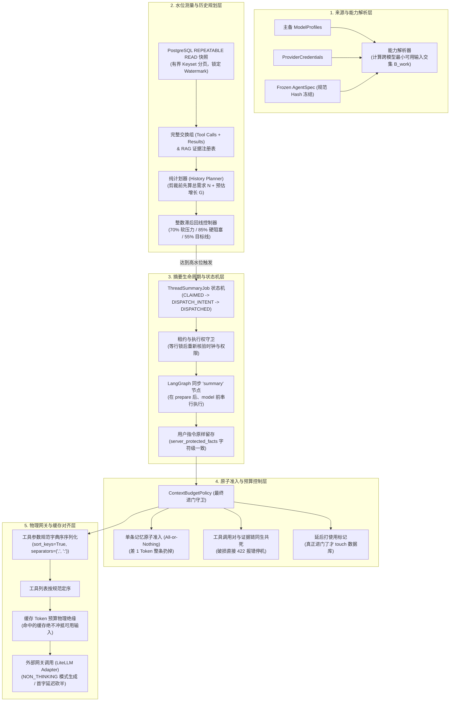
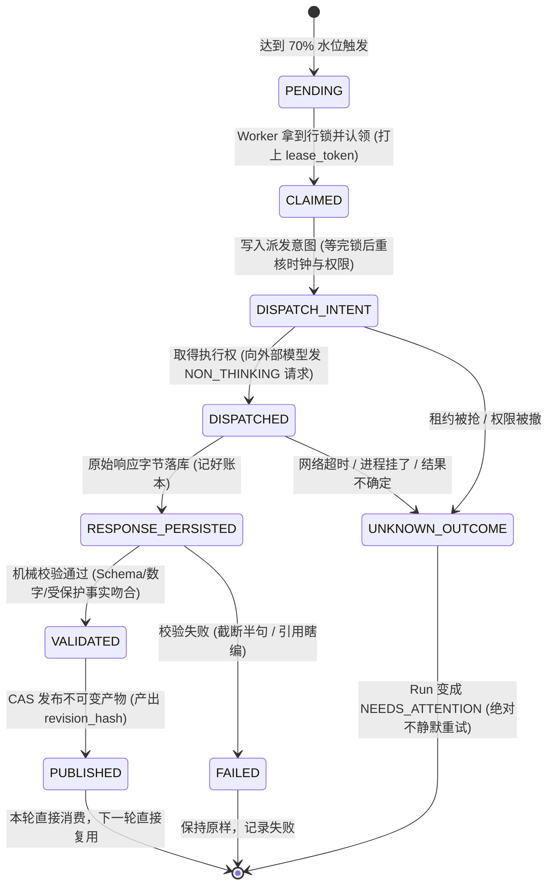
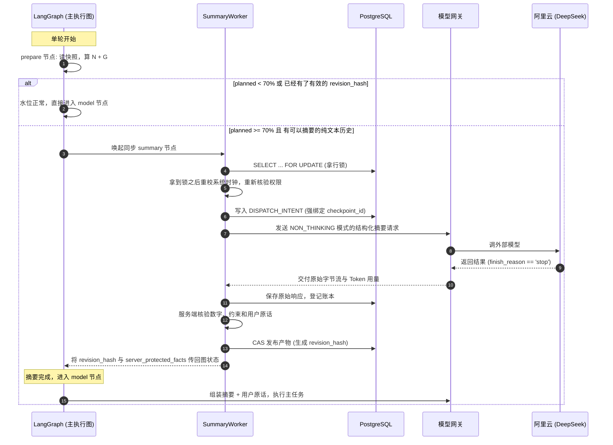

# AgentHub 上下文与长记忆架构：当前结构、设计理由与系统取舍

首次整理：2026-11-01（Asia/Shanghai）；基于分支 `codex/context-policy-m2-20261027`、基线提交 `99dd57c` 以及 `0038`～`0048` 迁移规格。本文用来讲清楚上下文与长记忆（Context & Memory）体系目前的实际结构、为什么这么设计、做了哪些取舍。

如果想看具体研发过程中踩了哪些坑、怎么排障、有什么负结果，请先读 [上下文与长记忆开发复盘](14-context-memory-development-retrospective.md)。

---

## 1. 先用大白话讲清楚这次设计

很多 Agent 系统的上下文做法非常简单：把历史消息无脑拼在一起，超长了就截掉前几轮，全扔给大模型硬抗。

AgentHub 没有这么做。我们当前落地的设计可以概括为一句话：**“以备用模型的最小窗口给整个链路设预算上限，事实和工具交互按原子块整体进出，在剪裁前按整数阈值测算真实高水位，用同步节点把长历史压成不可变摘要快照，并在底层用规范键序去蹭服务商的前缀缓存。”**

拆开来看，主要有六个关键点：
1. **输入上限由链路里最弱的模型决定**：主模型就算有 100 万窗口，只要备用降级模型只有 32K，有效工作预算 $B_{\text{work}}$ 就必须受 32K 限制。否则主模型一挂，降级直接把备用模型打崩。
2. **事实宁可整条丢，绝不切半截**：长期记忆或工具调用是原子块。空间只差 1 个 Token，也必须整条丢弃，坚决不切半句话，防止把“严禁退款”切成“退款”。
3. **剪裁前测水位，不掩耳盗铃**：在对历史做任何裁剪前，必须测出未经裁剪的真实需求 $N+G$。绝不能先截掉前几轮再去算水位，假装系统没有超载。
4. **摘要是带租约和快照绑定的派生产物**：在 LangGraph 主图里通过同步 `summary` 节点执行。生成的摘要与具体 Checkpoint 强绑定，生成一个不可变的 `revision_hash`。第二轮如果还在相同水位，直接复用，0 次额外调用。
5. **用户原话由代码原样留存，不信大模型的概括**：核心诉求由服务端提取为 `server_protected_facts`，大模型生成的摘要只作为辅助背景，两部分并行喂给模型，确保用户的硬性约束原字原句送达。
6. **参数字典序对齐蹭缓存，但缓存 Token 绝不冲抵可用空间**：在网关层对参数按键排序，字节一致触发上游隐式缓存（实测 TTFT 降 50%）。但服务商返回的 `cached_tokens` 绝不从可用预算里扣掉，防止云端缓存被淘汰时物理超窗报错。

---

## 2. 为什么需要这套长上下文架构

### 2.1 为什么不能搞简单的拼接和滑窗

很多原型项目喜欢直接写 `messages[-10:]`（只保留最近 10 轮），在生产环境里会撞上四个确定性的故障：
1. **把否定词切没了**：按字符或按无序条目截断时，容易把“除特殊情况外不得退款”后半截切掉，直接造成违规操作。
2. **把工具调用对切碎了**：滑窗刚好切在 `tool_calls` 和工具返回结果中间，发给大模型一个“有调用无返回”的残缺历史，直接触发 OpenAI API 的 400 校验错。
3. **把真实超载压力掩盖了**：15 轮长对话其实已经占了 30K Token，如果先截掉前 5 轮再算水位，监控上看着只有 20K（显得很健康），直到某一轮自身稍微变长，瞬间打爆系统。
4. **主备降级当场暴毙**：主模型 128K，备选模型 32K。按 128K 装配上下文，主模型一旦超时切换备用模型，备选模型直接抛 `ContextWindowExceeded` 挂掉。

### 2.2 为什么模型宣称有 100 万窗口，也不能当甩手掌柜

现在的模型动不动宣称几十万甚至上百万的窗口，但把什么东西都一股脑往里塞，在工程上非常不划算：
1. **注意力分散，模型开始装聋作哑**：当上下文塞了几万字无关废话时，模型对指令的遵循度严重下降，经常对用户刚刚提出的核心纠正视而不见。
2. **首字延迟（TTFT）和账单吃不消**：几万字的输入会导致每次请求的首字延迟飙到十几秒，而且每轮都要把全部历史重新上传一遍，费用按轮次呈现平方级爆炸。
3. **大模型做摘要天然不靠谱**：让模型去摘要长历史，它天生喜欢大而化之。把“发票开给北京某公司，必须退款不能换货”概括成“用户咨询了退换货政策”。所以关键的原话事实，必须由服务端代码直接原样锁死。

### 2.3 为什么 Thread 摘要不能写进长期记忆（Memory）

在很多初学者的设想里，觉得“把对话摘要直接存进长期记忆库不就两全其美了吗”。在 AgentHub 里，这两者严格隔离：
* **Thread 摘要**是会话内部的临时草稿纸。它只服务于当前这一条对话流，用户会话删了或者归档了，它就失去价值了。
* **长期记忆**是企业工作区级别的知识库（Workspace + Agent）。它必须经过异步提取和严格的准入审查。如果把某个人在会话里的临时闲聊流水账直接写进全局长期记忆，整个公司的知识库很快就会被垃圾事实污染。

---

## 3. 总体架构图与分层职责



### 五层分工与“不能推导”的伪保证

| 层次 | 主要文件 | 这一层到底管什么 | 千万别推导出的伪保证 |
| :--- | :--- | :--- | :--- |
| **1. 能力解析层** | `context_policy.py`<br>`context_metadata.py` | 查清主备模型的窗口大小和预留输出，取最小交集算出一个保底的 $B_{\text{work}}$。 | 模型宣称有 100 万窗口，不代表 100 万全都能放心塞满。 |
| **2. 历史规划层** | `history_planner.py`<br>`history_transcript.py` | 锁住快照，把工具调用与返回捆绑成完整组，在动剪刀前先算出真实高水位。 | 历史规划得再漂亮，也不代表模型一定不会说胡话。 |
| **3. 摘要生命周期层** | `summary_worker.py`<br>`summary_service.py` | 管好租约，防止两个 Worker 争抢；把用户原话原封不动提出来；把产物绑定到 Checkpoint。 | 摘要模型生成的内容，不代表绝对覆盖了原始对话的 100% 细节。 |
| **4. 准入预算层** | `context_budget.py`<br>`runtime_graph.py` | 守住发给模型前的最后一道门：单条记忆整进整出，破损工具对直接报错，确定进门才打 touch。 | 只要过了准入，不代表复杂的多跳逻辑就一定能推理正确。 |
| **5. 网关缓存层** | `litellm/adapter.py`<br>`cache_capability.py` | 把参数按字典序排整齐了发出去，去蹭服务商的前缀缓存；命中的缓存不扣减物理预算。 | 任何服务商在任何时候都能 100% 命中缓存（缓存随时会被服务商踢掉）。 |

---

## 4. 核心数学模型与预算计算法则

### 4.1 跨主备降级交集：怎么算出真实工作集 $B_{\text{work}}$

当 Agent 配置了备选模型时，系统的预算不是按主模型算的，而是按链路里最弱的那个算：

1. **单个模型预留输出**：
   $$O_i = \max(\text{max\_tokens}_i, \text{output\_reserve})$$
2. **单个模型的净输入上限**：
   $$R_i = \min(I_i, T_i - O_i, P_i)$$
   （$I_i$ 是独立输入上限，$T_i$ 是总窗口，$P_i$ 是部署限额，谁小按谁算）。
3. **留出安全垫（Safety Margin）**：
   $$S_i = \max(1024, \lceil 0.05 \times R_i \rceil)$$
4. **单模型可用输入**：
   $$B_i = R_i - S_i$$
5. **链路全局有效输入与业务工作集**：
   $$B = \min_{M_i \in \text{chain}} B_i, \quad B_{\text{work}} = \min(B, L_{\text{preset}})$$
   （$L_{\text{preset}}$ 是业务预设，比如 `STANDARD_32K`、`GENERAL_64K`）。

**大白话举例**：主模型是 100 万窗口的大模型，但备用模型是个 32K 窗口的模型。扣掉预留输出和安全垫后，备用模型只剩 29,184 Token。那么无论主模型多大，有效输入预算 $B_{\text{work}}$ 强行卡死在 29,184。主模型故障时备用模型接手，绝对不超窗。

### 4.2 双滞后回线：为什么全用整数除法

为了彻底干掉浮点数在边界上的跳动，代码里全部用整数除法：
- **软触发线（70%）**：`(70 * B_work + 99) // 100`（向上取整）
- **硬阻塞线（85%）**：`(85 * B_work + 99) // 100`（向上取整）
- **压缩目标线（55%）**：`(55 * B_work) // 100`（向下取整）

设当前已有的所有 Token 需求为 $N$，本次交互预估增长为 $G$（给 Prompt 和工具结构体预留），总需求 $\text{planned} = N + G$：
* $\text{planned} < 70\%$：正常运行，不需要动用任何摘要模型；
* $70\% \le \text{planned} < 85\%$：软压力，如果发现历史里有已经完成的旧会话，可以准备摘要；
* $\text{planned} \ge 85\%$：**硬阻塞**，主模型调用直接挂起，必须先通过同步节点把历史压缩到 55% 以下，才能恢复主任务。

### 4.3 智能体级动态可配置参数（Per-Agent Configurability）

不同业务形态的智能体（如轻量客服问答、多轮代码报错联调、超长财报研报分析）对水位线和历史保留策略的需求差异很大。系统将经验常数全部开放为每个 Agent 可独立声明的策略项（未指定时默认回退到上述基准常数，保持对旧版本快照 100% 兼容）：

* **`preset`（工作集档位）**：支持 `MINI_16K` (16,384)、`STANDARD_32K` (32,768)、`GENERAL_64K` (65,536)、`LONG_DOCUMENT_128K` (131,072)、`EXTENDED_256K` (262,144)。
* **`soft_trigger_percent` / `hard_trigger_percent` / `target_percent`**：支持按智能体特征调节三道水位线（默认 `70 / 85 / 55`），由校验器强制约束 $0 < \text{target} < \text{soft} < \text{hard} \le 100$。
* **`retained_recent_turns`（末尾免压缩轮数）**：默认保留最近 `2` 轮完整原始对话不进入摘要前缀；代码调试类 Agent 可调高至 `4~5` 轮（范围 `0~50`）。
* **`max_history_groups`（单次规划最大历史组数）**：默认 `256` 组（范围 `16~4096`）。
* **`safety_reserve_percent` / `safety_reserve_tokens`（安全垫冗余）**：默认 `5%` 与 `1024` Token，支持按工具 Schema 复杂度在 `0~30%` 与 `0~65536` Token 之间微调。

---

## 5. 关键状态机与执行时序

### 5.1 摘要任务的生命周期（防止并发双花与未知悬挂）



### 5.2 LangGraph 同步 `summary` 节点的执行顺序



---

## 6. 模块代码分布

代码严格分层，具体文件位置如下：

```text
packages/agent_runtime/
├── context_budget.py         # 进门总管：ContextBudgetPolicy，单条事实原子准入 (All-or-Nothing)
├── context_policy.py         # 算账中心：主备预算交集、整数 70%/85%/55% 滞后回线
├── history_planner.py        # 纯计划器：剪裁前测算高水位 (N+G)、Exchange 分组、保留原因
├── history_transcript.py     # 工具调用与返回的完整组 (Exchange Group) 持久化
├── history_evidence.py       # RAG 证据注册表校验，引用和证据同生共死
├── summary_service.py        # 摘要持久化服务，强绑定 Checkpoint ID，CAS 发布
├── summary_worker.py         # 摘要执行器：租约时钟核验、行锁重新校准、异常熔断
├── summary_prompt.py         # 冻结中文摘要 Prompt 模板
├── summary_state.py          # 纯内存状态机转移规则
└── runtime_graph.py          # LangGraph 主图：集成同步 summary 节点与延后打 touch

packages/model_gateway/
├── context_metadata.py       # 模型物理窗口、独立输入和部署限额定义
├── cache_capability.py       # 供应商前缀缓存能力发现
└── adapters/litellm/
    ├── adapter.py            # 工具定义定序、参数字典键排序序列化 (sort_keys=True)
    └── aliyun_delivery_fix.py# 阿里云 DashScope 关停思考模式 (NON_THINKING) 修复

migrations/versions/
├── 0038_thread_history_snapshot.py      # Thread 历史规划快照
├── 0039_thread_history_transcript.py    # Thread 工具交互组持久化
├── 0040_thread_history_evidence.py      # RAG 证据注册表
├── 0041_thread_summary.py               # 摘要核心表 (jobs, responses, artifacts)
├── 0042_summary_eligibility.py          # 历史来源可摘要资格表
├── 0043_summary_dispatch_boundary.py    # 摘要派发边界唯一性
├── 0044_summary_evidence_guard.py       # 证据留存与防删除触发器
├── 0045_run_budget_ledger.py            # 单 Run 共享预算账本
├── 0046_summary_review.py               # 受保护原文审阅记录
├── 0047_summary_checkpoint_binding.py   # 摘要任务绑定精确 Checkpoint ID
└── 0048_summary_run_step.py             # 支持同步 'SUMMARY' 步骤
```

---

## 7. 系统不变性契约（严格对齐工程守则）

1. **配置冻结不能漂移 (Rule 8)**：发布后的 `AgentVersion`，上下文策略 `adaptive_context_v1` 被固化进 Canonical Spec Hash，运行时只读冻结配置，不读草稿。
2. **逻辑标识不依赖第三方 (Rule 11)**：历史规划和摘要绑定全部使用系统自有的 `source_id`, `exchange_id`, `checkpoint_id`，绝不依赖大模型服务商随机吐出的 `tool_call_id`。
3. **未知结果绝不静默重发 (Rule 12 & 13)**：摘要向外发请求超时或状态不明时，状态机直接标为 `UNKNOWN_OUTCOME`，Run 标为 `NEEDS_ATTENTION`，**绝对不自动重试**，防止产生未知的二次扣费或状态混乱。
4. **中断恢复前不产生副作用 (Rule 14)**：已发布的摘要快照具备不可变 Hash，重新恢复执行时直接读取，不产生副作用。
5. **所有输入无条件经过准入守卫 (Rule 20)**：所有最终喂给模型的文本，无条件经过 `ContextBudgetPolicy.admit` 检验，网关层坚决不放行任何未经裁决的内容。
6. **故障注入覆盖全窗口 (Rule 23)**：租约被抢、派发前权限被撤、落库后断电等窗口，全部通过了单测与隔离数据库的故障注入验证。

---

## 8. 生产部署与运维注意事项

1. **数据库必须手动跑迁移**：部署时必须由 CI/CD 显式执行 Alembic 迁移 `0038` 到 `0048`，API 业务进程绝不会自动建表。
2. **生产环境默认关停自动摘要**：在发布代码（`packages/agent_runtime/publish.py`）里，任何人只要把 `summary_policy.enabled` 设为 `true`，接口默认返回：
   ```json
   {
     "code": "SUMMARY_QUALITY_GATE_NOT_MET",
     "message": "Thread automatic summarization is not approved for production release.",
     "status_code": 422
   }
   ```
   只有在带沙箱许可的隔离测试环境里才能运行。
3. **产生了摘要的 Thread 删不掉**：为了保留审计证据，产生过摘要记录的 Thread，删除接口会返回 `409 SUMMARY_EVIDENCE_RETAINED`，拒绝物理删除。
4. **稳定前缀千万别乱插动态变量**：如果想蹭到服务商的前缀缓存（延迟砍半），System 提示词和工具定义必须保持静态定序，千万不要手抖在 System 消息里动态塞入“当前时间戳”这种每秒都在变的值，否则上游缓存 100% 击穿。
