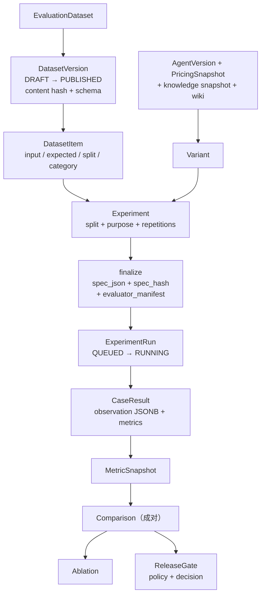

# AgentHub 评测现状与差距分析

> **阅读基线**：当前工作区，迁移 head `0048_summary_run_step`（以 `migrations/versions/` 实际文件为准；`docs/current-state.md` 记录的 `0037` 已过期）。本文是**静态代码阅读 + 文档核对**，没有运行测试、没有调用模型、没有跑实验。文中“事实”指当前源码里能读到的结构；“已验证”一律引用仓库既有证据文档，不把本轮阅读当作运行结果。
>
> **配套文档**：[调研报告首页](README.md) · [基准全景](01-benchmarks.md) · [方法论](02-methods.md) · [接入方案](05-integration-plan.md)

---

## 0. 一句话结论

AgentHub 已经有一个**可复现实验平台**：数据集版本、冻结实验、租约执行、成对比较、消融、发布门禁、冻结 judge 都在代码里，而且口径比多数开源项目严谨。

但它现在测的是**终态 + 少量确定性信号**，不是 2026 年行业语境里的 **agent evaluation**。缺的不是“再来几个指标”，而是三层基础设施：

1. **轨迹层**：真实 Runtime 没有把工具调用序列、参数身份、审批事实、循环信号投影成可评分证据；
2. **统计层**：重复运行只取均值，没有 `pass^k`、方差、置信区间与功效分析，30 条 holdout 无法支撑门禁结论；
3. **环境层**：多轮是固定脚本，没有自适应用户模拟器，也没有可 reset / 可断言状态的任务环境。

补法不是重写，而是在现有骨架上加这三层，并把“证据等级”变成字段而不是文档里的一句免责声明。

---

## 1. 现有链路（读代码得到）



| 层 | 实现 | 入口 |
| --- | --- | --- |
| 数据集与定价 | 版本化、内容 hash、DRAFT/PUBLISHED、DEV/HOLDOUT、pricing snapshot | [models.py](../../../packages/evaluation/models.py) |
| 实验冻结 | 数据/变体/知识/定价/构建 SHA/evaluator manifest 一起冻结，`spec_hash` 可核查 | [experiments.py](../../../packages/evaluation/experiments.py)、[reproducibility.py](../../../packages/evaluation/reproducibility.py) |
| 执行 | DB 租约 + generation fencing；claim/heartbeat/recover；三种 driver | [runner.py](../../../packages/evaluation/runner.py) |
| 评分 | 7 个类别的确定性 evaluator；judge 只产出补充 `answer_quality` | [metrics.py](../../../packages/evaluation/metrics.py)、[judge.py](../../../packages/evaluation/judge.py) |
| 比较 | 成对 win/tie/loss、绝对/相对差、方向、缺失对 | [metrics_service.py](../../../packages/evaluation/metrics_service.py) |
| 消融 | 按变体差异推断 RETRIEVAL / PROMPT / MODEL / MULTI_FACTOR | [ablation.py](../../../packages/evaluation/ablation.py) |
| 门禁 | 6 类规则、必需/安全指标、HOLDOUT + RELEASE_GATE 限定 | [release_gate.py](../../../packages/evaluation/release_gate.py) |
| 人工/审计 | 离线 `quality_audit.py`：三 trial、claim 审核、judge 一致性与 kappa | [quality_audit.py](../../../packages/evaluation/quality_audit.py) |
| API | 约 35 个 `/evaluation/*` 端点 | [evaluation.py](../../../apps/api/routes/evaluation.py) |
| UI | datasets / experiments / runs / pricing / release-gates 五组页面 | `apps/web/app/evaluations/**` |

这套东西的价值在于**口径**：`MetricStatus` 区分 `AVAILABLE / NOT_APPLICABLE / NOT_AVAILABLE`，失败与缺失不被静默当成 0；`evaluator_version` 不一致时比较直接拒绝；HOLDOUT 暴露是持久化事件。这些是很多“评测平台”没有的。

---

## 2. 五个“能跑，但测不准”的点

这一节是本文的核心。每一点都能指到具体函数，且都不是“再加一个指标”能解决的。

### 2.1 真实 Runtime 不产出工具轨迹，TOOL 类 case 在使用该 driver 时被判错

[AgentRuntimeEvaluationDriver](../../../packages/evaluation/runner.py) 写出的 observation 只有这些键（约 379–390 行）：

```text
category, agent_run_id, status, observed_agent_status,
observed_agent_failure_code, model_step_count, tool_call_count,
output_hash, variant_hash, business_outcome, timing
```

没有 `tool_identity`、没有 `tool_sequence`、没有 `arguments` / `arguments_hash`。而 [evaluate_tool](../../../packages/evaluation/metrics.py) 恰恰只读这三个键：

```python
expected_tool = expected.get("tool_identity")
observed_tool = observation.get("tool_identity") or observation.get("observed_tool_identity")
```

结果是：真实 Runtime 跑 TOOL case 时，`tool_selection_accuracy = 0`、`tool_argument_accuracy = 0`、`tool_sequence_accuracy = 0`，`task_success = False`。**只有确定性 driver 会把这些键填成 expected**（[runner.py](../../../packages/evaluation/runner.py) 149–154 行），所以 M7-H 的确定性 conformance 能过，但真实模型实验不能。

更刺眼的是：**同样的抽取逻辑在仓库里已经写过一遍**——[benchmarks/agent_runtime/runner.py](../../../benchmarks/agent_runtime/runner.py) 496–502 行从 `RunStep.safe_metadata["tool_identities"]` 抽出了完整工具序列；[runtime_graph.py](../../../packages/agent_runtime/runtime_graph.py) 3030–3036 与 3552–3556 行也确实把 `tool_identities` 写进了 `TOOL_PROPOSAL` / `TOOL_EXECUTE` 步骤。也就是说，证据在库里，只是没有进入评测投影。

**影响**：所有“工具用对了没有 / 顺序对不对 / 参数对不对”的真实模型结论目前都不可信。同一问题还影响另外两类：

- **APPROVAL**：observation 没有 `approval_required` / `approval_decision` / `action_executed`，`evaluate_approval` 会把 `approval_required` 判成 `False`、decision 判成不匹配，`task_success = False`；
- **MULTI_STEP**：observation 没有 `steps` / `terminal_status`，`required_steps_covered` 记 0、`terminal_task_success` 记 `False`。

也就是说，真实 Runtime 目前只有 **RETRIEVAL**（专用分支）和 **FAILURE**（读 status/failure_code）两类能拿到真实评分；**KNOWLEDGE_QA / NO_ANSWER** 会落成 `NOT_AVAILABLE`（答案 hash 与 answerable 信号没有投影），**TOOL / APPROVAL / MULTI_STEP** 会被判成失败。后三类是“看起来有指标、实际上没有证据”。

**修法（AE-1）**：在 `AgentRuntimeEvaluationDriver.prepare` 内复用 M4 的抽取；同时把 `TOOL_PROPOSAL` 的 `arguments_hashes` 写进 step metadata（只写 hash，不写参数原文），这样参数匹配可复现且不违反“trace 不记业务内容”的约束。

### 2.2 重复运行只取均值，没有 `pass^k` 与方差

[metrics_service.py](../../../packages/evaluation/metrics_service.py) 的 `_aggregate_repetitions`（1206 行）对同一 case 的多次重复只做 `mean`。实验允许 `repetitions = 1..5`。

后果：3 次里成功 2 次，与 3 次全成功，都记成 `0.667`。对客服、退款、审批这类要求**稳定**的场景，这个数字恰好掩盖了最重要的差异——`pass^3` 分别是 `0` 和 `1`。

**修法（AE-2）**：并列报告 `success_rate`（pass@1）、`pass_hat_k`（k 次全过）、`trial_variance`；`pass_hat_k` 的分母是 case 数，不是 trial 数，缺失 trial 必须计入分母并标 `NOT_AVAILABLE`，不能只算完整 case。

### 2.3 没有置信区间，样本量与门禁不匹配

当前比较只给 `absolute_delta`、`relative_delta`、`win/tie/loss`、`applicable_pairs`，没有区间、没有检验、没有功效。

用当前数据集算一下（M7-H：100 例，DEV 70 / HOLDOUT 30）：

| 场景 | n | 95% 区间半宽（p=0.5 最坏情况） |
| --- | ---: | ---: |
| HOLDOUT 单臂成功率 | 30 | **±17.9pp** |
| DEV 单臂成功率 | 70 | ±11.7pp |
| 全量单臂成功率 | 100 | ±9.8pp |
| 假设扩到 400 | 400 | ±4.9pp |

也就是说：**30 条 holdout 上的发布门禁，无法把“10pp 的真实退化”和随机波动区分开**。成对设计会好一些，但按 20% 不一致率估算，检测 5pp 差异、80% 功效、双侧 α=0.05，McNemar 需要约 **625 对**；30 对远远不够。

**修法（AE-2）**：按 case 做 cluster bootstrap（B=2000，固定 seed）给区间；成对二元指标用 McNemar / sign test；多指标门禁用 Holm 校正；比较结果里直接输出 `mde_at_n`，让读者知道“这个样本量能看见多大的差异”。

### 2.4 judge 是单点，且校准闭环在平台外

[judge.py](../../../packages/evaluation/judge.py) 的设计是对的：judge 的 provider/model/参数/rubric 一起 hash 成 `evaluator_version`，换 judge 就拒绝比较；verdict 只存分数、身份和 hash，不存被评文本。

但它仍是**单 judge、单次调用、无校准**：

- 没有多 judge 投票或级联（便宜规则先筛、边界样本升级）；
- 没有位置偏差 / 长度偏差 / 自我偏好的控制；
- [quality_audit.py](../../../packages/evaluation/quality_audit.py) 已经实现了 `judge_agreement` 与 `judge_kappa`，但它是离线函数，没有 API、没有 UI、没有抽样队列，也就没有“每次 judge 变更都重新校准”的机制；
- judge 调用的 token/费用没有进入实验成本口径（judge 走的是 model gateway，但 experiment 的成本只统计被评 agent 的 Run）。

**影响**：开放式答案的分数不可审计；judge 漂移只能靠人记得；成本被低估。

**修法（AE-4）**：多 judge 配置（冻结在 manifest）、校准集（人工标签 ≥20 对才算 kappa）、抽样复核队列、judge 成本单独计量。

### 2.5 多轮是“脚本”，不是“交互”

[ScriptedScenarioDriver](../../../packages/evaluation/scenario_driver.py) 按 `user_turns` 顺序发固定文本，审批按 `approval_decisions` 顺序消费。它能验证“给定这串话，系统会不会走到审批/工单”，但测不了：

- agent 主动追问、用户回答后才给出关键信息；
- 用户不配合、改口、提供错误信息；
- 双控（agent 指导用户在自己的界面操作）；
- 同一 goal 下不同对话路径的鲁棒性。

此外，环境只有 support 的 `SupportPostcondition`（工单数/状态/动作键）一种状态断言，没有通用的 `reset / seed / assert_state` 抽象，也没有隔离的 fixture 世界（现有 fixture 工具是 case-scoped 的，方向对，但没有上升为环境协议）。

**修法（AE-6）**：`TaskEnvironment` 协议（reset/seed/assert_state/teardown）+ `UserSimulator` 协议（私有事实、目标、按需披露、最大轮数、冻结身份）。这是整个接入方案里工作量最大、也最能拉开差距的一块。

---

## 3. 差距矩阵

优先级口径：**P0 = 不补则现有结论不可信**；P1 = 补了才能覆盖真实风险；P2 = 规模化与持续改进。

| # | 能力 | 现状 | 代码证据 | 影响 | 优先级 | 估算 |
| --- | --- | --- | --- | --- | --- | --- |
| 1 | 轨迹证据（工具序列/参数身份/审批事实/循环） | 真实 Runtime 只有计数 | `runner.py` 379–390 | 工具类结论不可信；无法证明过程受控 | P0 | 2–3d |
| 2 | `pass^k` / 方差 / 一致性 | 只取均值 | `metrics_service.py` 1206 | 稳定性被平均值掩盖 | P0 | 2–3d |
| 3 | 置信区间 / 检验 / 功效 / MDE | 无 | `metrics_service.py` compare | 30 条 holdout 无法支撑门禁 | P0 | 2–3d |
| 4 | 证据等级字段（conformance / simulated / real provider / production） | 只在文档里声明 | `docs/benchmark/m7-unified-evaluation.md` | 容易被误读成模型准确率 | P0 | 1d |
| 5 | 交互环境 + 用户模拟器 | 固定脚本 | `scenario_driver.py` | 测不了追问、双控、鲁棒性 | P1 | 4–6d |
| 6 | judge 校准 / 多 judge / 成本 | 单 judge，校准在离线脚本 | `judge.py`、`quality_audit.py` | 开放式评分不可审计 | P1 | 3–4d |
| 7 | 失败分类与步骤级归因 | 只有数据集类别 | `models.py` 162–166 | 知道失败率，不知道失败在哪一步 | P1 | 3–4d |
| 8 | 安全对抗用例族（注入/越权/外泄/审批绕过） | 有审批指标，无对抗集 | `metrics.py` 323–372 | 只测“好不好用”，不测“会不会被利用” | P1 | 3–4d |
| 9 | 成本/延迟一等维度（CNSR、Pareto、SLO） | 有 cost 指标，无联合视图 | `metrics.py` 915–931 | 质量提升可能以不可接受成本换来 | P1 | 2–3d |
| 10 | 外部基准适配（BFCL、τ-bench 类） | 无 | — | 无法与外部可比，也无法借用成熟任务 | P2 | 4–5d |
| 11 | 在线评测 / 漂移 / 失败回流 | 无 | — | 离线集与真实分布脱节 | P2 | 4–5d |
| 12 | 人工评审队列 / IAA / 仲裁 | 离线函数 | `quality_audit.py` | 领域知识无法沉淀 | P2 | 3–4d |
| 13 | CI 回归门禁（PR 级） | 有 release gate API，无流水线 | `.github/workflows` | 小改动悄悄劣化 | P2 | 2–3d |
| 14 | 基准健康度（饱和/污染/评测感知） | 只有 holdout 暴露计数 | `models.py` 573 | 分数虚高而无人察觉 | P2 | 2–3d |

---

## 4. 不能破坏的现有约束

新增能力必须服从这些已经写进代码/ADR 的不变量，否则“补评测”会先把评测平台自己弄坏：

1. **已发布 DatasetVersion 不可变**：新数据只能新建版本；历史 content hash 与 100 例 M7 数据集不能变。
2. **历史实验不重算**：新增 evaluator 只能通过新 manifest 版本生效，旧实验读出来仍是旧口径。
3. **观测只存安全投影**：不把业务正文、工具参数原文、模型原始输出写进 observation；需要可核查时用 hash + 引用。
4. **judge 不改变确定性结论**：`answer_quality` 永远不参与 `task_success`。
5. **迁移只增不改**：`EvaluationDatasetCategory` 是 DB check constraint（`models.py` 162–166），新增类别必须走新迁移，不能改历史迁移。
6. **租约与 fencing 不降级**：新增的统计/轨迹查询不能绕过 workspace 作用域与权限。
7. **失败与未知保留在分母**：新增 `pass^k`、CI 时，缺失 trial 不能被静默丢弃。

---

## 5. 结论

现有平台解决的是“**这次实验的身份是否可复现**”，还没有解决“**这次 agent 的行为是否可评价**”。

两者的差别不是工程量，而是证据种类：

- 可复现性靠**冻结 + hash + 租约**，这部分 AgentHub 已经做得比多数项目好；
- 可评价性靠**轨迹 + 环境 + 统计**，这部分基本是空白。

因此接入顺序应该是：先让**已有证据进入评分**（AE-1，几乎零新概念），再让**已有数字变得可解释**（AE-2，纯计算），然后才是**新证据来源**（AE-6 环境与用户模拟）和**新风险覆盖**（AE-4 judge / AE-7 安全）。把 AE-6 放前面会得到一个很酷但无法解释的演示；把 AE-1/AE-2 放前面，一周内就能让现有 100 例数据集从“点估计”升级为“区间 + 稳定性 + 轨迹”。

具体设计与验收见 [接入方案](05-integration-plan.md)。
