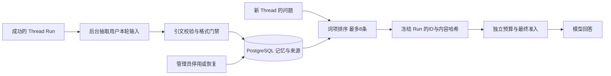

# Memory 现状盘点与先进项目对比

日期：2026-10-26。代码基线：`3a9490343b1b5e7828316e3c1db7411cf6291451`。范围：现有代码、历史验收及官方项目文档/源码。未改产品实现，未连接业务数据库，未新增模型调用。外部资料按本日读取的默认分支/文档描述，不宣称已锁定版本或复现外部质量成绩。

> 后续专项补充：见第 8 节。当前并无记忆专属的语义压缩、保真分级或缓存组织策略；紧预算探针确认通用裁剪可能同时丢失限定与条目身份。因此“记忆条目原子准入/保真”应先于第 7 节原建议的相关性优化，不能只把无关拒绝当作唯一优先项。

## 1. 当前定位

**AgentHub 已有可持久化、可治理、可回放的轻量共享记忆；尚未形成可靠的记忆质量管理系统。**

它记住的是同一个 **Workspace + Agent** 的共享项目事实、偏好、决定和约束。不是每个用户的个人画像，不是整个 Workspace 内所有 Agent 公用的一份脑库，也不是任意历史聊天的跨会话全文搜索。

要区分三种已经存在的能力：

| 层次 | 当前行为 | 边界 |
| --- | --- | --- |
| 当前 Thread 的近端历史 | 默认最多取最近 10 轮成功问答，带 artifact 引用，再走上下文预算 | 旧工具结果不按原样持续带入，不能从上一轮摘要重建业务字段 |
| 当前 Thread 的历史检索 | 发布开关 `thread_history_search`，模型调用 `search_thread_history`，最多返回 5 轮匹配问答 | 词项检索，只读本线程；不是跨线程 episodic 记忆库 |
| 跨 Thread 长期记忆 | 发布开关 `long_term_memory`，后台抽取事实，下一 Run 自动选取注入 | 共享范围是 Workspace + Agent；两种记忆开关均默认关闭 |

依据：[历史上下文](../../packages/threads/context.py)、[历史检索工具](../../packages/agent_runtime/memory_tools.py)、[运行配置](../../packages/agent_runtime/runtime_config.py)。

## 2. 已实现到什么程度

### 写入与存储

- 成功且属于 Thread 的 Run 完成后，提交数据库状态，再尝试发 Celery 消息。写入不占回答生成的主路径；抽取失败不回滚已完成回答。
- worker 重读 Run、发布版本及当前成员权限；使用该版本自己的模型计划，不另换一个未授权的抽取模型。
- **只向抽取模型发送本轮用户输入**，最多前 2000 字符；不发送 assistant 回答，也不读取已有记忆来做语义合并。长消息尾部事实可能被遗漏，多轮指代也缺少消歧上下文。
- 候选带 `content/kind/evidence`。必须有本轮用户输入中的精确非空引文；类别为 FACT/PREFERENCE/DECISION/CONSTRAINT，内容 8～400 字符，每轮最多写入 3 条，引文最多 300 字符。
- 规范化空白和大小写后做 SHA-256 去重；这不是语义去重，也不会自动统一同义表达、实体别名或标点差异。
- PostgreSQL 保存来源 Thread/Run、引文、状态、salience、创建/更新时间、expires_at、last_used_at。重复事实由不同 Run 贡献时提升 salience，同 Run 重投不应重复强化。
- 新修复已有 extraction job 和 contribution 持久身份；抽取结果先保存，再做确定性落库。未知派发不会自动再调模型，已有候选可以继续落库。这是安全重放能力，不是已经证明无丢失的抽取投递。

依据：[抽取](../../packages/memory/extraction.py:33)、[存储](../../packages/memory/store.py:261)、[模型](../../packages/memory/models.py:43)、[worker](../../apps/worker/tasks/memories.py:60)。

### 召回与使用

- 查询全部本 Agent 的 ACTIVE、未过期记忆，在应用层排序；中文按双字词项、英文按词匹配，查询词项最多 8 个。
- 排序优先级是 **匹配词项数 → salience → 创建时间**，不是向量相似度；`last_used_at` 当前不参与排序，也没有真正的时间衰减。
- **没有最低相关性拒绝**：零命中仍可入选。条目少于 8 时尤其容易把无关项带入；同一项目名命中也不表示属性与当前问题有关。
- 最多选 8 条，第一次 PREPARE 冻结 Run 的记忆 ID、内容哈希及选取时间；空集合也冻结。恢复时不重新检索，哈希异常失败关闭；旧 ID-only 快照保留兼容边界。
- 选中条目组成一条背景消息，说明可能过时或错误、不能当指令、当前用户声明优先。消息在准入投影中带 UNTRUSTED 标识，并受独立 MEMORY 预算约束。
- 旧发布版本保留其冻结预算；新版本可按模型窗口推导记忆预算，不能一概说现在恒定 1500 tokens。
- 只有进入最终准入消息的 ID 才 touch。**touch 表示送达，不证明模型使用、采纳正确或产生收益**。
- 最终模型视图主要含 id/kind/content；数据库中的引文、来源时间与时间有效性并未完整变成可供模型核对的记忆证据包。

依据：[选择器](../../packages/memory/store.py:98)、[词项](../../packages/core/text/terms.py)、[快照](../../packages/agent_runtime/runtime_graph.py:242)、[最终送达](../../packages/agent_runtime/runtime_graph.py:786)、[记忆消息](../../packages/agent_runtime/runtime_projection.py:304)、[发布预算](../../packages/agent_runtime/publish.py:1038)。

### 管理、隔离与回放

- 已有记忆列表、类别/状态过滤、文字搜索、分页、来源信息，以及前端 Memories 页签。
- 有人工停用/恢复。读权限要求 agent_run 或 agent_edit，写管理要求 agent_edit；跨 Workspace 对外返回不存在。
- 没有面向管理员的新增、编辑、纠错替换和审批工作流；内部 `supersede` 及 `superseded_by_id` 是预留，自动抽取不调用它。
- 不硬删除；人工停用只影响后续新 Run，旧 Run 仍回放当时输入。这种审计取舍已明确，但不是完整的数据擦除或保留期管理方案。
- `expires_at` 字段和“若已设置则不再新选”的过滤已有；抽取链路不自动设置 TTL，没有衰减、容量淘汰和后台清理。**部分到期支持 ≠ 完整遗忘机制**。
- 当前共享隔离符合产品定义；缺少个人/项目细分 namespace 不直接算 bug。如未来确需个人记忆，必须先新增归属和访问契约，不能把个人数据混进共享库。

依据：[管理服务](../../packages/memory/service.py:63)、[API](../../apps/api/routes/agents.py:195)、[ADR-011](../adr/ADR-011-memory-must-be-snapshotted.md)。

## 3. 已验证与未验证

历史已有 API/Celery/PostgreSQL、小规模跨 Thread 真实试跑、开关、预算、RBAC、快照与恢复证据；不能说“从未真实调用过模型”。但复杂记忆质量仍缺可靠收益证据。

[质量收口报告](AgentHub-closure-memory-quality-20261005.md)的 11 个场景是合成输入、强制候选、脚本消费者：

| 指标 | 历史结果 | 应如何理解 |
| --- | --- | --- |
| 写入 precision | 6/9 | 固定候选下的接受边界，不是真实模型抽取准确率 |
| 必要事实召回 | 2/2 | 小样本到最终准入的送达，不是一般召回率 |
| 禁止/无关事实召回 | 5/8 | 越低越好；有引文的临时、私人、恶意候选及无关/旧事实可能被送达 |
| 任务 correctness | 10/10 | 脚本后置条件，不能代表真实模型 USE |
| 冲突 | 两条 PostgreSQL 版本同时 ACTIVE 并准入 | 没有自动更新/冲突解决引擎 |

结论仍是 `NO_DEMONSTRATED_BENEFIT`，不是 Memory 不存在或已证明完全无效。

本轮独立执行 5 个相关单元测试文件，共 65 项通过，进程退出码 0：长期记忆、快照回放、管理 API、质量指标、评测组装。pytest 写缓存权限警告不影响用例结果。没有重跑 PostgreSQL 集成、浏览器或真实模型质量实验。新版 worker 的持久化重放与权限边界另有现存集成测试，本轮只检查源码及测试范围，不冒充重新跑过。

## 4. 与代表性项目的机制对比

这是机制参考，不是同数据同模型排名。SDK 提供某个功能，不代表自动解决租户隔离、准确率、审计或成本。

| 项目/版本边界 | 当前核对的机制 | AgentHub 可借鉴的点 |
| --- | --- | --- |
| Mem0 当前主线 | 官方已将主算法描述为 ADD-only：事实追加而非抽取时自动 UPDATE/DELETE；语义、BM25、实体多信号检索。SDK search 有 threshold、可选 rerank/explain。托管平台成绩含私有优化，不能套在 OSS 上 | 明确“拒绝不相关结果”、可解释选择、实体与属性匹配；不能照旧教程认定必须实现自动覆盖更新才能接近 Mem0。[官方说明](https://github.com/mem0ai/mem0)、[search 源码](https://raw.githubusercontent.com/mem0ai/mem0/main/mem0/memory/main.py) |
| Letta 新 Agent SDK | 记忆由 git-backed MemFS 支撑；system/ 常驻、其他文件按需读取；后台 dreaming 可整理近期对话。旧 V1 的 memory blocks/archival 是另一代接口，不能混作同一实现 | 分开稳定核心事实与按需事件、可检查的编辑历史、后台整理。常驻 system 或自动写入方式不能直接搬到本项目的 UNTRUSTED/发布快照契约。[当前 SDK](https://docs.letta.com/agent-sdk/memory) |
| Graphiti OSS（Zep 相关基础框架） | episode 溯源、实体/关系与时间有效性、混合检索；边模型区分 created_at/expired_at 与 valid_at/invalid_at | 先借鉴“系统何时得知”和“事实何时有效”的区别、历史保留与冲突表达，不先引入图数据库。Graphiti OSS 不等于 Zep 全托管产品。[官方仓库](https://github.com/getzep/graphiti)、[时间字段源码](https://raw.githubusercontent.com/getzep/graphiti/main/graphiti_core/edges.py) |
| LangMem | 区分 semantic/episodic/procedural，支持 collection/profile 的抽取与整合、命名空间、热路径或后台管理；有基于反馈优化提示的接口 | 先确定记什么、何时记、何时取；经验与共享事实分层。现有四个 kind 不是四套不同记忆系统，不能把自动改 system prompt 当成可直接启用的改进。[官方概念](https://langchain-ai.github.io/langmem/concepts/conceptual_guide/)、[整合源码](https://raw.githubusercontent.com/langchain-ai/langmem/main/src/langmem/knowledge/extraction.py) |

AgentHub 已有应保留的工程基础：版本级 opt-in、每 Run 输入快照、审批恢复不重选、最终准入计量、共享权限边界、异步模型派发的谨慎重放。此次没有全面审计外部项目是否具有同等机制，因此不声称这些方面全面领先。

## 5. 缺口与优先级

这里的优先级是后续立项顺序，不是当前已发现的严重故障等级。

| 优先级 | 缺口 | 为什么值得做 | 最小范围 |
| --- | --- | --- | --- |
| 第一批 | 相关性拒绝与召回解释 | 当前代码及已有探针都证明“能排序但不拒绝” | 独立验证空命中拒绝、项目相同但属性无关、同义问法的召回守护；保存选择/拒绝理由，不先换索引 |
| 第一批 | WRITE/RECALL/USE 的真实质量基线 | 现有脚本 PASS 不能说明实际净收益 | 同一模型下 ON/OFF、证据充分控制、错误/未知保留；抽取额外调用、token、时延一起核算 |
| 第二批 | 共享适宜性及语义支持校验 | 引文真实不等于内容被原文蕴含，也不等于适合团队共享 | 给临时性、个人性、命令注入、概括失真分别设标注与处理边界；评测后再选规则、确认或模型闸门 |
| 第二批 | 事实纠错与新旧关系 | 两个互斥事实可同时 ACTIVE，创建时间不能代表业务生效时间 | 先做可审阅的替代/冲突链和时间字段，保留原事实与旧 Run；不要简单“最后一句赢” |
| 第二批 | 异步抽取可见性与投递补偿 | Run 提交到消息入队存在 best-effort 缝隙；失败 job 不等于完整任务运维 | 显示抽取状态、失败原因、可安全继续的状态；按证据决定 outbox/reconcile，禁止对未知派发自动补调 |
| 第三批 | 语义检索、事件记忆、跨 Agent 共享 | 能力确实较薄，但需先证明用量和任务需求 | 受边界保护的 selector adapter、事件来源索引或共享绑定；不能直接绕过 Run 快照 |
| 条件性 | TTL、衰减、容量、清理/擦除 | 字段不构成策略，长期规模和保留需求尚未测 | 用实际增长/陈旧错误与保留需求立项，不拍脑袋设 30 天过期 |

两个细节值得单独保留：

1. salience 记录重复贡献，不等于真实可信度；多个重复错误也会更“显著”。
2. 手动停用不是持续抑制规则；后续新的抽取可能再学习到同样内容。若需要“以后不要再记”，应与单次停用分开定义，且考虑旧 Run 回放。

## 6. 公共评测如何选，避免再把数据用错

不再使用助手临时编写的题作为主质量验收，也不重复已有 RAG 公共问答实验。但公开可下载不等于真实生产对话或全人工语料：

- LongMemEval 覆盖抽取、跨会话、更新、时间和拒答；上游已提供 cleaned 版本并指向 V2。先核对版本与构造方式，不把 v1/v2 混分，不提前暴露确认答案。[官方说明](https://github.com/xiaowu0162/LongMemEval)
- LoCoMo 的原论文明确采用模型生成、人工核验编辑的 machine-human pipeline；应如实标注，不能换个来源继续叫“真人历史聊天”。[原论文](https://aclanthology.org/2024.acl-long.747/)
- **任务范围不匹配更关键**：很多公开记忆题要求记个人生活事实，而本项目明确禁止写入个人画像。直接将此类题导入共享记忆后按答对率优化，会奖励违反产品定义的行为。

下次立项前先做数据与产品契约适配审查：明确哪些是共享工作事实、哪些应拒写、对话中的助手陈述是否允许作为事实来源、事件时间如何表示。若无法找到符合当前范围的公开样本，就报告数据缺口；不能偷偷放宽记忆范围、让模型代造主金标或把个人场景成绩冒充企业共享记忆收益。公共个人记忆基准可以作为单独诊断任务，但必须清楚标为不同能力范围。

## 7. 建议下一里程碑

**共享记忆的相关性拒绝与误召回控制。** 首先复用已有 probe 与可审定的公开来源，只验证选择器能否在“该空则空”时返回空，同时不明显损害必要事实召回。保持后台抽取、表结构、快照和权限契约不变。

达到小范围验收后停止。语义写入门禁、冲突更新与事件记忆分别立项；不一次性照搬 Mem0、Letta、Graphiti 和 LangMem 的功能合集。本报告完成盘点与选型依据，不代表已批准或已实现这些后续功能。

## 8. 压缩、分级与缓存专项补充

### 8.1 当前实际状态

| 维度 | 已有 | 没有 |
| --- | --- | --- |
| 压缩 | 抽取成短句、文本去重；通用预算投影/截短 | 多条语义合并、受保护字段、原文/摘要双表示、摘要版本和失真检查 |
| 分级 | 事实类别、状态、salience、独立 MEMORY 预算 | 是否可压缩、是否必须整条保留、稳定核心/按需事件/归档分层、各层准入策略 |
| Prompt 缓存 | 固定发布提示、每 Run 冻结记忆；能记录供应商 cached_tokens | 记忆缓存策略、显式缓存能力契约/断点、稳定块版本、跨 Run 前缀差异分析和命中率验收 |

`kind=CONSTRAINT` 目前并不会让该条目享有特殊保真保护；salience 是重复贡献强度，也不是信息重要性或正确性。

不能把三件事混为一谈：内容哈希用于身份与完整性，Run 快照用于回放，供应商 KV/prompt cache 用于复用相同请求前缀的推理计算。前两者存在，不代表第三者已经优化。

### 8.2 紧预算下存在语义与身份损失

源码：[通用 JSON 投影](../../packages/agent_runtime/context_budget.py:1017)。RAG 特定格式有单独投影分支；Memory 没有条目专属分支，进入递归映射/列表/字符串处理。字符串按能装下的前缀截取，字段按通用规则遍历，不理解否定、例外或 AND/OR。

本轮补充本地函数级探针：构造一条合法长度 233 字的 CONSTRAINT 记忆，结尾为“但安装故障不受30天限制；任何退款操作仍须审批”。调用生产 `_memory_message` 与 `_project_json_value`，分别给 MEMORY 80、140 个估算 token 的紧预算。两次结果均：

- `truncated=true`，UNTRUSTED 仍在；
- 保留“退货窗口为30天”和部分前文，末尾例外与审批条件不在；
- 条目只留下 `content`，没有 `id/kind`。

这是一条自造的工程边界探针，不是新业务金标或质量基准。它没有调用模型、没有修改记忆表，也不是某次默认配置事故的复现。结论限定为：**当前低预算投影路径可产生不完整记忆事实和身份缺失，不能承诺保真压缩或每条送达都可按 ID 归因。** 根级截断标志不能恢复被删掉的限制条件。

应先为 Memory 设计条目原子准入：必要身份和语义不可完整装入时整条不送达，并明确排除/不足状态；不能把半条权限或例外规则送给模型。不能只补一个 ID 后继续允许正文截断。

### 8.3 需要分开的策略维度

不是加一个 L1/L2/L3 数字就能同时决定重要性、保真、信任与缓存：

| 策略维度 | 示例 | 建议处理原则（尚未实现） |
| --- | --- | --- |
| 保真需求 | 金额、时间窗、实体 ID、否定、条件与例外 | 原子事实/必要原文保留；不允许普通摘要改写关键关系 |
| 可摘要性 | 重复表达的团队沟通偏好、较长项目背景 | 可生成有来源的派生摘要；保留来源 ID/hash、摘要版本和更新时间，变更后失效 |
| 活跃层级 | 稳定共享事实、当前项目状态、历史过程 | 核心小集合、按需事实、历史事件/归档分开预算和召回；不能所有内容常驻 |
| 信任与权限 | 用户陈述、工具确认、正式政策 | 分别标来源权威；共享记忆仍是证据，不能因“重要”升为系统指令或绕开审批 |
| 有效时间 | 新旧数据库版本、临时运行状态 | 生效/失效与记录时间分开；陈旧内容不因缓存命中而继续当现行事实 |

“不可压缩”也不等于所有轮都强制塞入。它表示一旦本轮需要使用就必须完整保真；不相关时仍应不召回。真正安全/权限规则应由发布契约和工具治理执行，不能只依赖某条记忆是否在窗口内。

### 8.4 缓存命中组织

目前请求基本组织为“运行策略 → 发布提示 → 动态记忆 → 历史 → 当前任务”，记忆集合/顺序随问题变化，可能缩短跨 Run 的公共前缀；启用历史搜索时，第一条运行策略还可能包含变化的历史轮数提示。这是代码层面的前缀变化因素，没有测得实际缓存损失比例。

供应商缓存依赖公共前缀及具体模型/接口支持；隐式缓存可能自然命中，所以不能写成“项目完全无缓存”。阿里云也明确区分显式和隐式缓存，隐式命中不确定。[官方说明](https://help.aliyun.com/zh/model-studio/context-cache)

当前 [LiteLLM 适配器](../../packages/model_gateway/adapters/litellm/adapter.py:79)没有发送显式缓存控制配置；支持 OpenAI-compatible 不等于支持任何厂商的缓存字段。不能直接在通用协议里硬塞某家 `cache_control`，也不能把文档中的支持范围套到当前 DeepSeek 路由。

候选设计应是：尽量保持发布提示和工具 schema 的表示稳定；合法稳定的核心记忆采用独立、版本化的块；本轮新检索事实和易变内容在不改变信任/时序契约的前提下组织到动态区域。相同块固定序列化与排序，不把 last_used_at、salience 或当前时间放进稳定内容。当前快照的 selected_at 本来就不在记忆消息里，不应误诊为它正在破坏缓存。

压缩摘要也应按来源内容与压缩策略版本复用，避免每轮重新摘要导致文本漂移。原始事实更新、权限变化、来源删除/失效必须使派生摘要缓存失效。共享缓存键需包括合法作用域，不能因为相同文本而跨租户复用私有内容。

这里讨论输入内容/摘要与 prompt 缓存，不提议缓存整个 Agent 回答或复用退款等动作结果。效果需实测前缀稳定性、缓存读写 token、TTFT、总费用和业务正确性；缩短 token 与提高缓存命中率可能存在取舍，不能只看某一比例。

### 8.5 修订后的顺序

1. 先修正 Memory 专属原子准入，验证不丢身份、不截断条件/例外，完整事实装不下时可解释地拒绝。
2. 接着验证相关性拒绝，建立任务范围相符的 WRITE/RECALL/USE 基线。
3. 再单独立项保真策略和核心/按需/归档分层；只对明确可摘要的内容做派生压缩。
4. 在请求语义与版本边界稳定后，按当前实际路由验证缓存适配和净成本。不要为了缓存保留过期事实、改变权限或跳过预算。

上述为专项检查与候选设计，没有在本轮实施产品变更或新增付费实验。
