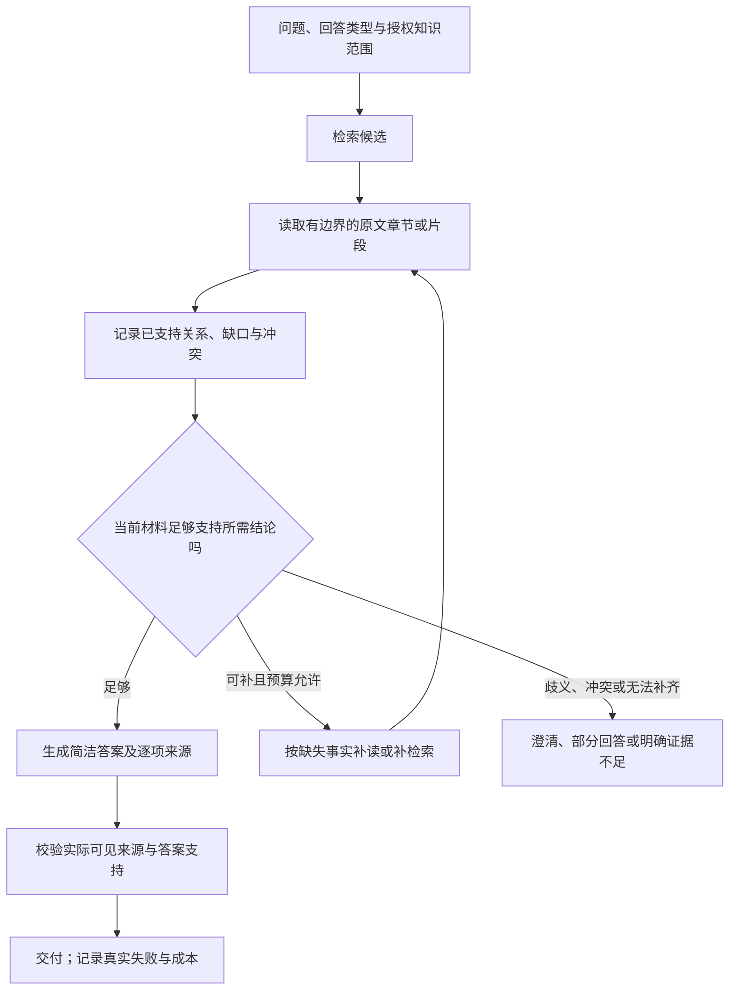

# 完整 RAG 如何对答案负责：架构调研与 AgentHub 瓶颈诊断

2026-10-24。范围为实际开源调用链和已有实验审阅；不改生产配置、不启动新生成评测、不重测留出集。项目源码说明职责组织，不代表这些项目已保证事实正确，亦不构成与 AgentHub 的同台质量排名。

## 判断

AgentHub 的检索、来源和运行治理并非没有设计，也已取得部分真实收益。现在的主要问题是：我们把大量精力放在“相关材料如何进入窗口”，却还没有在一个稳定业务场景中，验证一条对“问题是否得到有据解答”负责的完整流程。

这不等于所有低分都是检索错，也不等于 RAG 原理失效。现有证据支持三个并存判断：

1. 材料交付仍有损失；完整性代理不是语义充分性。
2. 模型会把相关但不同的关系混淆，也会在证据不足时给出答案。引用合法挡不住这类错误。
3. 官方词面分数、严格格式和用户事实正确性并不相同，不能拿 17% F1 直接宣布只有 17% 的回答事实正确。

当前尚不能定量断言“多少由模型能力造成、多少由缺据造成”。同一当前模型、同一问题和同一输出任务下，缺少经过充分性复核的证据对照，这是继续堆组件前应补的识别环节。

这里的完整落地应包含三条相连的线：离线把文件变成可追溯、可更新且保留结构的知识；在线围绕问题检索、阅读并决定交付；上线后依据真实问题、失败和复核反馈持续验收。不能用一个优秀 retriever 代替这三条线，也不必为此推倒现有运行与控制面。

## 实际项目怎样组织完整链路

### PaperQA：将材料、证据和交付决定分开

核查版本 `57e89f7223b0960d5ee5ea048c69e3c47e088572`。

- [Docs.aget_evidence](https://github.com/Future-House/paper-qa/blob/57e89f7223b0960d5ee5ea048c69e3c47e088572/src/paperqa/docs.py#L492)：检索之后，按当前问题处理候选为 contextual evidence，过滤失败、无关与重复结果，积累到 session，而非把相似度列表直接当作答案依据。
- [GenerateAnswer 与 Complete](https://github.com/Future-House/paper-qa/blob/57e89f7223b0960d5ee5ea048c69e3c47e088572/src/paperqa/agents/tools.py#L314)：生成是工具步骤，结束是另一项决定；`has_successful_answer` 可表达不确定。
- [代理循环及状态](https://github.com/Future-House/paper-qa/blob/57e89f7223b0960d5ee5ea048c69e3c47e088572/src/paperqa/agents/main.py#L141)：区分成功、不确定、截断和超时。直接查询路径也有空上下文处理。

值得借鉴的是 session 内问题、证据、答案与完成状态的统一管理。生成式摘要可能改变原意，模型 relevance 分数与成功标记都不是事实证明；不能将它包装成独立语义核验器。其论文综合型答案目标也不同于 QASPER 的短答案词面评分。

### RAGFlow：普通检索与研究代理是不同执行策略

核查版本 `4cb2e5abfe0c490ccbb05c9278e2d42b8b395996`。

[真实入口](https://github.com/infiniflow/ragflow/blob/4cb2e5abfe0c490ccbb05c9278e2d42b8b395996/internal/service/chat_pipeline.go#L249)按模式进入普通 pipeline 或 agentic 路径；不能把总览注释中的所有能力都当成每次请求必经步骤。普通路径构造知识上下文、生成并装饰引用，也支持配置空检索回复；它并不普遍执行答案语义审查。

[agentic Run](https://github.com/infiniflow/ragflow/blob/4cb2e5abfe0c490ccbb05c9278e2d42b8b395996/internal/agentic_rag/agent.go#L326)组织工具、会话、受限循环和最终交付；特定编译知识路径可在覆盖判断成立时直接作答，失败则转入工具循环。模式、工具和知识编译条件不能省略，不能说所有用户已经运行这一分支。

[EvidenceRegistry](https://github.com/infiniflow/ragflow/blob/4cb2e5abfe0c490ccbb05c9278e2d42b8b395996/internal/agentic_rag/evidence_registry.go#L27)在材料实际交给模型时分配引用标识，保留多次读取的身份关系。重要的是“检索到”和“交付阅读”分别记录。

[decision judge](https://github.com/infiniflow/ragflow/blob/4cb2e5abfe0c490ccbb05c9278e2d42b8b395996/internal/agentic_rag/decision_judge.go#L63)还明确区分片段相关性与整体充分性；多跳桥接片段不应因不能独自答题就被删除。这对我们很重要：充分性应检查证据集合和问题需求，不能让每个段落单独承担整个答案。

边界同样值得重视：引用插入可依赖相似度，不能据此声称语义蕴含已验证；代理到达预算边界还可能尝试综合现有材料。我们不应复制其循环次数、强制交付或重试策略，企业权限、未知执行结果和流式切换规则继续由 AgentHub 契约约束。

### Onyx：检索、阅读与回答的实际连接

核查版本 `f1fa7005725263df1bbdc6278b62ed804225a75d`。[普通聊天循环](https://github.com/onyx-dot-app/onyx/blob/f1fa7005725263df1bbdc6278b62ed804225a75d/backend/onyx/chat/llm_loop.py#L915)将工具结果追加到历史，模型可选择继续调用或回答，最后一轮关闭工具；不能把轮次耗尽解释成证据充分。

[Deep Research](https://github.com/onyx-dot-app/onyx/blob/f1fa7005725263df1bbdc6278b62ed804225a75d/backend/onyx/deep_research/dr_loop.py#L82)另有澄清、规划、编排和子研究路径，中间报告汇总后生成最终报告。这是独立模式，不是每个问答都启动多代理。[引用处理](https://github.com/onyx-dot-app/onyx/blob/f1fa7005725263df1bbdc6278b62ed804225a75d/backend/onyx/chat/citation_processor.py#L582)映射来源编号，不能保证引用内容蕴含结论。

借鉴点是让检索与阅读的反馈进入后续决策，并区分停止原因。完整[源码笔记](evidence/rag-architecture-20261024/onyx-answer-loop.md)也记录了不确定性：是否充分主要依赖模型，轮次和超时会强制报告；没有理由据此保证引入 Deep Research 就提高我们的短问答质量。

## 用户追问：我们现在有没有问题改写、拆解

核查生产 `packages/`、`apps/` 与近期实际请求后，准确答案是：**有让通用模型自行组织查询和多次调工具的底座，没有独立发布、受控编排、通过效果评测的问题改写/拆解流程。**

| 机制 | 当前实现情况 | 近期论文实验 |
| --- | --- | --- |
| 纠错、同义或指代改写 | 没有独立 query rewriter；通用 Agent 的工具参数可自由组织 | 提示要求原题查询，但有少量模型自发纠错、语法修改或改为关键词 |
| 同一意图多查询召回 | 没有已集成的多查询生成/分配/合并策略 | 未启用；dense/sparse 是同一查询的不同检索通道 |
| 子问题与依赖拆解 | 没有结构化子问题、依赖、中间结果绑定与完成状态的执行器 | 未启用；MuSiQue 标准分解只用于离线诊断 |
| 缺口驱动补检索 | 通用 runtime 可多次调工具，没有验收过的场景补检索闭环 | 显式最多一次 search，不能补第二次 |

工具的[查询构建](../../packages/tools/builtins/search_knowledge.py)直接使用模型传入的 `query`；其中多项 `RetrievalQuery` 对应多个固定知识绑定，不是自动生成多个子问题。runtime 默认允许多步，并不保证模型会正确拆解或在合适时停止。

[实际请求审阅](evidence/rag-architecture-20261024/query-mechanism-audit.json)显示：两组各69次搜索中，65次和66次完全使用原题，其余共7次文本有变化，涉及4道原题，主要是拼写纠正、语法或关键词变化。这证明模型会自发改写，不能冒充受控改写模块或证明其有效。3对问题的两臂实际查询不同，因此“同题输入/同提示要求”不能等同于实际检索字符串全部严格一致；本轮不删除这些题或重算更好分数。

改写解决“怎样表达同一信息需求”；拆解解决“先知道什么、再知道什么”；补读解决“有命中但上下文还不完整”。三者都必须保留原问题的实体、时间、否定与范围。尤其不能把“有没有比较 A 与 B”改成默认存在比较的“A 与 B 的性能差异”，把待判断的前提写进查询或答案。

## 对照我们的实现：卡住的是哪几层

| 层面 | 已有且应保留 | 当前实质边界 |
| --- | --- | --- |
| 数据和控制面 | revision、快照、权限、模型网关、冻结版本、上下文准入 | 工程运行成功不能代表任务回答正确 |
| 检索与选择 | hybrid、融合、重排、预算，显式互补集合选择 | 相关性和来源完整性不是所问关系的成立条件 |
| 阅读材料 | 原文摘录、可见引用集合、实验性共享组装 | 索引块仍强烈决定阅读块；包装和投影仍影响模型实际看到什么 |
| 阅读决策 | 可信指令要求只依据来源、缺据拒答 | 最近论文实验只准一次检索，缺少针对缺失事实再读/再检索的机会 |
| 答案交付 | JSON、引用身份、拒答字段和能力守卫 | 没有通用的逐项语义支持核验；内容判断主要仍由生成模型一次完成 |
| 评测 | 官方 F1/EM、可见性、用量与失败账本 | 用户正确解决率与充分性标注尚不足，不能定位全部误差的因果来源 |

最近真实论文实验的 [PROMPT](../../benchmarks/public_rag/paper_qa_live.py) 明确要求原问题一次搜索；[发布配置](../../benchmarks/public_rag/paragraph_qa_live.py)设 `max_tool_calls=1`、`max_steps=3`，请求关闭 thinking。这是一个受控、低调用数实验策略，不是对平台所有多步运行能力的测试；也不能未经同预算对照就把错误归因于关闭 thinking。

[Citation QA 校验](../../packages/knowledge/citation_qa.py)检查引用编号与可见集合、标记一致性及拒答结构。它没有证明引用句子蕴含答案关系。[互补集合组合器](../../packages/knowledge/evidence_set_retriever.py)是显式选用，没有在最近切块比较中叠加；它此前在 MuSiQue 给定候选上通过确认，不代表已经在 QASPER 或全生产链路验收。

这暴露出实验连续性的限制：我们已有一些有用组件，但不能把不同数据、模型入口、候选条件和预算下的局部胜者相加，称为一个“综合最优产品”。同样，不能为了凑齐架构，把尚未通过质量门槛的组件全部打开。

## 已有实验允许我们说什么

| 已做工作 | 实际结论 | 不能据此推出 |
| --- | --- | --- |
| 预算贯通、互补选材 | 指定条件下答案确实随材料改善而提高；互补选择确认 F1 36.34%→52.49% | 召回永远不是瓶颈，或所有多跳均已解决 |
| 共享紧凑组装 | 输入减少，但质量非劣未成立 | 换模型视图即可自动提高质量 |
| 原文定位再回答 | 同批 F1 60.78%→63.06%，区间跨零，输入约2.22倍、流程P95约2.98倍 | 再加一层 reader 已证明值得默认启用 |
| 任务指导提示 | F1增益约0.60pp、区间跨零，删除证据对照退步 | 再写长提示就能弥补关系理解 |
| 最新自然段切块 | 完整原证据可见率提高，答案 F1 17.01%→16.95% | 结构化切块无用，或系统只有17%事实准确率 |

来源：[互补选择](AgentHub-RAG互补证据选择与阅读组织-20261023.md)、[紧凑组装](AgentHub-RAG共享证据组装实施与评测-20261023.md)、[定位阅读](AgentHub-RAG原文定位与答案生成评测-20261023.md)、[提示实验](AgentHub-RAG单次回答提示实验-20261023.md)、[最新真实论文实验](AgentHub-RAG结构化阅读单元真实评测-20261024.md)。最新实验原首题中断、剩余69题补充、原70题分母补零，原推断资格无效；表格只陈述该开发结果。

已有充分性证据不能被忽略，也不能夸大：[4对删除对照](AgentHub-RAG证据关系诊断集与删除对照-20261023.md)中，执行时期被错答为发布年份，说明至少存在可见材料中的关系误读；其余28题当时仍待裁决，4对也未经人类专家校准。旧 oracle 对照应按当时模型、数据和消息范围解释，不能直接充当当前 QASPER reader 的能力上限。

更早的[MuSiQue 200题标准支持段落对照](AgentHub-RAG消费者闭环与答案评测-20261023.md)已经得到 F1 62.83%、EM 48%，同期实际材料主方案 F1 39.39%。它说明当时既有证据损失，也有材料给足后仍未答对的空间；不能将 62.83% 当作当前模型或所有 RAG 的理论上限。避免“没有做过 oracle”这种错误总结，也避免只见一次 oracle 就跳过新场景的识别。

## 三个不能混同的问题

**相关、可回答、有据正确，是三个不同判断。** “论文提到了 MAML”能证明相关；“本方法在实验中与 MAML 比较”需要比较对象、实验范围等关系证据。相似度高和引用可点击都补不上这个关系。

**未找到与事实否定不同。** 在若干片段里未找到比较，不能直接回答“没有比较”。肯定答案可由一个明确实验陈述支持；否定答案通常需要明确否定语句，或覆盖足够完整、定义清楚的实验范围。否则应继续读取相关章节，或说明当前材料不足。即便 No 碰巧匹配标准答案，也可能是缺乏证据的猜测。

具体核对 [MAML 实际可见材料](evidence/rag-architecture-20261024/maml-visible-evidence.json)后可看到：现有组引用的实验清单在第3项中途截断，却答“包含 MAML”；新组拿到完整六项基线清单，清单不含 MAML，支持该实验范围内的 No。这一题确有改善，不能只因总体 F1 持平就抹掉，也不能把它推广成所有否定题已有可靠解法。更关键的职责是识别“清单还没读完”，而不是仅给截断段落更高相关性分数。

**答案事实、依据支持、输出形式不同。** 长解释、弯引号、数字词形会影响官方 F1；这需要新增独立评分维度，而不是事后清洗历史答案来提分。与此同时，人工不可回答题仍得到非拒答、执行/发布关系混淆等问题，也不能用“评分太严格”解释掉。

已有下载的 [RAGChecker metrics 实现](https://github.com/amazon-science/RAGChecker/blob/6091f08c00e676e87a970f2aeb4a23a484746348/ragchecker/metrics.py)将标准答案与输出匹配、上下文中的标准事实召回、以及输出被上下文支持分为不同方向。这种分解比再添一个总分更适合当前归因；提取器和 checker 自身仍会错，不能未经校准就把其输出当人工真值。本轮仅阅读代码，没有安装依赖或运行它来重判历史成绩。

## 适合 AgentHub 的设计主线

建议主线为：**围绕问题的信息需求组织证据，并用证据状态控制交付决定。** 这是待验证的目标设计，不是声称本轮已实现或先进项目普遍拥有同一套机制。

各步骤不是都需要新增模型调用。简单事实可直接完成；只有明确的缺失信息才触发补读，补读也受总步骤、时延、tokens和权限约束。已有候选不足才换查询，缺上下文优先读同 revision 的相关范围，避免重复做相似检索。

运行技术成功与答案是否充分继续分开：一次有效拒答可以是正常完成的 Run；一次正常结束且引用合法的 Run 也可能答错。不要为追求语义门槛而混淆既有执行状态、审批状态与外部副作用的 UNKNOWN_OUTCOME。

要明确三类对象：

- **检索单元**服务匹配，保留原始身份；**阅读视图**服务理解，可组合多个原始范围，但不能悄悄改写原 chunk ID 的含义。
- **证据状态**记录问题需要哪些关系、哪些原文支持它、哪些缺失或矛盾；这不是无依据的生成摘要或暴露长篇思维链。
- **交付结果**区分已回答、部分回答、需澄清、证据不足。产品解释与短答案评分值应在新版本契约里清楚分离，不能事后修补旧成绩。

最后一项语义支持校验也只是候选机制：一个自信的生成模型再调用一次自己，不自动成为可靠裁判。若引入模型 verifier，需在独立复核的支持/冲突/缺据样本上校准，记录误放行、误拒绝和成本；不能把 self-score 当置信概率，也不能逐段要求独自回答多跳问题。

## 下一步先诊断，不再同时新增多种架构

先锁定一个真实场景，例如研究者询问指定论文的方法、实验对比与数值；固定一套已发布配置和当前模型入口。只在已有曝光数据上做机制诊断，性能确认另用新来源，避免一边诊断一边消耗确认集。

首个切片应区分：

1. 同一 reader 面对实际可见材料，能否回答。
2. 面对经过独立复核、确实足够的原文材料，能否回答；标注不能盲信 gold 段落身份。
3. 删除必要关系、保留相关干扰后，能否停止无依据回答。

问题、模型、输出任务和调用上限保持一致；禁止把标准答案作为“阅读笔记”喂给模型。先补足关系、数值单位、否定、冲突和不可回答案例的裁决，报告争议与标注者，而不是再宣称已有32道人类金标。

诊断结果决定研发方向：充分材料下仍大量误读，优先研究阅读/生成能力与答案任务契约；充分材料下表现好而实际材料下差，优先做有界补读或证据组合；缺据仍答，优先处理交付策略。不能在尚未识别瓶颈时，同时换模型、开 thinking、加图、加摘要和多代理。

验收主指标应提升为“问题得到正确且有证据支持的解决”的比例，同时分别报告答案正确性、必要部分完整性、引用语义支持、拒答/误拒答、格式有效性、覆盖率与成本。官方 EM/F1 保留，新增维度并列，不覆盖旧分数。抽样人工盲审或经校准评审必须有明确可核查标准；单靠模型互相认可不够。

本次先完成上述调查和决策，不部署新机制，也不宣称架构草图已带来性能提升。

本地逐项审阅、置信边界及主执行者可见文本复核见[本地证据笔记](evidence/rag-architecture-20261024/local-bottlenecks.md)；外部固定源码范围见[来源索引](evidence/rag-architecture-20261024/source-index.json)。子代理的审阅是辅助分析，不是人类专家金标或新的答案评分。
