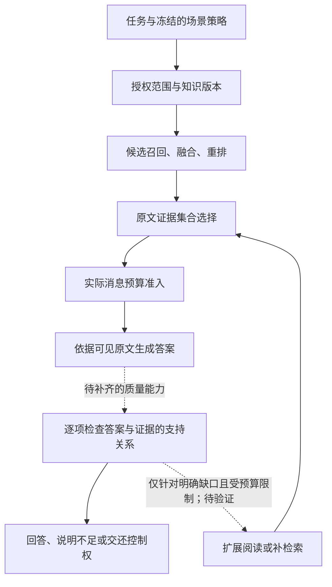

# AgentHub RAG：架构主线与项目借鉴

2026-10-23。本文对照实际开源源码和 AgentHub 已有实验，提出统一的架构叙事与后续取舍。它是研究决策，不是新功能验收；本轮没有新增模型 API 调用、调参或重跑确认集，也不修改产品总计划的已实现范围。

> 后续[证据关系诊断集与删除对照](AgentHub-RAG证据关系诊断集与删除对照-20261023.md)将“材料是否足够”落实为可复核条件：保留32题台账、4对完整/删除证据、28题待裁决，8次真实请求显示完整材料答对3/4、删除后正确拒答4/4。该切片不证明总体性能，但进一步区分了缺证据处理和所问属性误读，未向主链追加通用模型调用。

> 后续[问题需求与证据关系诊断](AgentHub-RAG问题约束与证据关系评测-20261023.md)具体化了“问题需求、证据覆盖、答案支持”的职责边界。32道已曝光题、733个原文视图追溯发现选材遗漏与问题/关系歧义交织，尚不足以启动通用关系reader。保留离线归因工具，原型归档而不向生产主链堆策略；没有新答案质量成绩或历史评分重写。

> 用户后续授权的[原文定位与答案生成实验](AgentHub-RAG原文定位与答案生成评测-20261023.md)已收口：有开源实现依据的两阶段reader在固定DEV上未证实稳定答案收益，保留直接回答。代码隔离到实验目录，未向生产主链增加开关；该结果不能代替本文尚待建设的语义支持核验。

## 1. 产品主线：让 Agent 带着可核查的证据执行任务

AgentHub 的产品定位是 Enterprise Agent Runtime & Control Plane。RAG 在这个定位下承担一项明确职责：**在授权的知识版本和成本预算内，为当前任务提供可追溯的证据，并明确证据与答案的边界。**这能与已有的工作空间权限、不可变 AgentVersion、知识快照、上下文准入、执行观测和人工接管形成同一条执行链。

这是一项工程目标；当前代码尚未形成完整的答案语义支持保证，不能把目标写成已完成承诺，也没有依据宣称这些设计为业内首创。自己的取舍体现在：以任务所需证据为核心组织各层，能说明引入某个机制是为了修复哪一种损失、付出什么成本、在哪些场景已经成立。

每次知识消费应能回答五个问题：

1. 用的是谁有权访问、哪个时点的知识？
2. 候选材料是否覆盖当前问题需要的事实与关系？
3. 在预算内，哪一组原文真正被模型看到？
4. 答案的具体陈述由哪些可见原文支持，哪些仍不确定？
5. 不足时应扩展阅读、补充检索、澄清问题还是停止，额外成本上限是什么？

前面三项已有不同程度的代码与实验依据；第四项目前主要只有引用身份检查，第五项尚无经验证的专用闭环。这个缺口必须保留。

## 2. 从优秀项目借鉴职责边界

本次重新核对下列源码；Onyx、Dify、RAGFlow 使用既有已核对的固定提交，HippoRAG、RAGChecker 为当日读取的默认分支。仅据局部源码说明机制，不推断其完整产品质量或与 AgentHub 的同台准确率差异。

| 项目与源码 | 值得借鉴的机制 | 在 AgentHub 中的归属与取舍 |
|---|---|---|
| [Onyx：搜索工具编排](https://github.com/onyx-dot-app/onyx/blob/f1fa7005725263df1bbdc6278b62ed804225a75d/backend/onyx/tools/tool_implementations/search/search_tool.py) | 查询扩展、融合、相邻片段整理、联合选材、按需扩展阅读；模型视图和完整来源对象分开 | 归入候选获取与证据选择两种职责。联合选材已得到本地质量证据；后续只在确有阅读缺口时评估扩展，不默认启用整套多轮流程 |
| [Dify：父子索引处理器](https://github.com/langgenius/dify/blob/bf2f058ab3132ad54f60ea9387478af3a1cfc071/api/core/rag/index_processor/processor/parent_child_index_processor.py) | transform 构建父子关系，向量加载路径索引子块；命中单位与阅读单位可不同 | 归入文档结构与阅读材料构建。适合章节型长文的候选方向，需要真实父段落与原文位置；不能把现有字符块任意拼大就称为父子架构 |
| [RAGFlow：文档解析选择](https://github.com/infiniflow/ragflow/blob/4cb2e5abfe0c490ccbb05c9278e2d42b8b395996/internal/service/document/document_parser_selection.go) | 文件家族、配置与实际解析 pipeline 保持一致，解析入口有专门选择规则 | 归入入库结构。先按业务文档保留章节、段落、表格等有意义边界，再评估相应查询；不能用英文段落成绩证明复杂 PDF 或表格已解决 |
| [HippoRAG：关系事实与图搜索](https://github.com/OSU-NLP-Group/HippoRAG/blob/main/src/hipporag/HippoRAG.py) | `rerank_facts` 选择事实；`graph_search_with_fact_entities` 将关系实体、段落相似度与个性化 PageRank 结合 | 借鉴多跳问题要连接关系的思路。当前给定候选任务中 198/200 已有完整支持集，重建图索引不是这批样本的首要缺口；将来有真实跨文档召回缺失证据时再立项 |
| [RAGChecker：评估编排](https://github.com/amazon-science/RAGChecker/blob/main/ragchecker/evaluator.py)、[指标计算](https://github.com/amazon-science/RAGChecker/blob/main/ragchecker/computation.py) | 将标准答案、模型回答与检索上下文的事实陈述分别关联；区分 claim recall、context utilization、faithfulness 等 | 优先借鉴归因方法，先用于离线质量诊断。它不是在线答案修复器，其检查器也会出错；需人工标注校准，不能将自动判断当成事实裁判，更不能与 token F1 混称同一指标 |

这些来源共同提醒我们：入库结构、候选搜索、证据选择、模型阅读、答案核验各自有不同职责。AgentHub 应通过自己的稳定契约连接这些职责，保留第三方实现可替换的适配器边界。

## 3. 一条主链，三类单位

图中核验和针对性修复是目标结构，不能读作已经实现。知识版本、完整来源与最终可见范围贯穿主链；重试、费用和调用次数也应由同一执行策略约束。证据充分并不替代工具授权或审批决策。

应清楚区分三类单位：

- **索引单位**：帮助系统命中的小块，可由向量或关键词检索。
- **阅读单位**：供模型理解的一段或一组原文；长文中可能是有边界的章节片段，多来源问题中可能是互补证据集合。
- **核验单位**：答案中的一个具体事实陈述及其支持原文。现有引用 ID 合法性不能替代这一层。

它们共享来源关系，但数量和大小不能混算。合并阅读材料之后，仍要报告原子片段数、实际 tokens、原文范围和完整来源，避免用“一个父块”掩盖输入量增长。这些是职责划分，不要求立即新增一批类、框架或配置开关。

## 4. 已有迭代如何支撑这条主线

| 已有证据 | 对架构的启示 |
|---|---|
| 早期消费者实验修复 RAG 被通用工具预算截断，原 200 题 F1 27.92%→39.39%；预算对齐控制也接近新成绩 | 模型实际看到的上下文是必须验证的边界；该收益主要来自预算贯通，不包装成排序算法突破 |
| 共享紧凑视图减少约 48.88% 输入，但开发 F1 47.86%→45.69%，预登记非劣未成立 | 表示压缩有工程价值，质量采用需独立验收。该格式仍为未推荐的实验选项，不因架构图画得整齐就替换已验收路径 |
| 互补集合来源隔离确认 200 题：完整支持集 63.50%→80.00%，F1 36.34%→52.49% | 单段各自相关不等于整个集合够用；联合选择确实修复了一部分候选到阅读之间的损失，代价是额外输入约 1.98 倍、增量模型流水线 P95 约 1.62 倍 |
| 新集合的阅读排序诊断 F1 61.22%→61.13%，区间跨零 | 目前保留原相关性顺序。没有证据支持的排列技巧不进入推荐链路 |
| 同一新确认中，候选池完整 198 题，最终集合完整 160 题；这 160 题中 EM 命中 90 题、未完全匹配 70 题 | 仍有 38 题的已召回支持集在选择阶段丢失；同时还需定位材料使用、关键事实可见性和答案表达问题，单独提高候选召回不能解释全部损失 |

各行来自不同样本和协议，不能首尾相减，拼成一条从 27.92% 到 52.49% 的累计增长曲线。最近一轮确认以 2 跳为主，长链分层样本少、表现不稳定；不称通用多跳问题已解决。

最后一项是对已曝光结果的事后分解，不是新的确认。这里“完整支持集”按段落身份评分，不保证关键事实 span 完整可见；即使使用每个支持段落至少 90% 文本覆盖的代理口径，149 题中仍有 68 题未达 EM，但该代理也不能等同事实 span。EM 未匹配可能包括部分正确、别名或格式差异，不能将这 70/68 题全部判成推理错误。见[事后统计与限制](../../benchmarks/public_rag/results/evidence-set-20261023/posthoc-consumer-attribution.json)。

## 5. 场景差异应表现为策略，而非多套割裂架构

| 任务形态 | 首先需要解决什么 | 候选策略与边界 |
|---|---|---|
| 条款、编号、单点事实定位 | 找准原文、版本和适用条件 | 优先简单检索与重排；保留日期/替代状态。没有依据让每个问题都多一次模型选择 |
| 论文、政策长文理解 | 命中块与上下文的语义完整性 | 显式章节、父段落与受限阅读扩展；这是待验证方向，不能重复先前任意父块拼接的负实验 |
| 跨来源比较与关系问题 | 覆盖不同对象、关系及中间证据 | 互补集合选择作为已验证的局部能力；范围限受控英文给定候选，多轮搜索与业务迁移仍待验证 |
| 全库综合、来源冲突与无法回答 | 覆盖性、冲突处理与正确停止 | 先建立相应业务标注与评分；当前短答实验不足以证明能力，不以自动置信分数直接路由上线 |

策略最初可由知识库用途、应用任务和明确配置选择，并与 AgentVersion 冻结；自动分类需要单独验证。运行时不能读取 benchmark 的 gold 跳数、支持标签或答案来选策略。所有策略仍复用授权、知识版本、来源身份、预算准入及评测契约。

## 6. 后续优先级与退出条件

### A. 先把已验证的集合选择纳入真实执行闭环

目前是显式可组合检索器，不是已发布的全局功能。下一工程里程碑应限单个 PINNED snapshot：明确发布策略和模型绑定，核对生产 Gateway 的 JSON 请求行为，把额外选择请求纳入 Run 的 usage/cost/调用次数和错误处理，验证真实 builtin、授权、最终准入及引用映射。

验收同时报告全流程答案质量、真实 Run 延迟、全部请求用量和失败，不以 adapter 的模型请求耗时替代 Run P95。成功后只在对应场景推荐；不能因为一个英文任务通过就切换所有知识库。复用既有版本与快照机制，不新增无意义的哈希盘点。

### B. 再补答案—证据的离线诊断

借鉴 RAGChecker，将错误拆为关键事实未召回、选材遗漏、最终消息遗漏、可见材料未正确使用、引用不支持、版本/冲突处理错误、答案别名或格式差异。先对已曝光失败样本做可复核人工归因，再建立新的开发/确认标注。

分别衡量答案事实正确性、具体引用的支持精确率/覆盖率、对无法回答问题的处理，以及成本。自动检查器先经人工对照校准；不能用同一生成模型自评高分宣告可靠，也不立即给每次线上回答都追加检查调用。检查能帮助诊断，但不能保证回答正确。

### C. 根据已证实的缺口选择结构或修复机制

关键事实因章节边界/截断丢失，就做局部阅读扩展；事实原本不在候选池，才做一次有界补检索；材料已足够但回答不对，应优先处理理解、问题约束和答案表达。候选池完整率 99% 的受控任务不支持优先建设重图索引。

扩展和补检索必须保留同一授权范围与知识版本，有总调用/成本/上下文上限，没有新证据时停止。门槛、样本与退出条件先登记；曾经确认过的题可作诊断，不能重新当未曝光确认。

这三项按里程碑顺序推进。本文不授权同时开发全部路线，也没有启动新测试作业。

## 7. 可以对外讲到什么程度

可以准确说明：AgentHub 让知识消费服从 Agent 的权限、版本、预算和执行语义，并通过逐阶段证据流失分析选择 RAG 机制；在一个来源隔离的 200 题英文给定候选确认中，互补选择将答案 F1 从 36.34% 提升到 52.49%，同时披露额外推理成本和场景限制。保留压缩、排列等负结果，也是这套决策方式的一部分。

现阶段应把“答案逐项得到证据支持、按缺口自适应修复”作为下一步目标，不能讲成已实现保证；也没有同条件完整运行 RAGFlow/Onyx/HippoRAG 的证据来宣称整体超越。详细实现与实验见[互补证据选择报告](AgentHub-RAG互补证据选择与阅读组织-20261023.md)，产品语义以[总计划](../../plan/plan.md)为准。
