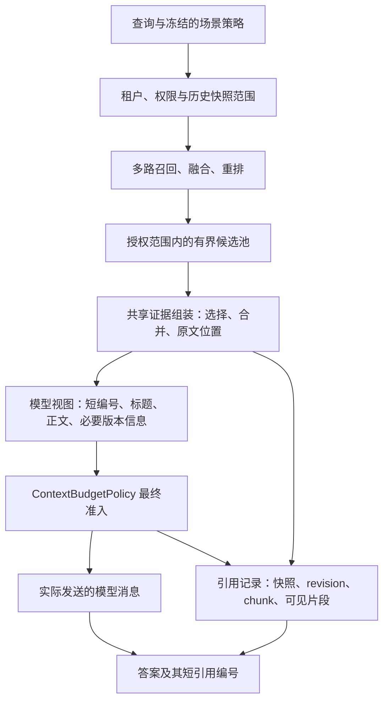

# AgentHub RAG：源码架构对照与改造决策

> 后续实施已完成：[共享证据组装实施与评测](AgentHub-RAG共享证据组装实施与评测-20261023.md)。输入开销下降，但开发 F1 非劣未成立，默认保留且未开启新确认。以下是实施前冻结的架构方案，不代表所有后续方向已授权并行开工。

> 用户后续授权的[互补证据集合选择与阅读组织](AgentHub-RAG互补证据选择与阅读组织-20261023.md)已实现并完成单次来源隔离确认：F1 36.34%→52.49%，完整集63.5%→80%。该收益来自联合选择，阅读顺序未证实额外收益；新增显式项目组合接口，默认与业务版本未改，额外推理成本和长链局限按报告保留。

2026-10-23。依据用户要求，停止继续扫参数，改看实际项目如何组织 RAG 链路。本次核查 RAGFlow、Onyx、Dify 的固定提交源码和 AgentHub 当前实现；交付架构决策与可执行的下一里程碑，不增加模型调用、索引重建或新一轮成绩。

## 决策

**优先建立独立的证据组装层，分开“检索命中”“模型实际阅读的证据”“完整引用记录”。**先解决同一批证据在不同表示上反复选择和截断的问题；随后，长文场景才引入有边界的父子结构，多跳场景才研究有界补检索。暂不更换整套框架，也不把 GraphRAG、更多查询或更多模型调用作为全场景默认。

这是根据本项目损失分解作出的工程推断，尚不是新的质量收益。源码说明这些结构如何工作，不能证明它们迁入 AgentHub 后自然提高分数。

## 1. 为什么从调参转向架构

上一里程碑已经修复 RAG 预算进入 runtime 后被通用工具上限再次截断的问题。新 MuSiQue 200 题答案 F1 27.92%→39.39%，但仅对齐预算的控制也达到 38.63%；不能把主要收益算成新的选择算法。完整结果见[消费者验收](AgentHub-RAG消费者闭环与答案评测-20261023.md)。

当前实际 5 块消费者的支持段落集分解如下，均是已暴露数据的事后诊断：

| 阶段 | MuSiQue，200 有效题 | QASPER，854 有效题 |
|---|---:|---:|
| 缓存候选池已含全部支持段落 | 195 | 719 |
| 检索器输出含全部支持段落 | 108 | 493 |
| 工具返回含全部支持段落 | 108 | 493 |
| 最终模型上下文含全部支持段落 | 108 | 491 |
| 候选池齐备、检索输出不齐备 | **87** | **226** |
| 候选池本身不齐备 | 5 | 135 |

来源：[MuSiQue 分解](../../benchmarks/public_rag/results/consumer-rag-20261023/confirmation-prepared-1/loss-attribution.json)、[QASPER 分解](../../benchmarks/public_rag/results/consumer-rag-20261023/qasper-clean-exposed-regression-1/loss-attribution.json)。这里按段落身份计数，不能证明具体答案句已完整进入模型。

这支持把注意力放在池内选择和证据表示上，**不能据此断言 87/226 题全是字节预算造成，也不能承诺压缩元数据就能找回全部证据**。数量上限、单块相关性排序、记录大小和互补证据选择都可能参与。QASPER 较宽离线填充曾达到 84.39% 段落召回，那一口径容纳约 12 段；它与实际 5 块消费者不同，不能据前者直接认定当前主要瓶颈只在 dense 召回。

## 2. 优秀项目实际怎样做

以下固定提交均在本次读取时由 GitHub HEAD 解析得到，用于可复核定位，不是宣称这些未发布提交比稳定版本更可靠。

### Onyx：检索后还有一条独立的“读证据”链路

核查提交 `f1fa7005725263df1bbdc6278b62ed804225a75d`。

实际执行链路是：多查询结果融合 → 相邻命中块合并为 section → 选择值得读的 section → 按需扩展邻接上下文 → 再合并重叠 section → 生成模型可读内容与引用映射。这里的 section 是本次阅读单元，不等于强制把整篇文档送入模型。

- [pipeline.py：merge_individual_chunks，142–255 行](https://github.com/onyx-dot-app/onyx/blob/f1fa7005725263df1bbdc6278b62ed804225a75d/backend/onyx/context/search/pipeline.py#L142)：同文档且 chunk 序号相邻才合并；依据原始排名中最早的命中维持结果优先次序。
- [search_tool.py：实际编排，1140–1328 行](https://github.com/onyx-dot-app/onyx/blob/f1fa7005725263df1bbdc6278b62ed804225a75d/backend/onyx/tools/tool_implementations/search/search_tool.py#L1140)：选择输入先按预算收紧，选择后扩展；扩展后去掉重复覆盖，再构造工具响应。返回值显式区分 rich_response 与 llm_facing_response。
- [search_utils.py：merge_overlapping_sections / expand_section_with_context](https://github.com/onyx-dot-app/onyx/blob/f1fa7005725263df1bbdc6278b62ed804225a75d/backend/onyx/tools/tool_implementations/search/search_utils.py#L210)：上下文扩展是一项可独立处理的步骤，而非给每个命中无条件拼接固定邻居。
- [utils.py：convert_inference_sections_to_llm_string，29–124 行](https://github.com/onyx-dot-app/onyx/blob/f1fa7005725263df1bbdc6278b62ed804225a75d/backend/onyx/tools/tool_implementations/utils.py#L29)：模型读取短引用编号、标题、正文和所需元数据，完整文档身份另由 citation_mapping 连接；调用点明确关闭 include_document_id。

**借鉴：**把阅读单元和索引单元分开；模型表示与完整响应分开；合并之后再计算实际上下文开销。AgentHub 原有快照、revision 和授权必须继续绑定，不能只按文档 ID 合并不同版本。

**不照搬：**Onyx 的整条链包含额外 LLM 查询生成、选择和扩展；此前 AgentHub 的选择器在 SciFact/FiQA 有收益，在 QASPER 对填充基线没有确认出额外收益，因此不把所有步骤默认启用。它的选择预算也使用近似元数据开销，不能替代 AgentHub 最终完整消息预算检查。其引用主要映射到文档；AgentHub 应保留段落/片段级可追溯身份。

### Dify：入库时就区分“用于命中”和“用于阅读”

核查提交 `bf2f058ab3132ad54f60ea9387478af3a1cfc071`。

- [IndexProcessorFactory，28–46 行](https://github.com/langgenius/dify/blob/bf2f058ab3132ad54f60ea9387478af3a1cfc071/api/core/rag/index_processor/index_processor.py#L28)：段落、问答、父子索引分别使用对应 processor；它们不是同一个切块函数换几个数字。
- [ParentChildIndexProcessor，58–165 行](https://github.com/langgenius/dify/blob/bf2f058ab3132ad54f60ea9387478af3a1cfc071/api/core/rag/index_processor/processor/parent_child_index_processor.py#L58)：transform 构建父段落与 children；父模式可为段落或全文，load 的高质量索引路径将子文档写入向量索引。
- [RetrievalService.format_retrieval_documents，472–781 行](https://github.com/langgenius/dify/blob/bf2f058ab3132ad54f60ea9387478af3a1cfc071/api/core/rag/datasource/retrieval_service.py#L472)：从命中子节点反查 segment，按 segment 去重，保留命中子块明细，并据子块等得分形成父段落记录。
- [DatasetRetrieval，313–389 行](https://github.com/langgenius/dify/blob/bf2f058ab3132ad54f60ea9387478af3a1cfc071/api/core/rag/retrieval/dataset_retrieval.py#L313)：格式化后再次授权检查，构造带 title/content/metadata/child_chunks 的 Source。可复用的是明确的结构边界，不能据这一局部阅读声称已完成它全部权限实现的审计。

**借鉴：**QASPER 这类指定论文的长文任务，检索小块、返回有边界的父段落可能比任意字符窗口更合适。需要入库时保留标题路径、父段落身份和子块的原文位置，不能事后凭 ordinal 猜章节关系。

**不照搬：**不把全文父块当作通用默认，不按父块数量掩盖实际输入增长。父子关系必须限定在同一 revision；新结构进入新的索引/知识版本，保留旧快照引用。此前父块/邻居变体已有负结果，不能只换上 Dify 的名字就重复同一实验。

### RAGFlow：解析模板、检索、知识上下文和引用分开处理

核查提交 `4cb2e5abfe0c490ccbb05c9278e2d42b8b395996`。这个提交的相应主线实现是 Go；本次没有把已不存在的旧 `rag/nlp/search.py` 当作当前源码。

- [document_parser_selection.go：resolveDocumentParser / rebuildParserConfig](https://github.com/infiniflow/ragflow/blob/4cb2e5abfe0c490ccbb05c9278e2d42b8b395996/internal/service/document/document_parser_selection.go#L157)：按文件家族与已配置选择确定解析路径，通过 pipeline DSL 重建相关配置，并传递父子分块配置。
- [builtin_registry.go](https://github.com/infiniflow/ragflow/blob/4cb2e5abfe0c490ccbb05c9278e2d42b8b395996/internal/ingestion/pipeline/builtin_registry.go#L80)：内置入库模板有独立注册和加载机制。重点是按文档组织处理流程，不是固定一个切块长度包办所有格式。
- [nlp/retrieval.go：RetrievalRequest / Retrieval](https://github.com/infiniflow/ragflow/blob/4cb2e5abfe0c490ccbb05c9278e2d42b8b395996/internal/service/nlp/retrieval.go#L51)：kNN 候选、rerank 候选和分页输出是不同控制面；[RetrievalByChildren](https://github.com/infiniflow/ragflow/blob/4cb2e5abfe0c490ccbb05c9278e2d42b8b395996/internal/service/nlp/retrieval.go#L1037)再将子命中按父身份、文档、知识库分组回取父内容。
- [chat_pipeline.go：实际调用点，789–853 行](https://github.com/infiniflow/ragflow/blob/4cb2e5abfe0c490ccbb05c9278e2d42b8b395996/internal/service/chat_pipeline.go#L789)：标准路径在检索后调用父块处理，再构造知识上下文；[kbPrompt，2448–2510 行](https://github.com/infiniflow/ragflow/blob/4cb2e5abfe0c490ccbb05c9278e2d42b8b395996/internal/service/chat_pipeline.go#L2448)使用引用位置、标题和正文组织模型输入。
- [kb_prompt.go：ChunksFormat / KbPrompt](https://github.com/infiniflow/ragflow/blob/4cb2e5abfe0c490ccbb05c9278e2d42b8b395996/internal/service/kb_prompt.go#L26)另有独立的完整响应格式化与模型上下文格式化函数；不要将这个导出函数与 chat_pipeline 内部同名风格方法误认为同一调用点。

**借鉴：**入库结构、检索预算、阅读内容和引用编号各自有明确职责。复杂 PDF、表格确实需要更强的解析结构，但当前英文段落语料不能证明更换 PDF 解析器会提升已经测出的分数。

**不照搬：**不复制它的 64 候选、97%/95% 预算比例或大体量编排服务。内部 kbPrompt 先按内容计数、后加元数据，仍需后续消息预算处理；AgentHub 应对最终表示整体计数。也不把其它项目把证据嵌入 system prompt 的做法带入本项目，证据继续属于 UNTRUSTED 数据。

## 3. 对照 AgentHub：已有基础与真实缺口

| 边界 | AgentHub 当前实现 | 下一步架构意义 |
|---|---|---|
| 解析与分块 | `parser.py` 输出 text/locator；文本为整块，PDF 按页提取。`chunking.py` 按块作字符窗口 | 已有安全解析边界；缺显式章节/父子结构。ordinal 不足以代表语义相邻 |
| 候选检索 | `retrieval.py` 已有 dense/sparse、RRF、候选配额、rerank、快照 SQL 校验 | 保留这套可替换适配器，不重造另一套 hybrid 框架 |
| 最终选择 | `retrieval.py` 可按 `asdict(RetrievedEvidence)` 的字节大小及 final_top_k 选择 | 这个表示不是最终模型输入；在它上面提前丢弃，后续无法补回 |
| 工具结果 | `search_knowledge.py` 跨绑定结果排序、限制 5/10 块，并生成 1000 字符 snippet 和 evidence_refs | 又一次独立取舍；完整内部记录与模型阅读视图尚未统一规划 |
| runtime | `rag_evidence.py` 已保证完整 record/ref 配对；ContextBudgetPolicy 最终准入 | 已修复破碎 JSON 和类别预算问题，但模型仍读取含重复内部身份等字段的 DTO |
| 另一路问答 | `citation_qa.py` 已有短编号，却使用自己的字符预算选择和提示词构造 | 项目并非完全没有短引用；真正缺少的是共享证据规划，不能再新造第三套裁剪逻辑 |

对应本地源码：[contracts.py](../../packages/knowledge/contracts.py)、[parser.py](../../packages/knowledge/parser.py)、[chunking.py](../../packages/knowledge/chunking.py)、[retrieval.py](../../packages/knowledge/retrieval.py)、[search_knowledge.py](../../packages/tools/builtins/search_knowledge.py)、[rag_evidence.py](../../packages/agent_runtime/rag_evidence.py)、[citation_qa.py](../../packages/knowledge/citation_qa.py)。

另外，跨多个知识绑定目前直接比较各自 rerank_score/检索分数；若将来允许不同模型或不同检索策略，分数标度不能假定可比。本次数据主要是单范围任务，不因此扩大当前改造范围。

## 4. 推荐目标结构与第一步切片

图中候选池在服务内部使用，不能把未授权命中或整个大候选池直接变成工具响应。组装器位于 application/domain 边界，provider、SQL、Qdrant 继续留在 adapters。引用记录属于业务执行数据，按现有授权和留存规则保存；不默认把完整原文写入 trace。

**第一步只做共享模型视图与引用映射，不重建索引、不增加 LLM 选择器。**

1. 建立 `EvidencePlan` 概念，明确本次可见原文片段、短编号、对应完整引用身份，以及舍弃原因。外部接口继续保持现有契约；模型视图作为内部投影，不能随意替换公开 DTO。
2. 将 Agent 工具路径与 Citation QA 的阅读格式/预算计算逐步收敛到同一组件。初始仍保持原始排序、原子块数量上限及既有摘要边界，不借合并名义暗中增加证据数量；标题、生效日期、替代状态等影响答案的字段必须保留。
3. 根据**实际渲染后的模型视图**选择可容纳的完整片段，完整 UUID、得分、快照和来源记录走引用映射，避免把同一身份在正文和 refs 重复发送。候选池与模型视图不再共用同一个 DTO 字节预算。内部传递候选的边界单独有硬上限。
4. runtime 仍必须进行最终消息准入。若历史消息/工具开销挤占预算，成对收紧模型视图和“本次可见引用集合”；不能出现引用记录声称模型看到了已被最终准入移除的内容。
5. 第一切片不合并不同来源或版本，不做生成式摘要；先保留可核对的原文片段。以后引入 section，要记录其多个成员的原文范围，并同时报告原子块数、阅读单元数和实际 tokens。

**边界提醒：**这个第一切片主要消除表示开销与多层选择不一致，不保证解决“最高相关的 5 块不含全部推理链”问题。如果同一数量与实际 token 预算下收益不足，停止扩大它的范围，再单独评估 section/互补证据选择；不能继续围绕十几个预算组合迭代。

### 第一切片的验收与退出条件

- 开发只用已声明的 train/已暴露数据；200 题确认已暴露，不再次称为新盲测。剩余未暴露集合先登记用途，确认最多做一次；若没有适合的数据，明确只报告开发/回归结果。
- 固定检索候选、排序、原子块上限、生成模型及生成配置，仅比较旧已验收路径与新共享组装路径。输出完整的“池→组装→工具→最终消息”支持覆盖和丢弃原因；不只测组装前召回。
- 同时报告相同配置上限与实际消耗。除固定上限比较外，检查实际输入 tokens 接近的预算对齐控制，避免再次把“更多模型输入”当成算法优势；这一控制预先固定，不开启网格搜索。
- 主质量用真实答案 EM/F1 与支持完整率；按问题配对、按共享来源分组给区间，失败计零，不依据确认成绩改方法。引用 ID 有效性与语义支持分开报告，前者不能替代 faithfulness。
- 机械检查仅覆盖可见片段/引用映射一致、租户/revision 边界和预算超限等必要行为，不添加哈希盘点或镜像实现的测试。
- 做一项实现、一次开发选择、一次冻结确认。预登记最低质量收益和时延/费用容忍度；若主要质量区间不支持收益，保留负结果并结束此方向，不继续靠调参追过线。设计可保留为等质量降低开销，但必须另有实测，不能把整洁代码当成质量提高。

## 5. 后续场景边界

| 场景 | 后续应借鉴的结构 | 目前不应投入的方向 |
|---|---|---|
| SciFact/FiQA 等全库单跳检索 | 已有 hybrid/rerank + 可选池内选择；按文档评估排序 | 为所有题加完整图索引或多轮代理 |
| QASPER 指定论文长文问答 | Dify 式父子结构、Onyx 式阅读 section，保留标题与原文范围 | 不受控全文父块、逐题调长上下文 |
| MuSiQue 多跳问题 | 先有互补证据阅读单元，之后单开有界补检索/查询分解 | 由“单块相似”直接宣称完成多跳；无限循环补查询 |
| 中文制度、编号条款、时间版本 | 冻结业务场景策略，显式元数据/版本范围与针对性数据 | 用英文段落成绩背书中文、历史版本或编号匹配 |
| 扫描 PDF、表格 | RAGFlow 式按类型的解析与结构保留，另有真实文件验收 | 在已经提取好的段落数据上评价 OCR/版面改进 |

场景策略先由数据集/知识库/发布配置明确选择并冻结，不能为了每题 gold 结果切换策略，也不急着引入自动路由器。不同场景配置不等于不停逐题调参：索引结构、范围、阅读单元、是否补检索、停止条件应该先定清楚。

## 6. 本次完成范围

已核查三个项目的实际函数及调用点，记录固定源码链接；对照 AgentHub 的入库、检索、工具、两条问答路径与最终预算边界；修正旧建议中将较宽离线填充成绩直接用于真实 5 块优先级的口径。未调用生成/embedding API，未安装框架，未修改检索默认值、业务版本或索引；没有新的质量成绩。

本次架构调研到此收口。下一项明确里程碑为共享证据组装的第一切片；父子索引、自动路由、图检索和多轮检索不与它同时开工。
